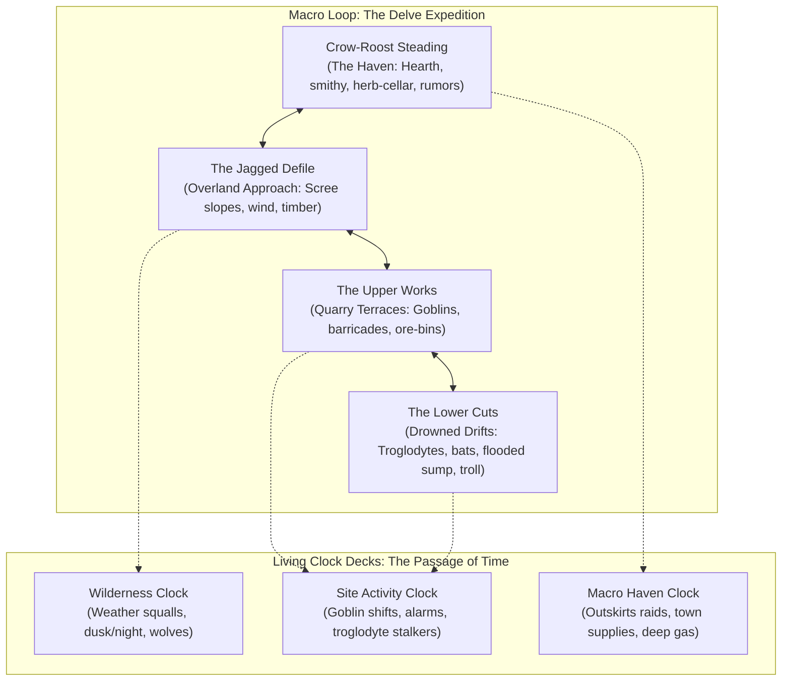

# Scenario Workshop: The Delve of Crag-Gallows

This directory contains the structural outline, worldbuilding, and living environment design for **"The Delve of Crag-Gallows"**, a low-fantasy, procedural dungeon and wilderness crawl.

Its primary purpose is to serve as a **rapid-iteration rules testbed** that can be played with little to no GM adjudication—whether run solo with two player characters or automated by software agents. Rather than relying on complex social investigation or GM-adjudicated narrative improvisation, the scenario tests how _caRdPG_'s core systems function in practice:

1. **The Attrition & Consequence Engines:** How fatigue accumulation, deck dilution, and physical condition cards escalate under sustained exploration pressure.
2. **The "Push Your Luck" Dilemma:** The tension between pressing forward into dangerous, unmapped chambers versus retreating across an exposed wilderness to the safety of town.
3. **Living Clock Decks:** Modeling inhabitant behavior (patrols, shifts, reinforcements) and environmental shifts (weather, daylight, encroaching threats) without scripted GM fiat.

---

## 1. Scenario Vision & Grounded Realism

_The Delve of Crag-Gallows_ is set in a rugged border defile where an abandoned hillside quarry and iron-mine complex overlooks a frontier coaching road:

- **Grounded Heroism & Physicality:** Protagonists are competent, courageous frontier wanderers, not invincible superheroes. Violence has genuine physical weight; wet wool, cold stone, heavy ore, and smoke-filled air impose tangible physical strain. The danger of the wild is balanced against the warmth, hot stew, and safety of a frontier hearth.
- **Atmospheric Contrast:** The wind-scoured scree and damp, lightless tunnels of the Delve stand in stark contrast to _Crow-Roost Steading_, the fortified roadside tavern and smithy where adventurers nurse their bruises and count their scrap.
- **An Active, Reactive Inhabitant Ecosystem:** The site is not a static funhouse of dormant monsters waiting in rooms. A scavenging goblin clan occupies the dry upper terraces, fortifying chokepoints and setting bone chimes; blind troglodytes stalk the unlit lower cuts; a wounded, regenerating troll lurks in the flooded deep sump; and wolves prowl the approach trails.

---

## 2. Adventure Architecture

The scenario follows an open-ended expedition loop:

- **Open-Ended Sandbox:** Characters choose their path, decide how thoroughly to search or scout, and choose when to turn back.
- **No Artificial Action Caps:** Characters can rest, retreat, search, or push forward as they see fit; the passage of time is tracked naturally through the clock decks whenever time-consuming tasks or overland travel occur.
- **Action Pressure via Practical Logistics:** Delving deep yields heavy bog-iron ore, salvageable tools, and bounty tokens. Returning to town with salvage allows characters to afford a warm bed and dedicated apothecary care; returning empty-handed forces them to sleep rough or earn their keep through honest toil or tavern performance.

---

## 3. Directory Contents

- [environment-and-inhabitants.md](environment-and-inhabitants.md): Detailed breakdown of the Haven, the Wilderness Approach, the Upper Works, and the Lower Cuts, including locations, inhabitants, and environmental hazards.
- [living-clocks.md](living-clocks.md): Design and narrative concepts for the 3 Clock Decks (Wilderness Clock, Site Activity Clock, and Macro Haven Clock).
- [locations-and-travel.md](../../authoring/locations-and-travel.md): Canonical data schemas and prototypes for Location Cards, Travel Cards, and Clock Event Cards (promoted from this workshop to core authoring standards).
- [software-requirements-checklist.md](software-requirements-checklist.md): Engineering checklist for digital tabletop support of the expedition chronometer, modular decks, interrupt dispatch, and exploration automation.
- [verisimilitude-study-agenda.md](verisimilitude-study-agenda.md): Structured research agenda to empirically calibrate the tentative 30m/60m time baselines against vigilance fatigue, mine traversal kinetics, and acoustics.
- [research-handoff-brief.md](research-handoff-brief.md): Comprehensive context and execution brief for incoming clean research session to investigate vigilance limits, caving locomotion, and mine acoustics.
- [index.yaml](index.yaml): Local package registry and document metadata.

---

## 4. Next Iteration Steps (Focused Follow-Up Topics)

To ensure game balance without premature, ungrounded rule invention, future refinement sessions will focus on targeted design topics:

1. **Empirical Verisimilitude Studies:** Dispatching `empirical_researcher` to stress-test vigilance fatigue limits, caving locomotion speeds, and acoustic transmission per [verisimilitude-study-agenda.md](verisimilitude-study-agenda.md).
2. **The Expedition Economy Session:** Calibrating lodging costs, apothecary treatment, and salvage values to create just the right amount of action pressure.
3. **The Attrition & Recovery Calibration Session:** Tuning deck dilution rates, fatigue purging during rests, and condition card treatment in town.
4. **Software Implementation of Chronometer & Decks:** Implementing the Haskell core models and Reflex UI widgets outlined in [software-requirements-checklist.md](software-requirements-checklist.md).
