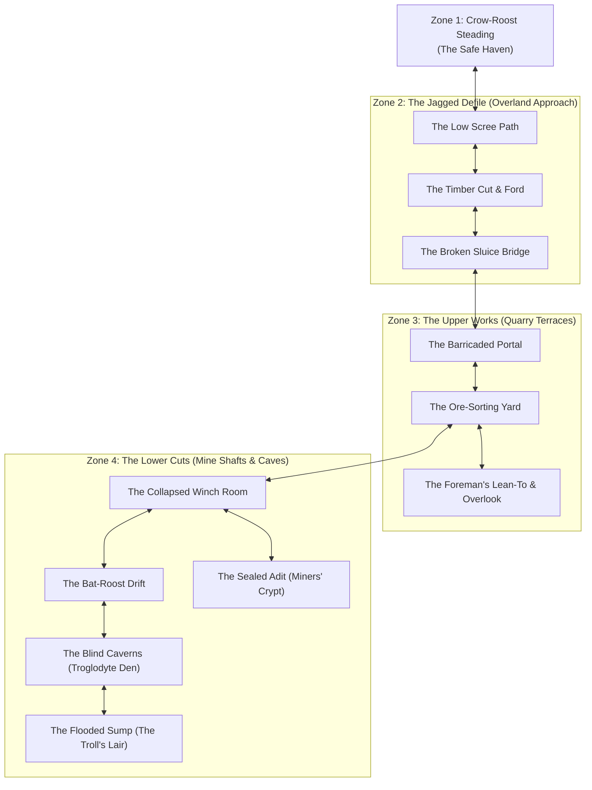

# Environment & Inhabitants: The Delve of Crag-Gallows

This document defines the worldbuilding, location layout, creature ecosystems, and environmental hazards of **The Delve of Crag-Gallows**. Designed as a procedural sandbox with minimal GM adjudication, every zone is articulated with clear physical features, natural inhabitant goals, and organic opportunities for each Color of Action.

---

## 1. Zone Topology

---

## 2. Zone 1: The Haven — Crow-Roost Steading

### Atmosphere & Setting

A fortified roadside steading nestled where the provincial post-road narrows into the rocky hills. Built of heavy drystone and cedar shingles, Crow-Roost centers on a bustling taproom with a massive slate hearth, roasting spitted game and boiling root stew. It serves timber-haulers, trappers, wandering mercenaries, and itinerant blacksmiths.

### Key Facilities & Haven Challenges

1. **The Common Room & Hearth (Old Master Gid):** Warmth, communal bench-sleep, spiced cider, and rumors.
   - **Challenge: Earning Haven Lodging & Sustenance**
     - _Option 1 — Honest Cordwood Labor (Red):_ **Strength 10 Red (Routine)** — _Single character._ Split cordwood and haul water for 2 hours; covers basic lodging and root stew for the whole party.
     - _Option 2 — Border Ballad Busking (Yellow):_ **Strength 20 Yellow (Challenging)** — _Single character._ Performance on lute or frontier singing; charms patrons, earning a private room and tavern favor.
     - _Option 3 — Local Gossip & Miner Lore (Blue):_ **Strength 15 Blue (Challenging)** — _Single character._ Inquire among veteran haulers over ale; extracts secret adit maps and hazard warnings.
2. **The Steading Forge (Bram the Smith):** Buys raw bog-iron ore and tools; repairs gear.
   - **Challenge: Forge Barter & Gear Maintenance**
     - _Option 1 — Anvil & Bellows Labor (Red):_ **Strength 20 Red (Challenging)** — _Single character._ Work the heavy sledge to pay for tool repairs without spending coin.
     - _Option 2 — Blade Honing & Strap Craft (Yellow):_ **Strength 8 Yellow (Routine)** — _Individual check (each character)._ Precision maintenance of blades and bows.
     - _Option 3 — Appraising & Bartering Ore (Blue):_ **Strength 25 Blue (Challenging)** — _Single leader check._ Negotiate premium exchange rates for raw delve salvage.
3. **The Herb-Cellar (Mother Martha):** Dried-herb loft where splints, fever drafts, and wound poultices are prepared.
   - **Challenge: Convalescence & Wound Treatment**
     - _Option 1 — Assisting Bonesetting (Red):_ **Strength 20 Red (Challenging)** — _Single character._ Physical assistance holding patients steady; Martha discounts poultice prices.
     - _Option 2 — Delicate Poultice Dressing (Yellow):_ **Strength 15 Yellow (Challenging)** — _Individual check (each character)._ Apply dressings cleanly without aggravating wounds.
     - _Option 3 — Herbal Lore Trade (Blue):_ **Strength 10 Blue (Routine)** — _Single specialist check._ Identify and supply wild mountain herbs (willow-bark/moss) in exchange for fever drafts.

### Organic Color Opportunities in Town

- **Red (Force, Presence, Labor):**
  - _Chopping Winter Cordwood:_ **Strength 10 Red (Routine)** — Splitting logs or hauling water at the stables to earn a hot meal and floor-space by the hearth without spending coin.
  - _Arm-Wrestling Timber-Cutters:_ **Strength 20 Red (Challenging)** — Matching brawn against seasoned teamsters to win respect, local rumors, or silver wagers.
  - _Asserting Hearth Presence:_ **Strength 25 Red (Challenging)** — Staring down rowdy haulers through sheer physical presence to secure the dry, warm bench by the slate chimney.
- **Yellow (Finesse, Performance, Craft):**
  - _Harness & Blade Maintenance:_ **Strength 8 Yellow (Routine)** — Oiling leather straps, replacing cracked buckles, and honing blade edges at the smithy whetstone.
  - _Border Ballad Busking:_ **Strength 20 Yellow (Challenging)** — Playing the lute or singing demanding frontier ballads to charm taproom patrons and earn a free bed from Old Master Gid.
  - _High-Stakes Dice with Teamsters:_ **Strength 30 Yellow (Difficult)** — Reading tells and palming dice in a fast game of frontier hazard to win traveler coin.
- **Blue (Intellect, Lore, Discipline):**
  - _Learning Subterranean Damp Signs:_ **Strength 10 Blue (Routine)** — Questioning retired miners over ale to learn telltale signs of blackdamp, rotten timber, and canary distress.
  - _Surveying Forgotten Adit Maps:_ **Strength 20 Blue (Challenging)** — Piecing together faded parchment fragments and miner rumors to chart old shafts and bypass cave-ins.
  - _Bartering Salvage with Bram the Smith:_ **Strength 25 Blue (Challenging)** — Evaluating raw bog-iron purity and negotiating favorable trade rates for refurbished tools and supplies.

---

## 3. Zone 2: The Approach — The Jagged Defile

### Atmosphere & Physical Terrain

A two-league ascent through a steep, wind-scoured ravine. Wind whistles through stunted pine and frost-shattered shale. Water rushes down rocky channels, cutting across the washed-out wagon road.

### Locations

1. **The Low Scree Path:** Loose slate and shifting gravel along an exposed incline. A careless step risks a painful slide into brambles.
   - _Inhabitants:_ A roaming pack of mountain [`wolf`](../../../data/cards/monsters/wolf.yaml) prowlers that hunt along the lower timberline, trailing weary travelers.
   - **Challenge: The Shifting Scree Ascent**
     - _Option 1 — Agile Scramble (Yellow):_ **Strength 15 Yellow (Challenging)** — _Individual check (each character)._ Fast scramble; any character who flips insufficient strength takes `Bruised Shins` or makes clattering noise that alerts trailing wolves.
     - _Option 2 — The Packhorse Haul (Red):_ **Strength 25 Red (Challenging)** — _Single leader check._ A stout character powers ahead dragging anchor cords and hauling companion packs. If successful, all party members ascend automatically without rolling.
     - _Option 3 — Geological Scouting (Blue):_ **Strength 20 Blue (Challenging)** — _Single specialist check._ Spend 10 minutes analyzing slate stratification to find stable granite footings. Bypasses the scree entirely for the whole party, but advances the Wilderness Clock by 1 tick.
2. **The Timber Cut & Mountain Stream:** A cold, fast-flowing torrent where an old wooden bridge washed out during spring melt. Crossing requires fording icy water or balancing across fallen logs.
   - _Inhabitants:_ An old, territorial [`bear`](../../../data/cards/monsters/bear.yaml) that feeds on upstream trout and aggressively defends its riverbank.
   - **Challenge: The Roaring Rapids & Bear's Ford**
     - _Option 1 — Balancing Across Drift-Logs (Yellow):_ **Strength 20 Yellow (Challenging)** — _Individual check (each character)._ Fast, agile crossing above the water; any failure slips into freezing spray and alerts the bear.
     - _Option 2 — Fording the Rapids (Red):_ **Strength 30 Red (Difficult)** — _Individual check (each character)._ Powering through chest-deep glacier water; high physical stability, but failure inflicts `Hypothermic Shaking` and waterlogs supplies.
     - _Option 3 — Downwind Stealth & Scent-Masking (Yellow):_ **Strength 35 Yellow (Difficult)** — _Single leader check._ Guides the entire party silently downwind past the feeding bear, bypassing the encounter entirely.
     - _Option 4 — Rigging a High Cable (Blue):_ **Strength 25 Blue (Challenging)** — _Single specialist check._ Rig ropes and tackle between tall riverbanks to hoist companions and gear across dry. Safe for the party, but costs 15 minutes (advances Wilderness Clock by 1 tick).
3. **The Broken Sluice Bridge:** A massive drystone culvert spanning a 20-foot drop. Rotted timbers and tangled iron wires make crossing precarious, especially in high wind.
   - **Challenge: The Gapped Drystone Culvert**
     - _Option 1 — Wind-Timed Leaps (Yellow):_ **Strength 25 Yellow (Challenging)** — _Individual check (each character)._ Timing leaps across broken culvert timbers buffeted by mountain crosswinds. Failure risks dropping gear or taking a hanging fall.
     - _Option 2 — Fixed Anchor Guide Line (Blue):_ **Strength 20 Blue (Challenging)** — _Single specialist check._ An agile or disciplined character drives pitons into stable stone; once anchored, all remaining party members cross without rolling.
     - _Option 3 — Timber Shoring (Red):_ **Strength 30 Red (Difficult)** — _Single leader check._ Muscle a heavy cedar log across the span. Requires heavy exertion, but permanently secures the bridge for future retreats.

### Organic Color Opportunities in the Wild

- **Red (Force, Endurance, Presence):**
  - _Fording the Freezing Torrent:_ **Strength 30 Red (Difficult)** — Powering through chest-deep glacier-melt current.
  - _Carrying an Injured Companion Up Scree:_ **Strength 25 Red (Challenging)** — Sustained athletic carry on loose shale.
  - _Withstanding Bitter Mountain Gusts (Forced March):_ **Strength 20 Red (Challenging)** — Pushing through biting ridge winds on an exposed ascent.
- **Yellow (Speed, Precision, Finesse):**
  - _Leaping Across Slick Boulders:_ **Strength 20 Yellow (Challenging)** — Rapid, agile footwork across river stones without slipping.
  - _Spotting Hidden Wolf Sign:_ **Strength 10 Yellow (Routine)** — Detecting fresh paw prints and crushed brush in the gravel.
  - _Slipping Past a Resting Bear:_ **Strength 35 Yellow (Difficult)** — Muffled, deliberate stalking out of the beast's sightlines.
- **Blue (Intellect, Lore, Discipline):**
  - _Reading Mountain Weather Signs:_ **Strength 15 Blue (Challenging)** — Predicting sudden temperature drops and squall timing.
  - _Spotting Natural Rock Ledges to Bypass Washouts:_ **Strength 20 Blue (Challenging)** — Analyzing geological contours to find safe detours.
  - _Foraging Wild Medicinal Herbs (Willow-Bark & Wound-Moss):_ **Strength 10 Blue (Routine)** — Gathering wild remedies along streams to dress cuts.

---

## 4. Zone 3: The Upper Works — The Quarry Terraces

### Atmosphere & Physical Terrain

The surface workings of the old iron mine: stepped limestone terraces, piles of shattered rock, abandoned iron ore bins, and the skeletal remains of timber cranes. Cold wind howls through empty door-frames.

### Inhabitants: The Bone-Whistle Goblin Clan

A scrappy, opportunistic band of [`goblin`](../../../data/cards/monsters/goblin.yaml) scavengers has made the upper quarry their stronghold. They are neither grand conquerors nor mindless pests; they are desperate, cunning frontier scavengers who treat the iron scrap as their lifeblood.

- **Goals:** Hoard salvageable metal, capture stray livestock from the valley, and avoid the horrors lurking down in the unlit mine shafts.
- **Tactics:** Mobbing in numbers with sharpened sticks, sounding bone horns to alert comrades, and retreating behind barricades rather than fighting to the death.

### Locations

1. **The Barricaded Portal:** The main archway leading into the quarry face, blocked by a hasty barricade of twisted mine-cart rails, sharpened stakes, and suspended tin cans that rattle in the breeze.
   - **Challenge: Breaching the Mine-Cart Barricade**
     - _Option 1 — Sledgehammer Breach (Red):_ **Strength 35 Red (Difficult)** — _Single leader check._ Shatters through rails and stakes immediately. Rapid and decisive, but tin-can chimes clatter loudly, immediately drawing a Site Clock card and putting goblin sentries in U2 on high alert.
     - _Option 2 — Muffled Wire Disarming (Yellow):_ **Strength 20 Yellow (Challenging)** — _Individual check (each character)._ Snip tripwires and slip through narrow gaps in silence. Slower, but preserves surprise if all succeed.
     - _Option 3 — Structural Arch Keystoning (Blue):_ **Strength 15 Blue (Challenging)** — _Single specialist check._ Identify loose shoring timbers to drop the barricade forward with minimal force and zero chime clatter, clearing a clean doorway for the whole party.
2. **The Ore-Sorting Yard:** An open stone courtyard surrounded by empty ore bins and rusted crushing wheels. Goblins use this area for cooking pots and sorting scrap, keeping watch from high timber scaffolds.
   - **Challenge: The Scavenger Gauntlet & Lookout Scaffold**
     - _Option 1 — Threshold Shield-Brace (Red):_ **Strength 40 Red (Difficult)** — _Single leader check._ Plant shields in the archway, holding back 3–5 goblin spears while allies maneuver or pick targets.
     - _Option 2 — Lookout Sentry Sniping (Yellow):_ **Strength 25 Yellow (Challenging)** — _Single specialist check._ Quick, silent takedown of the scaffold sentry before the bone horn alarm is sounded.
     - _Option 3 — Tactical Command Bluff (Blue):_ **Strength 50 Blue (Very Difficult)** — _Single leader check._ Assert total tactical dominance with military commands and flared torches to break goblin resolve and force a retreat without drawing steel.
3. **The Foreman's Lean-To & Overlook:** A partially collapsed stone shed perched on the highest terrace. Inside lies an old rusted strongbox, forgotten surveying journals, and a clear view of the lower trails.
   - **Challenge: The Weathered Iron Strongbox & Survey Cache**
     - _Option 1 — Crowbar Leverage (Red):_ **Strength 25 Red (Challenging)** — _Single character._ Pop corroded iron bands in seconds; loud metal shrieks draw attention.
     - _Option 2 — Lockpick Tumblers (Yellow):_ **Strength 30 Yellow (Difficult)** — _Single specialist check._ Delicate, completely silent manipulation of weathered lock pins before picks snap.
     - _Option 3 — Deciphering the Surveyor’s Ledger (Blue):_ **Strength 15 Blue (Challenging)** — _Single specialist check._ Search the foreman's papers for the hidden key and map notes, unlocking the strongbox cleanly and revealing rich unworked ore veins in the Lower Cuts.

### Organic Color Opportunities in the Upper Works

- **Red (Force, Presence, Labor):**
  - _Battering Down the Timber & Rail Barricade:_ **Strength 35 Red (Difficult)** — Breaching reinforced iron and timber obstacles.
  - _Physically Holding a Doorway Against a Goblin Mob:_ **Strength 40 Red (Difficult)** — Anchoring a defensive threshold against swarming spears.
  - _Bending Rusted Iron Bars for Ore Caches:_ **Strength 25 Red (Challenging)** — Forcing storage grates to extract salvaged tools.
- **Yellow (Speed, Precision, Finesse):**
  - _Slipping Past Rattling Alarm-Chimes:_ **Strength 20 Yellow (Challenging)** — Fluid stealth through tripwire-rigged chokepoints.
  - _Picking the Rusted Foreman's Lock:_ **Strength 30 Yellow (Difficult)** — Precision lock manipulation on corroded iron mechanisms.
  - _Targeting Goblin Horn-Blowers:_ **Strength 25 Yellow (Challenging)** — Immediate precision shot or sprint strike to suppress alarms.
- **Blue (Intellect, Lore, Discipline):**
  - _Reading Mining Logs for Rich Veins:_ **Strength 15 Blue (Challenging)** — Extracting actionable geological data from archival records.
  - _Deciphering Structural Wall Fractures:_ **Strength 20 Blue (Challenging)** — Tactical engineering appraisal of limestone quarry stability.
  - _Intimidating the Goblins via Superior Tactical Knowledge:_ **Strength 50 Blue (Very Difficult)** — Comprehensive military parley / psychological dominance to break enemy morale.

---

## 5. Zone 4: The Lower Cuts — Mine Shafts & Caverns

### Atmosphere & Physical Terrain

Crossing into the mountain interior plunges the party into absolute pitch blackness, freezing damp, and absolute stillness broken only by dripping water. The air smells of wet slate, rust, and damp earth. Without torches or lanterns, moving here is lethal.

### Locations & Inhabitants

1. **The Collapsed Winch Room:** A vaulted underground chamber holding a massive, rusted oak-and-iron windlass once used to haul ore buckets from the deep shaft. The flooring around the shaft edge is rotten and crumbling.
   - **Challenge: The Rotten Shaft Floor & Jammed Windlass**
     - _Option 1 — Floorbeam Skirting (Yellow):_ **Strength 20 Yellow (Challenging)** — _Individual check (each character)._ Tread lightly across decaying oak planks around the sheer 80-foot drop.
     - _Option 2 — Brute-Forcing the Windlass (Red):_ **Strength 30 Red (Difficult)** — _Single character._ Unjam corroded cast-iron cogs to swing an iron ore cage across as a safe ferry for the entire party.
     - _Option 3 — Truss-Strut Inspection (Blue):_ **Strength 15 Blue (Challenging)** — _Single specialist check._ Inspect ceiling eye-bolts and timber struts to map a solid stone bypass route around the rotted flooring for the whole party.
2. **The Bat-Roost Drift:** A long, sloping adit where the ceiling rises into a jagged cavern chimney. Thousands of [`cave_bat`](../../../data/cards/monsters/cave_bat.yaml) cling to the roof; loud noises or bright sparks risk triggering a disorienting, suffocating swarm.
   - **Challenge: The Smothering Bat Chimney**
     - _Option 1 — Shrouded Lantern Crawl (Yellow):_ **Strength 20 Yellow (Challenging)** — _Individual check (each character)._ Shroud lanterns and step quietly across guano-slick rock without disturbing the ceiling.
     - _Option 2 — Turtle-Shield Charge (Red):_ **Strength 25 Red (Challenging)** — _Single leader check._ Lock shields overhead and bull-rush through the draft; protects the whole party from disorientation, but open torches blow out.
     - _Option 3 — Sulfur Lichen Fumigation (Blue):_ **Strength 15 Blue (Challenging)** — _Single specialist check._ Burn damp lichen and sulfur at the entrance, driving the swarm high into the cavern chimney before the party walks through safely.
3. **The Blind Galleries:** A maze of unworked limestone cuts and narrow crawlways below the iron vein.
   - _Inhabitants:_ Stalked by a clan of blind [`troglodyte`](../../../data/cards/monsters/troglodyte.yaml) hunters that use echo-clicks and keen scent to hunt in complete dark. They hate open flames and strike from side crevices.
   - **Challenge: The Echolocating Squeeze**
     - _Option 1 — Silent Crevice Worm-Crawl (Yellow):_ **Strength 30 Yellow (Difficult)** — _Individual check (each character)._ Squeeze through narrow crawlways without gear clattering to bypass troglodytes in the dark.
     - _Option 2 — Acoustic Echolocation & Navigation (Blue):_ **Strength 35 Blue (Difficult)** — _Single leader check._ Track water drop echoes and drafts to guide the entire party through pitch-black galleries around the troglodyte den.
     - _Option 3 — Chokepoint Spear-Brace (Red):_ **Strength 25 Red (Challenging)** — _Single leader check._ Set a narrow defensive killzone with weapons braced to repel troglodyte leapers before advancing.
4. **The Flooded Sump (The Troll's Den):** The lowest working in the mine, where groundwater has pooled into a waist-deep, freezing underground lake littered with sunken mine carts and piles of crushed bones.
   - _Inhabitants:_ An ancient, scarred [`troll`](../../../data/cards/monsters/troll.yaml) dens on a raised dry stone mound in the center. Slow to stir but unstoppable in close quarters, regenerating wounds as it fights.
   - **Challenge: The Drowned Sump Traverse & Troll Ambush**
     - _Option 1 — Waist-Deep Wading (Red):_ **Strength 35 Red (Difficult)** — _Individual check (each character)._ Slosh through murky ice-cold water choked with submerged debris and bone heaps; causes heavy drag and cold water fatigue.
     - _Option 2 — Winch Counterweight Trap (Yellow):_ **Strength 25 Yellow (Challenging)** — _Single specialist check._ Cut an overhead haulage cable at the exact second the troll charges beneath, crushing or pinning it.
     - _Option 3 — Chemical / Torch Vulnerability Prep (Blue):_ **Strength 20 Blue (Challenging)** — _Single specialist check._ Coat party weapons in torch-pitch and caustic mine lime, suppressing troll regeneration for the encounter.
     - _Option 4 — Bracing for Kinetic Impact (Red):_ **Strength 50 Red (Very Difficult)** — _Single character._ Plant a heavy tower shield or stone pillar to tank a direct blow from the beast's club.
5. **The Sealed Adit (The Miners' Crypt):** A side tunnel sealed thirty years ago behind heavy mortar and iron bands following a catastrophic cave-in.
   - _Inhabitants:_ The entombed miners, preserved by the dry salt-dust, now wander in darkness as mindless [`zombie`](../../../data/cards/monsters/zombie.yaml) sentries guarding forgotten iron vein caches.
   - **Challenge: The Mortared Tomb & Blackdamp Pocket**
     - _Option 1 — Sledgehammer Demolition (Red):_ **Strength 45 Red (Difficult)** — _Single leader check._ Heavy sledge work to smash through masonry; noisy and exhausting, but breaches immediately.
     - _Option 2 — Chisel & Mortar Slicing (Yellow):_ **Strength 30 Yellow (Difficult)** — _Single specialist check._ Delicately chisel mortar around the iron frame to open a narrow entryway without alerting zombie sentries within.
     - _Option 3 — Controlled Flue Ventilation (Blue):_ **Strength 35 Blue (Difficult)** — _Single specialist check._ Clear the sealed mine flue before breaching, safely venting out blackdamp gas before the party enters.

### Organic Color Opportunities in the Lower Cuts

- **Red (Force, Endurance, Presence):**
  - _Wading Freezing Sump Water Against Drag:_ **Strength 35 Red (Difficult)** — High-drag wading through waist-deep icy runoff.
  - _Brute-Forcing a Jammed Windlass or Collapsed Timber:_ **Strength 30 Red (Difficult)** — Clearing fallen mine props to open passage.
  - _Breaching Mortared Crypt Stone:_ **Strength 45 Red (Difficult)** — Smashing heavy stonework under sustained physical strain.
  - _Withstanding Direct Troll Club Blow:_ **Strength 50 Red (Very Difficult)** — Surviving a catastrophic kinetic impact.
- **Yellow (Speed, Precision, Finesse):**
  - _Navigating Blind Passages in Silence:_ **Strength 30 Yellow (Difficult)** — Slipping through tight cuts past troglodyte senses.
  - _Stealthily Crossing Bat Chimney:_ **Strength 20 Yellow (Challenging)** — Muffled footwork beneath thousands of roosting bats.
  - _Releasing Winch Counterweight Trap:_ **Strength 25 Yellow (Challenging)** — Precision severing of haulage lines under combat pressure.
- **Blue (Intellect, Lore, Discipline):**
  - _Detecting Pockets of Blackdamp Gas:_ **Strength 30 Blue (Difficult)** — Spotting flame-droop and dense air pooling before asphyxiation.
  - _Deducing Troll Regeneration Countermeasures:_ **Strength 20 Blue (Challenging)** — Applying caustic minerals and fire to exploit regeneration vulnerabilities.
  - _Acoustic Subterranean Navigation:_ **Strength 25 Blue (Challenging)** — Using echo returns to chart tunnels without losing bearings.
  - _Venting Sealed Shaft Atmosphere:_ **Strength 35 Blue (Difficult)** — Breaching ventilation flues to purge noxious gas safely.

---

## 6. Integrated Inhabitant & Creature Card Roster

All creatures in _The Delve of Crag-Gallows_ integrate directly with the existing card library in [`data/cards/monsters/`](../../../data/cards/monsters/). Encounter rosters and tactical profiles are calibrated below:

| Creature                   | Monster Card Definition                                           | Primary Node(s)           | Baseline Roster | Tactical Role & Key Mechanics                                                                      |
| :------------------------- | :---------------------------------------------------------------- | :------------------------ | :-------------- | :------------------------------------------------------------------------------------------------- |
| **Mountain Wolf**          | [`wolf.yaml`](../../../data/cards/monsters/wolf.yaml)             | `W1: Low Scree Path`      | Pack (2–3)      | Harassment predators; burst Red damage (`bite-10`, `pounce`); relies on teeth and claws.           |
| **Timber Bear**            | [`bear.yaml`](../../../data/cards/monsters/bear.yaml)             | `W2: Timber Cut & Stream` | Solitary (1)    | Territorial brute; formidable defense and punishing swipes guarding the river ford.                |
| **Bone-Whistle Goblin**    | [`goblin.yaml`](../../../data/cards/monsters/goblin.yaml)         | `U1–U3: Upper Works`      | Mob (3–5)       | Scavenger swarm; passive: _All attacks copy per goblin_; utilizes barricades and bone horn alarms. |
| **Cave Bat**               | [`cave_bat.yaml`](../../../data/cards/monsters/cave_bat.yaml)     | `L2: Bat-Roost Drift`     | Swarm obstacle  | Aerial disturbance; triggers disorientation and smothers torches upon loud sounds or open sparks.  |
| **Blind Troglodyte**       | [`troglodyte.yaml`](../../../data/cards/monsters/troglodyte.yaml) | `L3: Blind Galleries`     | Stalkers (2–3)  | Subterranean hunters; blindsight, echolocation, and ambush tactics from dark side-fissures.        |
| **Scarred Troll**          | [`troll.yaml`](../../../data/cards/monsters/troll.yaml)           | `L4: Flooded Sump`        | Apex Boss (1)   | Deep apex threat; passive deck recovery each upkeep; club strikes and regeneration.                |
| **Preserved Miner Zombie** | [`zombie.yaml`](../../../data/cards/monsters/zombie.yaml)         | `L5: Sealed Adit`         | Sentries (3–4)  | Mindless guardians; persistent and immune to bleeding or morale breaks.                            |
