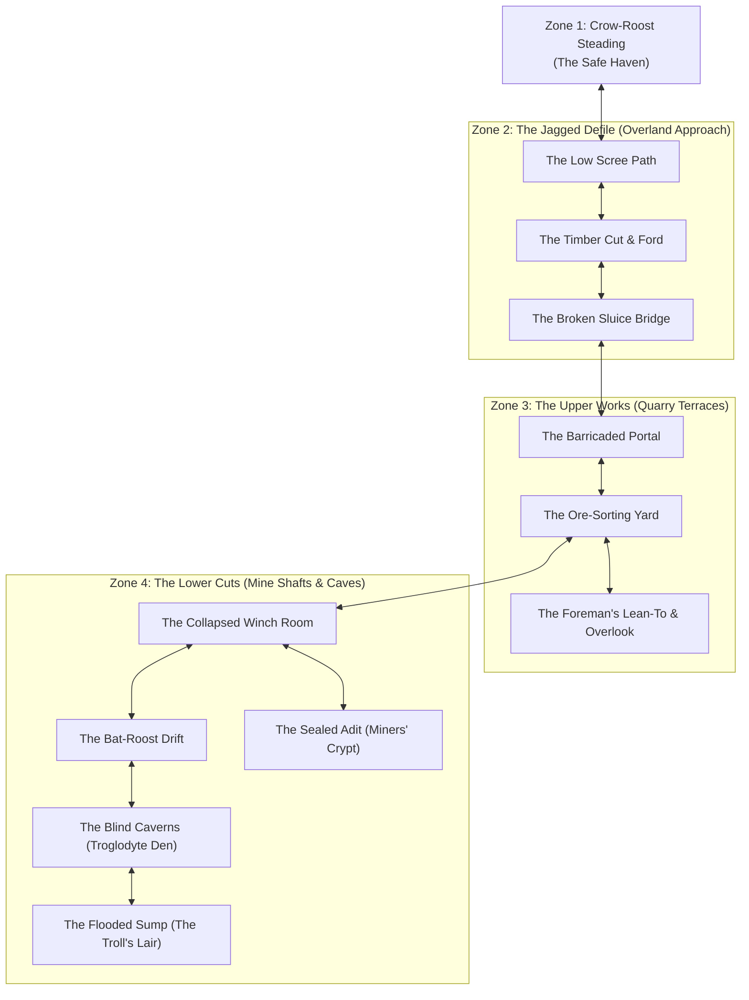

# Environment & Inhabitants: The Delve of Crag-Gallows

This document defines the worldbuilding, location layout, creature ecosystems, and environmental hazards of **The Delve of Crag-Gallows**. Designed as a procedural sandbox with minimal GM adjudication, every zone is articulated with clear physical features, natural inhabitant goals, and organic opportunities for each Color of Action.

---

## 1. Zone Topology

---

## 2. Zone 1: The Haven — Crow-Roost Steading

### Atmosphere & Setting

A fortified roadside steading nestled where the provincial post-road narrows into the rocky hills. Built of heavy drystone and cedar shingles, Crow-Roost centers on a bustling taproom with a massive slate hearth, roasting spitted game and boiling root stew. It serves timber-haulers, trappers, wandering mercenaries, and itinerant blacksmiths.

### Key Facilities & Roles

- **The Hearth & Common Room (Old Master Gid):** Warmth, communal bench-sleep, spiced cider, and rumors. Gid is willing to trade lodging for entertaining stories, hearty music, or honest labor splitting logs.
- **The Steading Forge (Bram the Smith):** Bram will pay fair silver or bartered tools for salvaged bog-iron ore, heavy iron chain, and undamaged picks dragged down from the old delve.
- **The Herb-Cellar (Mother Martha):** A dried-herb loft where simple splints, willow-bark fever drafts, and wound poultices are prepared. She can dress festering injuries, provided she is supplied with coin, fresh forage, or rare subterranean moss.

### Organic Color Opportunities in Town

- **Red (Force, Presence, Labor):** Splitting winter cordwood or hauling water at the stables to pay for supper; arm-wrestling tough timber-cutters; asserting an intimidating presence to secure the dry spot by the chimney.
- **Yellow (Finesse, Performance, Craft):** Busking on a lute or singing a demanding border ballad for tavern patrons; gambling with teamsters; oiling leather harness and sharpening blades at the whetstone.
- **Blue (Intellect, Lore, Discipline):** Inquiring with elder miners about old adit maps and shaft stability; learning the signs of poisonous damp; negotiating terms with haulers.

---

## 3. Zone 2: The Approach — The Jagged Defile

### Atmosphere & Physical Terrain

A two-league ascent through a steep, wind-scoured ravine. Wind whistles through stunted pine and frost-shattered shale. Water rushes down rocky channels, cutting across the washed-out wagon road.

### Locations

1. **The Low Scree Path:** Loose slate and shifting gravel along an exposed incline. A careless step risks a painful slide into brambles.
   - _Inhabitants:_ A roaming pack of mountain [`wolf`](../../../data/cards/monsters/wolf.yaml) prowlers that hunt along the lower timberline, trailing weary travelers.
2. **The Timber Cut & Mountain Stream:** A cold, fast-flowing torrent where an old wooden bridge washed out during spring melt. Crossing requires fording icy water or balancing across fallen logs.
   - _Inhabitants:_ An old, territorial [`bear`](../../../data/cards/monsters/bear.yaml) that feeds on upstream trout and aggressively defends its riverbank.
3. **The Broken Sluice Bridge:** A massive drystone culvert spanning a 20-foot drop. Rotted timbers and tangled iron wires make crossing precarious, especially in high wind.

### Organic Color Opportunities in the Wild

- **Red:** Fording the chest-deep freezing torrent; carrying an injured companion up the scree; withstanding bitter mountain gusts.
- **Yellow:** Leaping across slick boulders; spotting hidden wolf sign in the gravel; quietly slipping past a resting bear without waking it.
- **Blue:** Reading mountain weather signs to anticipate sudden squalls; spotting the safest natural rock ledges to bypass washouts; finding wild herbs to stem bleeding.

---

## 4. Zone 3: The Upper Works — The Quarry Terraces

### Atmosphere & Physical Terrain

The surface workings of the old iron mine: stepped limestone terraces, piles of shattered rock, abandoned iron ore bins, and the skeletal remains of timber cranes. Cold wind howls through empty door-frames.

### Inhabitants: The Bone-Whistle Goblin Clan

A scrappy, opportunistic band of [`goblin`](../../../data/cards/monsters/goblin.yaml) scavengers has made the upper quarry their stronghold. They are neither grand conquerors nor mindless pests; they are desperate, cunning frontier scavengers who treat the iron scrap as their lifeblood.

- **Goals:** Hoard salvageable metal, capture stray livestock from the valley, and avoid the horrors lurking down in the unlit mine shafts.
- **Tactics:** Mobbing in numbers with sharpened sticks, sounding bone horns to alert comrades, and retreating behind barricades rather than fighting to the death.

### Locations

1. **The Barricaded Portal:** The main archway leading into the quarry face, blocked by a hasty barricade of twisted mine-cart rails, sharpened stakes, and suspended tin cans that rattle in the breeze.
2. **The Ore-Sorting Yard:** An open stone courtyard surrounded by empty ore bins and rusted crushing wheels. Goblins use this area for cooking pots and sorting scrap, keeping watch from high timber scaffolds.
3. **The Foreman's Lean-To & Overlook:** A partially collapsed stone shed perched on the highest terrace. Inside lies an old rusted strongbox, forgotten surveying journals, and a clear view of the lower trails.

### Organic Color Opportunities in the Upper Works

- **Red:** Battering down the timber barricade; physically holding a doorway against a swarm of goblins; bending rusted iron bars to reach an ore cache.
- **Yellow:** Slipping past rattling alarm-chimes without making a sound; picking the rusted lock on the foreman's chest; targeting goblin horn-blowers before they can signal for help.
- **Blue:** Reading old mining logs to locate the richest ore vein; deciphering structural stress fractures in the quarry wall; intimidating the goblins by demonstrating superior tactical knowledge.

---

## 5. Zone 4: The Lower Cuts — Mine Shafts & Caverns

### Atmosphere & Physical Terrain

Crossing into the mountain interior plunges the party into absolute pitch blackness, freezing damp, and absolute stillness broken only by dripping water. The air smells of wet slate, rust, and damp earth. Without torches or lanterns, moving here is lethal.

### Locations & Inhabitants

1. **The Collapsed Winch Room:** A vaulted underground chamber holding a massive, rusted oak-and-iron windlass once used to haul ore buckets from the deep shaft. The flooring around the shaft edge is rotten and crumbling.
2. **The Bat-Roost Drift:** A long, sloping adit where the ceiling rises into a jagged cavern chimney. Thousands of [`cave_bat`](../../../data/cards/monsters/cave_bat.yaml) cling to the roof; loud noises or bright sparks risk triggering a disorienting, suffocating swarm.
3. **The Blind Galleries:** A maze of unworked limestone cuts and narrow crawlways below the iron vein.
   - _Inhabitants:_ Stalked by a clan of blind [`troglodyte`](../../../data/cards/monsters/troglodyte.yaml) hunters that use echo-clicks and keen scent to hunt in complete dark. They hate open flames and strike from side crevices.
4. **The Flooded Sump (The Troll's Den):** The lowest working in the mine, where groundwater has pooled into a waist-deep, freezing underground lake littered with sunken mine carts and piles of crushed bones.
   - _Inhabitants:_ An ancient, scarred [`troll`](../../../data/cards/monsters/troll.yaml) dens on a raised dry stone mound in the center. Slow to stir but unstoppable in close quarters, regenerating wounds as it fights.
5. **The Sealed Adit (The Miners' Crypt):** A side tunnel sealed thirty years ago behind heavy mortar and iron bands following a catastrophic cave-in.
   - _Inhabitants:_ The entombed miners, preserved by the dry salt-dust, now wander in darkness as mindless [`zombie`](../../../data/cards/monsters/zombie.yaml) sentries guarding forgotten iron vein caches.

### Organic Color Opportunities in the Lower Cuts

- **Red:** Wading through freezing, waist-deep sump water against heavy drag; brute-forcing a collapsed mine timber to clear an escape route; surviving direct physical impacts from a troll's club.
- **Yellow:** Navigating blind passages in silence to avoid troglodyte ears; shielding a torch from sudden bat swarms; precisely severing a haulage rope to drop a cage onto a pursuer.
- **Blue:** Detecting dangerous pockets of bad air (blackdamp) before they smother torches; deducing the troll's aversion to specific minerals or fire; assessing rock acoustics to navigate back to the main shaft without getting turned around.

---

## 6. Integrated Inhabitant & Creature Card Roster

All creatures in _The Delve of Crag-Gallows_ integrate directly with the existing card library in [`data/cards/monsters/`](../../../data/cards/monsters/). Encounter rosters and tactical profiles are calibrated below:

| Creature                   | Monster Card Definition                                           | Primary Node(s)           | Baseline Roster | Tactical Role & Key Mechanics                                                                      |
| :------------------------- | :---------------------------------------------------------------- | :------------------------ | :-------------- | :------------------------------------------------------------------------------------------------- |
| **Mountain Wolf**          | [`wolf.yaml`](../../../data/cards/monsters/wolf.yaml)             | `W1: Low Scree Path`      | Pack (2–3)      | Harassment predators; burst Red damage (`bite-10`, `pounce`); relies on teeth and claws.           |
| **Timber Bear**            | [`bear.yaml`](../../../data/cards/monsters/bear.yaml)             | `W2: Timber Cut & Stream` | Solitary (1)    | Territorial brute; formidable defense and punishing swipes guarding the river ford.                |
| **Bone-Whistle Goblin**    | [`goblin.yaml`](../../../data/cards/monsters/goblin.yaml)         | `U1–U3: Upper Works`      | Mob (3–5)       | Scavenger swarm; passive: _All attacks copy per goblin_; utilizes barricades and bone horn alarms. |
| **Cave Bat**               | [`cave_bat.yaml`](../../../data/cards/monsters/cave_bat.yaml)     | `L2: Bat-Roost Drift`     | Swarm obstacle  | Aerial disturbance; triggers disorientation and smothers torches upon loud sounds or open sparks.  |
| **Blind Troglodyte**       | [`troglodyte.yaml`](../../../data/cards/monsters/troglodyte.yaml) | `L3: Blind Galleries`     | Stalkers (2–3)  | Subterranean hunters; blindsight, echolocation, and ambush tactics from dark side-fissures.        |
| **Scarred Troll**          | [`troll.yaml`](../../../data/cards/monsters/troll.yaml)           | `L4: Flooded Sump`        | Apex Boss (1)   | Deep apex threat; passive deck recovery each upkeep; club strikes and regeneration.                |
| **Preserved Miner Zombie** | [`zombie.yaml`](../../../data/cards/monsters/zombie.yaml)         | `L5: Sealed Adit`         | Sentries (3–4)  | Mindless guardians; persistent and immune to bleeding or morale breaks.                            |
