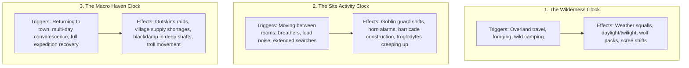

# Living Clocks: Simulating Time & Ecology in Crag-Gallows

In _caRdPG_, clock decks are not artificial doomsday countdowns. They are procedural engines of verisimilitude that allow an environment to react dynamically to player choices without requiring a Game Master.

When characters spend substantial time—hiking across rocky passes, taking pauses to bandage wounds, excavating cave-ins, or resting for multiple days at an inn—time moves forward. Drawing from these decks introduces organic shifts in weather, daylight, creature patrols, and regional threats.

---

## 1. Overview of the Three Clocks

---

## 2. Deck 1: The Wilderness Clock (Weather, Daylight & Predators)

### Purpose & Triggers

The Wilderness Clock drives the overland approach between _Crow-Roost Steading_ and _The Upper Works_.

- **Drawn When:** Moving along a wilderness leg, foraging off-trail, or pitching a cold camp in the mountains.

### Conceptual Card Catalog

- **Card: _Dense Mountain Fog_**
  - _Narrative:_ Cold river mist rolls up the defile, muffling footsteps and obscuring mountain landmarks.
  - _World State:_ Distant sightlines vanish. Spotting predators at range is impossible; stealth checks are favored, but navigation checks across washed-out trails become substantially harder.
- **Card: _Sudden Scree Squall_**
  - _Narrative:_ Bitter rain and sleet lash against bare rock, drumming furiously against cloaks and making boots slip on shale.
  - _World State:_ Open torches blow out unless shielded. Traversing steep trails risks losing footing; bowstrings slacken in the freezing downpour.
- **Card: _Dusk Gathers on the Ridge_**
  - _Narrative:_ The sun slips behind the crags, plunging the ravine into deep purple twilight.
  - _World State:_ Natural daylight fades. Moving without torches or lanterns forces characters to feel their way along precipices in near-total darkness.
- **Card: _Freezing Mountain Night_**
  - _Narrative:_ Temperature plunges below freezing. Frost coats shale and exposed iron buckles bite into cold fingers.
  - _World State:_ Traveling or resting without shelter or fire burns significant physical endurance against the bitter cold.
- **Card: _Wolf Howl on the Wind_**
  - _Narrative:_ The haunting, echoing call of a mountain pack rises from the lower timberline, answered by a closer baying upstream.
  - _World State:_ The [`wolf`](../../../data/cards/monsters/wolf.yaml) pack has found the party's scent trail and moves to intercept them at the river crossing.
- **Card: _Fresh Bear Claw-Scrapes_**
  - _Narrative:_ Freshly shredded cedar bark and heavy pad marks beside the stream show that an enormous predator recently fed here.
  - _World State:_ The [`bear`](../../../data/cards/monsters/bear.yaml) is alert and actively defending its territory along the mountain stream.

---

## 3. Deck 2: The Site Activity Clock (Lair Inhabitant Agency)

### Purpose & Triggers

The Site Activity Clock simulates the awareness, routines, and defensive measures of the delve's inhabitants without a GM scripting them.

- **Drawn When:** Moving between delve locations, taking a brief pause to catch breath or bind wounds, methodically searching an ancient chamber, or making loud noise (battering down heavy doors, sounding alarms).

### Conceptual Card Catalog

- **Card: _Sentry Shift Rotation_**
  - _Narrative:_ Two goblin lookouts scramble down from the scaffolding to relieve the guards at the lower entrance.
  - _World State:_ Goblin sentries shift locations. A previously guarded threshold is now temporarily empty, while an inner room gains extra eyes.
- **Card: _Horn Signal / Raising Barricades_**
  - _Narrative:_ A harsh bone horn sounds through the quarry. Panicked shrieks follow as goblins hastily haul timber and rocks into doorway gaps.
  - _World State:_ If the goblins were alerted to intruders, they drop a heavy deadfall across the nearest stone archway, turning an open door into a fortified physical obstacle.
- **Card: _Bone Chimes Rattle_**
  - _Narrative:_ A draft catches suspended tin cans and dry bone chimes strung along the ceiling, clattering sharply in the silence.
  - _World State:_ Lookouts in adjacent chambers perk up and scan the shadows, raising the alert level.
- **Card: _Troglodytes Stir Below_**
  - _Narrative:_ Soft, wet scraping sounds and clicking throats echo up from the dark winch shaft.
  - _World State:_ [`troglodyte`](../../../data/cards/monsters/troglodyte.yaml) prowlers creep up into any unlit upper chamber, hunting for meat in the dark.
- **Card: _Bats Disturbed_**
  - _Narrative:_ A tremor or sudden echo startles the cavern ceiling, sending hundreds of leathery wings beating through the adit.
  - _World State:_ Torches flicker precariously; vision is obstructed for several moments as a flurry of [`cave_bat`](../../../data/cards/monsters/cave_bat.yaml) creatures sweeps past toward the surface.
- **Card: _Troll's Heavy Footfall_**
  - _Narrative:_ A deep, shuddering thump reverberates through the stone flooring from deep in the flooded sump, accompanied by a wet, guttural groan.
  - _World State:_ The ancient [`troll`](../../../data/cards/monsters/troll.yaml) shifts in its slumber, stirring closer to the flooded mine entrance.

---

## 4. Deck 3: The Macro Haven Clock (The Living Front & Campaign Pressure)

### Purpose & Triggers

The Macro Haven Clock prevents players from casually taking weeks off in town to heal without consequences. It represents the broader living frontier: goblin escalation, town economic shifts, and environmental changes deep in the mountain.

- **Drawn When:** Returning to _Crow-Roost Steading_ and spending several days recovering from deep wounds, resting in the tavern, or waiting out injuries.

### Conceptual Card Catalog

- **Card: _Night Raid on the Timber Camp_**
  - _Narrative:_ Goblins slip down from the crags under cover of darkness, slaughtering draft horses and stealing iron axes from an outlying lumber camp.
  - _World State:_ Fear grips the steading. Town guards are on edge; blacksmith Bram places a bounty on goblin bone horns; prices for basic gear tick upward due to fear and shortages.
- **Card: _Blackdamp Accumulation_**
  - _Narrative:_ Prolonged calm air and rotting timber deep in the shafts allow poisonous, oxygen-depleted gas (blackdamp) to pool in low-lying galleries.
  - _World State:_ The lowest mine cuts become suffocating hazards; torches instantly smother upon entering until the shaft is manually ventilated.
- **Card: _Pack Caravan Arrives_**
  - _Narrative:_ A heavily guarded merchant pack-train makes it through the pass, unloading fresh grain, clean bandages, and iron tools at the steading.
  - _World State:_ Crow-Roost is well-stocked. Mother Martha has fresh medical herbs; the blacksmith has high-quality repair iron available for barter.
- **Card: _Flooding in the Deep Sump_**
  - _Narrative:_ Heavy mountain rains saturate the hills, sending rushing runoff cascading down the vertical shafts.
  - _World State:_ Water levels in the lower cuts rise from ankle-deep to waist-deep, making movement through the bottom drift slow, freezing, and treacherous.
- **Card: _The Troll Ascends_**
  - _Narrative:_ Starving from dwindling cave fish and bats, the ancient scarred troll drags itself out of the drowned sump and into the upper mine drifts to hunt.
  - _World State:_ The apex threat has moved into the middle mine, turning previously cleared tunnels into deadly encounter zones.

---

## 5. Integrating the Clocks into the Push-Your-Luck Decision

The presence of these three decks directly structures the core decision of _caRdPG_: **when to press forward and when to turn back.**

1. **In the Delve:** Every room explored or breather taken draws from the **Site Clock**. Lingering risks horn alarms, barricaded escape routes, or troglodytes creeping up into your rear.
2. **On the Retreat:** If characters decide to pull back, they must cross the **Wilderness Clock** while carrying whatever wounds and deck fatigue they accumulated underground. A sudden sleet storm or stalking wolf pack on the way down is ten times more dangerous to a limping, exhausted hero.
3. **In the Haven:** Safe at the hearth, heroes can rest and heal, but every day spent convalescing draws from the **Macro Clock**, causing the delve's inhabitants to reinforce, the mine environment to shift, and the valley to face goblin raids.
