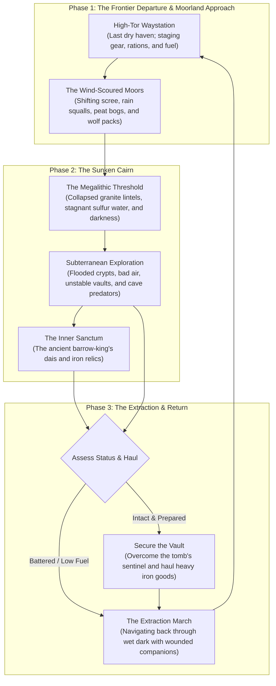

# Scenario Workshop: The Sunken Cairn of Dun-Mahr

This directory outlines the physical environment, narrative arc, and material constraints for **"The Sunken Cairn of Dun-Mahr"**, a travel-and-dungeon-crawl scenario designed for GM-less and small-group playtesting in _caRdPG_'s default **Grounded Heroism** setting.

Rather than imposing abstract rules or artificial timers, this workshop focuses strictly on **physical reality, verisimilitude, and narrative obstacles**. It models a grounded expedition where players navigate wilderness travel and ancient subterranean ruins, confronting the natural friction of the human body, finite provisions, deteriorating gear, and the physical weight of time.

---

## 1. Scenario Vision & The Sandbox Principle

### 1. Organic Friction Over Artificial Doom

In many traditional adventure modules, urgency is forced through an artificial countdown (_"the ritual completes in three days"_). _The Sunken Cairn_ is built on a different premise:

- **The Cairn is not going anywhere.** The ancient tomb sits silently beneath the high moors, indifferent to the protagonists.
- **The cost of time is purely physical and material:**
  - Torches and lamp oil physically burn down to their wicks (torches lasting ~30–40 minutes of intense light).
  - Every hour spent hauling gear across wind-scoured scree or wading freezing bogs drains finite glycogen reserves (triggering acute exhaustion within 2–3 hours without carbohydrates) and accelerates core heat loss.
  - Direct immersion in peat water turns dry hardtack rations into soggy, unpalatable slurry, while untreated carbon steel weapons develop surface flash rust that stains gambesons and demands attentive oiling at camp. (Crucially, actively worn chainmail does _not_ "rust stiff" during a delve—inter-ring friction continuously scours away superficial oxidation).
  - Lingering or making noise draws the attention of territorial bog predators and subterranean scavengers.
- **Player-Driven Risk Tradeoffs:** The scenario provides an open sandbox where the primary tactical choices are about self-preservation:
  - _Do we push deeper while shivering and nursing a twisted ankle to avoid burning our last dry torch?_
  - _Do we spend hours building a smokeless stone hearth to dry our wool and bandage wounds, knowing the scent of blood and woodsmoke travels through the vaults?_
  - _Do we press on for the inner burial chamber, or recognize our physical limits, gather the salvage we have, and begin the grueling extraction march back to the frontier waystation?_

---

## 2. The Expedition Lifecycle

The expedition is structured into three continuous, grounded phases:

---

## 3. Workshop Directory Contents

- [physical-constraints-and-resource-dilemmas.md](physical-constraints-and-resource-dilemmas.md): A grounded breakdown of the material constraints governing the expedition—light combustion and smoke, caloric burn and hydration, cold immersion and trench foot, physical trauma versus joint instability, and the physical reality of short breathers versus deep restorative camps.
- [travel-and-locations.md](travel-and-locations.md): The narrative and spatial breakdown of the overland moorland journey and the five subterranean chambers of the Sunken Cairn, defining physical obstacles, sensory cues, and plausible approaches without hardcoded rule formulas.
- [hazards-and-adversaries.md](hazards-and-adversaries.md): The natural subterranean hazards (blackdamp, rising floodwaters, crumbling masonry) and realistic ecology of the cairn's denizens (cave scavengers, territorial packs, and the immovable barrow guardian).

---

## 4. Key Verisimilitude Targets

This scenario directly exercises principles documented in our historical, geological, and biomechanical research:

1. **Proprioceptive Joint Degradation:** A twisted ankle on loose scree is not just generic "hit point damage"—it tears lateral ligaments and disrupts mechanoreceptors, causing persistent functional joint instability that makes subsequent balancing or swimming hazardous.
2. **Thermal & Moisture Drag:** Liquid water conducts heat away from the body nearly 24 times faster than still air, triggering rapid cold shock on immersion and inducing peripheral motor incapacitation (numb fingers, fumbling hands) within minutes. While woolen garments retain partial loft when wet (~40–50% clo value), their moisture subjects the wearer to brutal evaporative cooling and wind chill on exposed moors.
3. **The Ergonomics of Subterranean Light:** Handheld pine torches provide intense light (5–7m bubble) for roughly 30–40 minutes, but occupy a vital hand, smoke heavily in dead-end vaults, and constrict pupils, leaving carriers blind to anything beyond the light's immediate perimeter.
4. **Metabolic Exertion vs. Starvation:** Hauling heavy armor across rugged moorland burns 500–800 kcal/hr, exhausting intramuscular glycogen reserves within 2 to 3 hours without carbohydrate replenishment ("bonking"), long before multi-day starvation ketosis becomes relevant.
