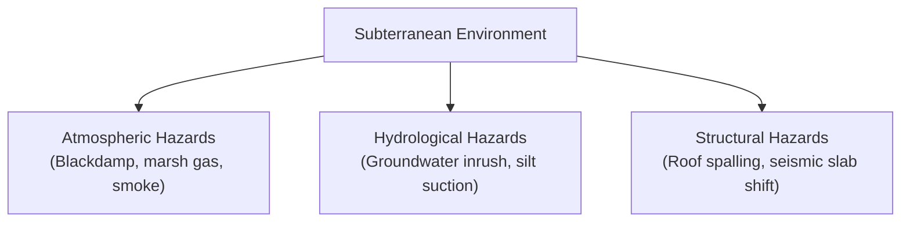
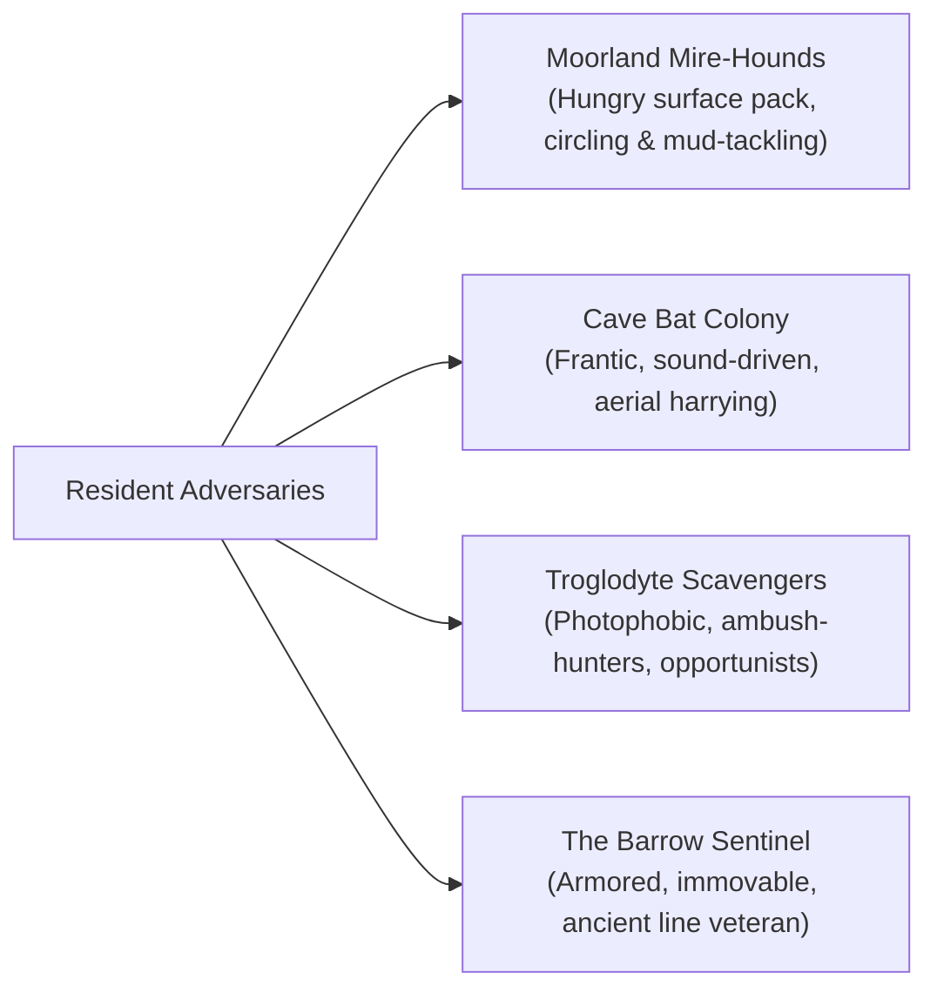

# Hazards & Adversaries: The Sunken Cairn of Dun-Mahr

This document details the natural subterranean hazards, atmospheric dangers, and resident creatures of **The Sunken Cairn of Dun-Mahr**. It approaches these threats through ecological verisimilitude, animal behavior, and material physics rather than abstract stat blocks or arbitrary rule penalties.

---

## 1. Subterranean Atmospheric & Structural Hazards

In a deep, waterlogged burial tumulus, the earth and air themselves are active, dangerous forces:

### 1. Blackdamp (Choke-Damp / Heavy Gas Stratification)

- **Physical Reality:** In low, dead-end crypts and sunken sumps with zero air circulation, dense nitrogen and carbon dioxide pool along the floor (Haldane 1895). Because $CO_2$ is 1.5 times heavier than air, blackdamp creates a sharp stratification layer.
- **Sensory Cues & The "Torch Height Trap":** An open torch carried at chest or head height will burn normally even while the carrier's legs and waist are submerged in asphyxiating gas. When lowered toward the floor, the flame sputters and dims below $17\%\ O_2$ and is snuffed out completely below $15-16\%\ O_2$.
- **Human Impact:** In moderately depleted air ($10-14\%\ O_2,\ 3-5\%\ CO_2$), travelers experience labored panting, a throbbing frontal headache, and weakness. However, if an explorer drops a tool, bends down, or falls prone into a concentrated floor pocket ($<6\%\ O_2$), **hypoxic syncope occurs within 15 to 30 seconds** without warning. Unconsciousness leads to irreversible cerebral anoxia within 3 to 5 minutes unless companions haul them immediately to higher ground.

### 2. Methane (Fire-Damp) & Stagnant Hydrogen Sulfide

- **Physical Reality & Chemistry:** Decaying peat and organic silt release marsh gases. Pure methane ($CH_4$) is completely odorless, non-toxic, and lighter than air (specific gravity $\sim 0.55$). The pungent, rotting vegetation or rotten-egg odor is toxic **hydrogen sulfide ($H_2S$)**, which deadens the olfactory nerves at higher concentrations.
- **Gas Behavior:** Being lighter than air, methane does _not_ pool on the water; bubbles disturbed from the mire rise immediately to collect in unventilated ceiling cavities and roof arches.
- **Human Impact & Ignition Hazards:**
  - Disturbing peat mud releases bubbles that produce only tiny, momentary surface flame flickers if ignited.
  - However, if methane accumulates in a dead-end ceiling pocket within its explosive window (**5% to 15% in air**), raising a blazing torch into the pocket triggers a violent deflagrating flame roll across the vault ceiling, scorching hair, blistering unarmored skin, and rapidly consuming localized oxygen.

### 3. Deceptive Water Table Rise & Silt Traps (Hydrological Reality)

- **Physical Reality:** Because the cairn sits atop an elevated moorland knoll, it lacks the vast upstream watershed required for sudden mountain flash floods rising feet in minutes. Instead, the peat moor acts as a giant sponge that slowly releases hydrostatic pressure into subterranean fissures over hours.
- **Sensory Cues & Behavior:** Faint, rhythmic dripping escalates to steady weeping through mortared joints. Clear groundwater darkens into silt-heavy runoff as low sumps slowly fill.
- **Human Impact:** The danger is slow, creeping entrapment rather than cinematic tidal waves: stagnant knee-deep pools creep up by several inches an hour, submerging stepping stones, concealing jagged bottom drop-offs, and drowning return passages. Furthermore, deep subterranean silt beds act as non-Newtonian suction traps that can pin an armored traveler's legs while the water table silently rises.

### 4. Cryofractured Frost-Wedging & Unstable Masonry (Replacing Torch Spalling)

- **Vetting Note on Thermal Spalling:** Handheld pine torches output only 5–15 kW of diffuse heat, which is physically incapable of delivering the $>200\text{–}500\ \text{kW/m}^2$ heat flux or $>400^\circ\text{C}$ surface temperatures required to induce thermal spallation in massive granite bedrock (Thirumalai 1970). Torches leave only harmless soot.
- **The True Structural Hazard (Frost-Wedging):** Millennia of surface frost-heaves and freeze-thaw cycles have driven water into bedrock joints, wedging apart fractured granite slabs and creating loose, razor-sharp shale flakes jammed precariously in the ceiling vault.
- **Human Impact:** Bumping tall spears, prodding crowbars, or the vibrations of forcing iron grates dislodge these pre-fractured stones. Fist-sized granite chunks and knife-like shale plates crash down without warning, denting iron helms and inflicting severe lacerations on exposed forearms.

---

## 2. Adversaries & Subterranean Ecology

The creatures encountered in and around the cairn are living, biological entities with survival instincts, territory, and physical vulnerabilities:

---

### Moorland Mire-Hounds (Surface Predators)

- **Nature & Ecology:** Feral mastiffs and hunting crossbreeds abandoned during past border conflicts that have reverted to wild, apex pack-hunting across the peat bogs. Gaunt, covered in drying muck, and permanently hungry.
- **Sensory Cues:** Mournful, distant baying echoing through the fog; churning water in the reeds; wet paw prints the size of saucers pressed into peat mud.
- **Pack Tactics & Behavior:**
  - They do not charge headlong into a bristling wall of spears or torches.
  - They circle outside the light, testing the perimeter. If they detect a limping or heavily burdened traveler trailing behind, two hounds feint from the front while a third lunges from the shadowed flank.
  - Their goal is to drag prey off solid footing into deep, knee-high mire where the traveler’s mobility is compromised, allowing the pack to overwhelm them.
  - **Fire Aversion:** Shoving a blazing torch into their faces causes them to yelp, jump back, and rethink their assault.

---

### The Cave Bat Colony (Subterranean Disruption)

- **Nature & Ecology:** Hundreds of small insectivorous microbats (_Myotis_ / pipistrelle species, weighing 5–15g each) roosting in the dry, high vault of the Collapsed Ossuary. (Temperate moorland caverns cannot support tropical fruit bats). They are exquisitely sensitive to ultrasound, thermal updrafts, and air displacement.
- **Sensory Cues:** A high-pitched, chittering carpet of sound across the ceiling; the stinging, alkaline ammonia stench of deep guano deposits; the soft clicking of claws against stone.
- **Disruption & Panic Reaction:**
  - If travelers pass beneath quietly with shielded lanterns, the colony remains agitated but tightly roosted.
  - If an open torch is waved high or granite masonry is struck with a steel crowbar, the entire roost erupts into a blind, deafening swarm toward the exits.
  - **Authentic Physical Hazards:**
    - **Light Extinction:** Hundreds of flapping leathery wings generate heavy air currents that immediately snuff out open torches, plunging the chamber into pitch blackness.
    - **Respiratory Choke:** The downdraft kicks up clouds of dried, desiccated guano dust and concentrated ammonia, triggering violent coughing fits and burning eyes.
    - **Disorientation:** In absolute darkness, panic buffeting against faces and tangled hair induces acute vertigo, causing explorers to lose balance and fall onto razor-sharp fractured shale. (The bats have no predatory interest in humans and do not intentionally bite; injuries result from accidental collisions and falling onto rocks).

---

### Troglodyte Scavengers (Subterranean Ambushers)

- **Nature & Ecology:** Pale, hairless subterranean humanoids adapted to complete darkness. Thin, sinewy, and possessing oversized, milky eyes and elongated, clawed fingers. They live by scavenging cave fish, bats, and anything that stumbles down into the cairn.
- **Sensory Cues:** Wet, slapping bare footprints on stone flags; guttural, clicking throat noises echoing through ventilation fissures; the smell of stagnant pond weed and decaying meat.
- **Hunting Tactics & Psychology:**
  - **Severe Photophobia:** Their eyes are exquisitely sensitive. The sudden glare of an unhooded lantern or thrust torch causes intense physical pain, forcing them to shield their faces and hiss in retreat.
  - **Cunning Ambush:** In total darkness, they are deadly. They cling to high stone ledges and drop onto the shoulders of travelers, attempting to wrench away helmets or slit throats with jagged flint daggers.
  - **Opportunism & Cowardice:** They do not fight to the death for abstract honor. If an intruder plants their feet, locks a heavy shield in place, and kills the first scavenger, the rest scatter into tight, flooded drainage pipes where armored humans cannot pursue.
  - **Pack Plunder:** Their secondary goal is theft. If they cannot drag away a traveler, they will slash pack straps and carry off provisions, tallow candles, or metal tools.

---

### The Barrow Sentinel (The Ancient Dead)

- **Nature & Ecology:** The mummified martial champion of the ancient Marcher warlord, interred standing before the royal sarcophagus. The cold, dry, sulfur-laden atmosphere has preserved flesh and sinew into hardened, leathery parchment.
- **Sensory Cues:** The grating shriek of ancient iron plate dragging across basalt flags; cold, blue-white witch-fire flaring in eye sockets; an unnatural, freezing chill that drops the room's temperature by twenty degrees.
- **Combat Behavior & Physical Presence:**
  - **Immovable Bulk:** The sentinel wears interlocking, full iron plate armor from a forgotten metallurgical tradition. Slashing strikes with light arming swords or rapiers skid harmlessly off its breastplate; arrows and throwing knives shatter against its vambraces.
  - **Relentless Momentum:** It does not breathe, does not pause to catch breath, and does not register pain. It moves with measured, terrifying economy, swinging an enormous, chipped ceremonial greatsword in sweeping, crushing arcs that can shatter wooden shields and cave in steel helms through raw kinetic force.
  - **Tactical Vulnerability:** Because it relies on brute momentum and ancient martial conditioning, it is slow to pivot. An agile opponent who dodges its initial cleave can slip behind its guard, thrusting a dagger into the unarmored articulation gaps at the back of the knee or between the gorget and helmet.

---

## 3. Dynamic Environmental Interactions & Player Tradeoffs

The physical constraints of the cairn create a living web of consequences based on the party's decisions:

| Player Action / Choice                            | Immediate Physical Benefit                                                    | Secondary Environmental Consequence                                                                               |
| :------------------------------------------------ | :---------------------------------------------------------------------------- | :---------------------------------------------------------------------------------------------------------------- |
| **Keeping Torches Blazing**                       | Clear visibility (5–7m bubble); keeps troglodytes and wild beasts at bay.     | Burns through fuel rapidly; soot builds up in unventilated chambers; alerts foes across long hallways.            |
| **Dousing Light to Move in Darkness**             | Complete stealth; avoids startling the bat colony or alerting the sentinel.   | Spatial blindness; severe risk of stepping into blackdamp or deep peat sinks; vulnerable to ambush.               |
| **Using Crowbars & Hammers to Force Doors**       | Rapid mechanical progress; breaches obstacles too heavy for raw muscle.       | Echoing iron-on-granite noise rings through the complex, waking the bat roost and alerting troglodyte packs.      |
| **Building a Fire in the Embalmer's Vault**       | Dries wet boots and wool; warms shivering bodies; allows boiling clean water. | Woodsmoke plume rising from the moorland flue signals the party's location to surface predators and bandits.      |
| **Shedding Heavy Armor to Swim Submerged Sluice** | Eliminates drowning risk; allows diving to clear jammed floodgates.           | Complete exposure to hypothermic water shock; leaves the diver vulnerable to troglodyte claws without armor soak. |
