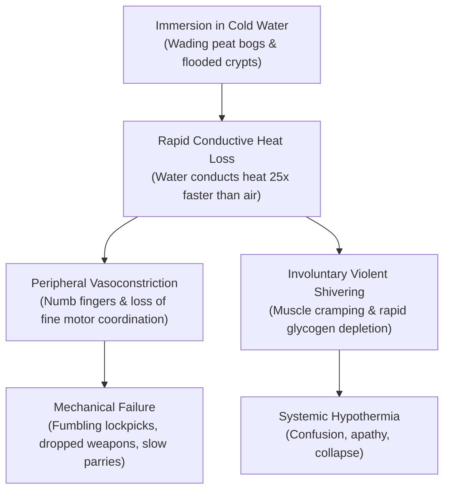

# Physical Constraints & Resource Dilemmas: The Sunken Cairn

This document analyzes the physical, material, and physiological constraints governing an expedition into **The Sunken Cairn of Dun-Mahr**. Rather than abstracting these pressures into game rules, it details the real-world physics of wilderness travel, subterranean exploration, human stamina, and equipment failure under our **Grounded Heroism** design philosophy.

---

## 1. Light, Combustion, and Subterranean Vision

In an ancient, sealed subterranean tumulus, the absence of light is not "dimness"—it is **absolute, tactile sensory deprivation**. Understanding the physical behavior of light sources is central to the tactical dilemmas of the delve:

### The Nature of Pitch Blackness

- Without an active flame, the human eye cannot adapt; after hours in total darkness, disorientation sets in rapidly. Depth perception vanishes, spatial orientation is lost, and navigating uneven, slick masonry becomes a crawl on hands and knees.
- In total darkness, hearing and touch become hypersensitive, elevating psychological stress and adrenaline burn.

### Torches: Flame, Smoke, and Fuel

- **Burn Duration & Fuel:** A standard pine-splint or pitch-soaked cloth torch burns vigorously for roughly **30 to 45 minutes** before burning down to the grip.
- **The Visual Bubble:** A bright open torch illuminates a radius of only 5 to 7 meters. Beyond that golden bubble, the darkness appears even blacker due to pupil constriction, effectively blinding the carrier to anything stalking them outside the light's immediate rim.
- **Smoke and Air Quality:** In small, dead-end stone chambers with poor ventilation, open torches produce heavy, acrid soot. The smoke stings the eyes, triggers coughing, and consumes oxygen, compounding the danger of stagnant air.
- **Ergonomic Cost:** A torch occupies a hand. A warrior holding a torch cannot hold a shield or wield a two-handed weapon (spear, billhook, greatsword). In a sudden skirmish, the torch must either be dropped onto wet flags (risking immediate extinction) or thrust into a wall fissure.

### Lanterns: Enclosed Flame and Vulnerability

- A tallow or whale-oil lantern provides a steadier, cleaner light and can be hooded to shield the flame.
- However, lanterns are mechanically fragile: dropped on hard granite, glass or horn panes shatter, spilling burning oil or plunging the chamber into darkness. Re-fueling a lantern in cold damp requires steady hands and dry tinder.

---

## 2. Caloric Burn, Hydration, and Provisions

Expedition endurance is directly bounded by human metabolism and supply stability:

### Metabolic Demands of Moorland and Subterranean Delving

- Marching uphill through wind-blasted heather and hauling heavy packs across slippery scree burns between **4,000 and 5,000 kilocalories per day** for an armored traveler (~500–800 kcal/hr during active movement; Askew et al. 2012, US Army ADA504354).
- In wet, freezing conditions, the body must burn additional calories through shivering thermogenesis just to maintain a core temperature of $37^\circ\text{C}$ ($98.6^\circ\text{F}$).
- **The Acute Glycogen Wall:** Human carbohydrate reserves are strictly bounded: ~1,800 to 2,000 kcal total (~400 kcal in the liver, ~1,600 kcal in skeletal muscle; Coyle et al. 1986). Under continuous heavy exertion without carbohydrate intake, muscle glycogen empties within **2 to 3 hours**. The result is acute exercise-induced hypoglycemia ("bonking" or "hitting the wall"): sudden leaden muscle heaviness, tremors, tunnel vision, and cognitive fog. (Multi-day starvation ketosis is irrelevant on a day-long delve; the real threat is acute hypoglycemic collapse by midday).

### Water Quality: Moorland Runoff vs. Stagnant Subterranean Sump

- A person under heavy physical exertion requires 2 to 3 liters of water per day.
- While the moor has standing water, peat bog runoff is heavily acidic (pH 3.5–4.5) and concentrated with astringent tannins. Ingesting significant quantities irritates the gastric lining, triggering acute nausea and vagal emesis within 30 to 60 minutes (Horn 2014).
- Deep subterranean water pooling in ancient burial crypts carries dangerous concentrations of dissolved mineral sulfates (magnesium and sodium sulfate $>1,000\ \text{mg/L}$). Ingesting high-sulfate cave water acts as an immediate osmotic cathartic ("the salts"): violent purging diarrhea, abdominal cramping, and rapid dehydration occur within **1 to 4 hours**.
- _(Microbiological note: While stagnant water also harbors bat guano and bacteria, classic waterborne parasites like Giardia have incubation periods of 7 to 14 days; the immediate in-dungeon crisis is chemical and osmotic purging rather than microbial infection)._

### Ration Degradation and Moisture

- Typical travel rations (hardtack, dry salt-cured beef, parched grain) rely on low water activity ($a_w < 0.60$) to prevent spoilage (FDA 1984).
- In ambient cave air, hardtack absorbs moisture slowly over days to weeks, becoming stale or chewy. However, falling into peat bogs or wading flooded chambers introduces liquid water directly into ration bags.
- Saturated hardtack degrades into an unpalatable, disintegrating mush within hours. While visible mold blooms require 5 to 14+ days in cold subterranean temperatures ($6^\circ\text{C}-10^\circ\text{C}$), soaked food bags ferment and turn sour within days, spoiling the party's reserve calories.

---

## 3. Cold, Immersion, and Thermoregulation

Water and cold are more dangerous to an expedition than enemy blades:

### The Thermal Trap of Wet Clothing and Armor

- **Conduction vs. Evaporation:** Direct immersion in cold water conducts heat away from the body roughly 24 times faster than still air. Once emerging from the water, soaked wool retains partial loft and ~40–50% of its dry insulating value, but exposed skin and saturated outer layers suffer massive heat loss via wind-driven evaporative cooling.
- **Armor as a Heat Sink:** Iron mail and plate armor act as rapid thermal conductors. Once the underlying textile gambeson is waterlogged, cold iron functions as an icy heat sink, compressing wet fabric and drawing heat directly out of the torso.

### Epidermal Maceration vs. Trench Foot

- **Acute Maceration & Shear Blistering (Hours 2–12):** Marching in waterlogged boots causes rapid stratum corneum hydration and maceration. Within 4 to 8 hours, the soles turn pale, wrinkled, and fragile. Hydrated skin experiences a steep rise in friction coefficient, massively increasing internal shear strain between moving foot bones and stationary skin (Rushton 2024). Repetitive shear tears the weakened stratum spinosum, creating large, agonizing intraepidermal blisters that easily rupture down to the vascular dermis.
- **True Non-Freezing Cold Injury / Trench Foot (Days 1–3):** Clinical trench foot involves microvascular endothelial damage, persistent vasospasm, and sensory neuropathy caused by continuous cold-wet exposure ($0^\circ\text{C}-15^\circ\text{C}$). While acute skin maceration and severe blister trauma occur on day one, true trench foot neurovascular injury requires sustained, un-dried immersion across **24 to 72+ hours** (Imray et al. 2009). Drying boots and socks at a warm camp hearth prevents both immediate blister rupture and downstream tissue damage.

---

## 4. The Spectrum of Trauma and Physical Breakdown

Physical damage during an expedition spans immediate joint failure to slow, grinding exhaustion:

### 1. Joint & Ligament Trauma (Proprioceptive Failure)

- Stepping into a concealed sinkhole or landing poorly on shifting shale causes acute ankle or knee inversion.
- A Grade I or II sprain tears ligament fibers. The immediate consequence is pain and swelling, but the more dangerous long-term consequence is **proprioceptive failure**: the joint's sensory receptors stop communicating precise position to the brain. The ankle becomes unstable and prone to repeatedly "giving way," turning subsequent jumps or slippery climbs into catastrophic hazards.

### 2. Acute Fatigue vs. Systemic Exhaustion

- **Acute Fatigue (Muscular):** Caused by intense, short-duration exertion (a frantic two-minute sword fight, lifting a heavy iron grate). Lactic acid pools in muscles, breathing is ragged, and grip strength temporarily fails. This resolves with **10 to 15 minutes of quiet rest** (catching one's breath, stretching, lowering heart rate).
- **Systemic Exhaustion (Neurological & Metabolic):** Caused by 6 to 10 hours of continuous marching, shivering, and carrying heavy loads. The central nervous system degrades. Symptoms include "tunneling" vision, apathy, misjudging distances, and a slow, dragging gait. This _cannot_ be fixed by a brief pause; it requires **hours of warm, undisturbed sleep, dry shelter, and hot food**.

### 3. Open Wounds and Sepsis

- Cuts from rusted iron weapons, jagged shale, or animal bites tear through skin and fascia.
- In a damp, unsterile subterranean environment, an untreated open wound exposed to foul cave water begins to fester within 24 hours. Binding wounds with clean, dry linen and applying antiseptic tallow or herbal poultices is critical to prevent septic fever.

---

## 5. Equipment Wear and Material Fatigue

Survival equipment is not indestructible; the environment actively degrades it:

- **Iron and Steel Hardware:** High subterranean humidity and sulfur fumes cause ferrous weapons and armor to develop orange surface flash rust ($\alpha\text{-FeOOH}$) within 12 to 24 hours (Alcantara et al. 2017). If neglected at camp, this leads to micro-pitting along sharp blade edges. However, _chainmail does not rust stiff during active wear_: the mechanical friction of moving rings against each other continuously scours away surface oxidation (Williams 2003). Seizing pack rust requires months of static storage; the immediate delver's burden is maintaining oiled edges and wiping away rust stains.
- **Leather Harnesses and Straps:** Wet leather stretches under load. Pack straps loosen and sag; scabbard frogs shift awkwardly. If dried too close to an intense fire, wet leather shrinks, stiffens, and cracks along stitch lines.
- **Rope Abrasion:** Hemp cordage dragged across sharp, fractured granite lintels suffers fiber abrasion, cutting tensile breaking strength in half after a few heavy friction drops.

---

## 6. The Physical Reality of Rest Tradeoffs

The party's decisions regarding when and how to rest are grounded in these physical realities:

| Recovery Action              | Physical Process                                                                                                                                                   |      Time Required      | Environmental Requirements                                         | Inherent Physical Risks                                                                                               |
| :--------------------------- | :----------------------------------------------------------------------------------------------------------------------------------------------------------------- | :---------------------: | :----------------------------------------------------------------- | :-------------------------------------------------------------------------------------------------------------------- |
| **The Breather**             | Dropping packs, leaning against stone, catching breath, stretching tight hamstrings, checking straps, drinking cold water.                                         |      10–15 minutes      | Any relatively quiet corner or wide passage.                       | Torches continue to burn down; body cools rapidly in drafty air, risking muscle stiffness.                            |
| **The Full Camp**            | Finding dry ground, building a stone windbreak or hearth, unlacing boots to dry feet, boiling rations into broth, redressing bandaged wounds, taking watch shifts. |        4–8 hours        | Elevated, dry, defensible chamber with smoke draft or ventilation. | Consumes fuel and dry tinder; woodsmoke and smell of cooking attract scavengers; sleepers are vulnerable if ambushed. |
| **The Extraction (Retreat)** | Packing up salvage, fashioning crude splints or litters for wounded comrades, turning back before fuel runs out.                                                   | Hours of retraced march | None (driven by necessity).                                        | Must navigate backward through cold wetness with diminished strength and failing light.                               |
