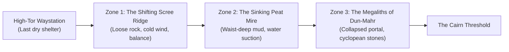
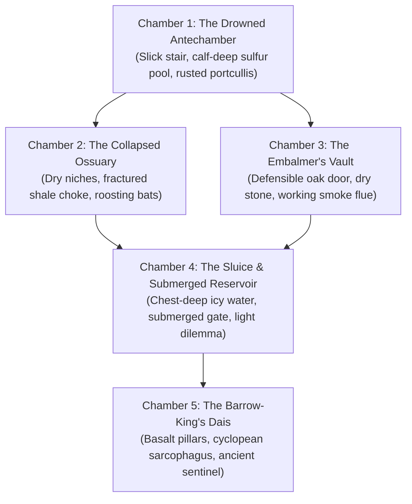

# Travel & Delve Locations: The Sunken Cairn of Dun-Mahr

This document details the physical environments, spatial layouts, environmental hazards, and natural obstacles of **The Sunken Cairn of Dun-Mahr**. It avoids hardcoded mechanical rules or game stats, describing the journey purely at the level of sensory detail, material reality, and tactical dilemmas.

---

## 1. Stage 1: The Moorland Approach (The Overland Journey)

The journey begins at the **High-Tor Waystation**, the last fortified tavern and sheep-fold before the high moors. Reaching the sunken cairn requires crossing three distinct wilderness zones, each testing physical stamina, footing, and weather endurance.

---

### Zone 1: The Shifting Scree Ridge

- **Sensory Reality:** A steep, wind-scoured shoulder of black shale and broken granite. Rain squalls drive horizontally across the slope. Every footstep sends cascades of rattling rock skittering into the mist-choked ravine below.
- **Physical Obstacle:** Navigating a 30-degree slope of unstable scree where the path has washed out. The shale is loose, slick with moss, and offers no solid purchase for smooth-soled boots.
- **Natural Approaches:**
  - _Light, Agile Footing:_ A nimble traveler can move quickly from one semi-anchored boulder to the next, relying on balance and rapid weight transfers to cross before gravel begins sliding.
  - _Deliberate, Brute Trenching:_ Digging the edges of heavy boots deep into the gravel bed, using a stout ash staff or pole to create a three-point anchor with every stride.
  - _Rope Traverse:_ Driving iron pitons into the upper rock face to fix a safety line for the party.
- **Physical Stakes:**
  - Slipping on the shale results in a sudden, violent ankle twist (tearing lateral ligaments) or falling hard onto jagged rock edges, causing deep contusions and tearing pack straps.
  - Dislodged packs tumble down the scree into the gully, risking broken gear or lost provisions.

---

### Zone 2: The Sinking Peat Mire

- **Sensory Reality:** The high ridge descends into a bowl of stagnant, spongy wetland. Black water pools between thick tussocks of sedge and dead heather. The air smells intensely of sulfur and rotting vegetation.
- **Physical Obstacle:** A 200-meter expanse of treacherous peat bog. The surface heather forms a deceptive crust over deep, liquefied peat slurry that acts like non-Newtonian quicksand.
- **Natural Approaches:**
  - _Reading the Surface:_ Surveying the wetland from an elevated hummock to trace ancient subterranean granite veins, where sub-surface stone keeps the ground firm enough to bear a human's weight.
  - _Probing with Marsh Poles:_ Using 3-meter willow poles to sound the mud ahead, stepping only where solid clay or rock is felt beneath the slurry.
  - _Roped Wading:_ Tying companions together with a 15-meter cord and wading through knee-to-waist-deep mud, accepting water immersion while using mutual anchor weight to prevent anyone from being sucked under.
- **Physical Stakes:**
  - Stepping into a false hollow causes immediate submersion to the chest. Mud suction is immense—extracting a leg requires four times the force of a normal step and frequently tears boots clean off the feet.
  - Soaking woolen clothing and provision packs. Liquid peat water instantly degrades hardtack biscuits into soggy, unpalatable mush, while damp provisions sour and spoil over subsequent days.

---

### Zone 3: The Megaliths of Dun-Mahr (The Cairn Threshold)

- **Sensory Reality:** Three massive, lichen-crusted granite standing stones loom on a raised knoll above the mist. Beyond them, a massive tumulus of earth and dry-stone masonry rises into the gray sky. At its base, a sunken passage descends into darkness, half-blocked by a tumbled cyclopean lintel stone.
- **Physical Obstacle:** The entrance passage has partially collapsed under centuries of mountain frost-heaves. Tons of tumbled granite boulders choke the stone stair, through which cold, sulfurous groundwater trickles out from below.
- **Natural Approaches:**
  - _Archaeological Forensics:_ Inspecting the runic carvings on the standing stones to locate the ancient builders' counterweighted drainage conduit—a concealed dry side-crawlway that bypasses the collapsed stair.
  - _Heavy Excavation:_ Using a steel crowbar, iron wedges, and raw shoulder power to lever the tumbled lintel aside, clearing a gap wide enough for an armored person to squeeze through.
- **Physical Stakes:**
  - Heavy levering is loud and grueling: the clang of iron on granite rings across the moors, alerting territorial predators, and burns through hours of daylight.
  - A slip while levering a multi-ton slab risks crushing a hand or pinning a leg under shifting masonry.

---

## 2. Stage 2: The Sunken Cairn (Subterranean Chambers)

Inside the cairn, the environment shifts to absolute darkness, damp stone, and dead air.

---

### Chamber 1: The Drowned Antechamber

- **Sensory Reality:** The stone steps descend below the moorland water table. The floor is covered in calf-deep standing water, dead black and freezing cold. Pale subterranean moss clings to the ceiling, which continually weeps droplets that echo with rhythmic hollow taps. The air is cold and thick with humidity.
- **Physical Obstacle:** An ancient, heavy iron-barred portcullis blocks the forward archway. Its hoisting chain connects to a calcified wall winch crusted with three centuries of mineral buildup. The bars are pitted with orange rust, and several bottom tines have corroded away near the waterline.
- **Tactical Options:**
  - _Forcing the Winch:_ Applying heavy leverage with a crowbar to crack the mineral crust on the iron gears and heave the chain up link by link. Requires immense upper-body force and produces loud, squealing metallic screeches.
  - _Lock Mechanism Manipulation:_ Clearing the calcified corrosion from the wall-mounted ratchet box with fine awls and oil, then picking the primitive gravity tumblers. Requires steady, warm fingers—difficult while standing in freezing water.
  - _Squeezing the Breached Grate:_ An agile, unarmored individual can wriggle through the gap left by the corroded bottom bars. However, anyone wearing a rigid breastplate, mail hauberk, or carrying a bulky pack cannot fit through without unbuckling and hauling gear through separately.
- **Physical Stakes:**
  - Screeching iron gears echo through the subterranean shafts, waking roosting scavengers in nearby vaults.
  - Standing stationary in calf-deep $6^\circ\text{C}$ water rapidly numbs feet and ankles, inducing intense shivering.

---

### Chamber 2: The Collapsed Ossuary

- **Sensory Reality:** The passage climbs slightly onto a dry, raised stone floor. Recessed niches along both walls are packed with stacks of ancient, yellowed femurs and skulls. A massive tectonic shift has cracked the vault ceiling, dumping a four-meter mound of fractured granite and sharp shale across the center of the hall. High in the shadows above, hundreds of cave bats roost, their leathery wings rustling nervously.
- **Physical Obstacle:** Traversing the jagged, unstable rubble mound without triggering a secondary rockfall or disturbing the roosting colony above.
- **Tactical Options:**
  - _Quiet, Low-Slung Scramble:_ Dousing or shielding the open torch (so the glare does not blind or provoke the bats) and crawling carefully across the rubble on hands and knees, testing each slab for stability before shifting weight.
  - _Systematic Clearing:_ Using a crowbar to roll the largest, sharpest boulders off the path, creating a clear walking lane. This creates noise that sends the bat colony into a panicked, dive-bombing frenzy of claws and biting teeth.
- **Physical Stakes:**
  - Fractured shale edges are sharp as broken glass: a slip cuts clean through trousers and leather gloves, creating ragged lacerations prone to infection from ancient bone dust.
  - Shifting rocks can trigger a slide that pins a foot or crashes onto a shoulder.

---

### Chamber 3: The Embalmer's Vault (The Dry Sanctuary)

- **Sensory Reality:** An elevated chamber built off the main axis, remarkably dry and sheltered. Three massive granite mortuary tables sit in the center. In the corner stands a primitive stone hearth connected to an ancient, natural chimney flue that drafts air cleanly up to the moorland surface. The room smells of dried herbs, dust, and aged tallow.
- **Physical Advantages (The Only True Camp Site):**
  - **The Oak Drop-Bar Door:** A heavy, iron-reinforced slab door still hangs on its bronze hinges and features functioning drop-bars, allowing the chamber to be physically sealed against wandering beasts.
  - **The Hearth & Flue:** A fire can be built here without suffocating the occupants. The rising draft pulls woodsmoke up the flue rather than filling the chamber with blinding soot.
  - **Dry Recovery:** This is the only location in the cairn where travelers can safely strip off soaked boots, dry woolen cloaks and gambesons, boil clean drinking water, and dress open wounds.
- **Physical Salvage:**
  - Sealed earthen storage jars in recessed wall cupboards contain dried willow bark (a natural fever reducer), blocks of animal tallow (for oiling rusted gear and torches), and rolls of clean linen wraps preserved by the dry atmosphere.

---

### Chamber 4: The Sluice Gate & Submerged Reservoir

- **Sensory Reality:** A dramatic, terrifying transition. The stone corridor abruptly plunges into a flooded subterranean reservoir where mountain runoff has backed up behind a jammed floodgate. The black water is chest-deep on a tall person, freezing cold, and completely opaque. The forward passage is a submerged stone archway entirely below the waterline.
- **The Core Tactical Dilemma: Fire and Water:**
  - An open flame **cannot survive underwater**. If both travelers plunge into the water, torches are extinguished, plunging the reservoir into absolute, pitch darkness while they are submerged.
  - One traveler must remain on the dry stone ledge, holding the torch aloft to illuminate the dark water's surface, while the other strips down and enters the freezing pool.
- **The Physical Challenge (The Submerged Gate):**
  - A diver must take a deep breath, plunge into freezing water, and descend 2 meters to find the jammed bronze sluice gate.
  - In total darkness beneath the surface, they must feel for the silted lever, clear centuries of river gravel jammed in the guide track, and heave it open to drain the chamber.
  - **The Armor Penalty:** Anyone attempting this while wearing mail or carrying iron tools will sink like an anvil. Armor must be stripped off, leaving the diver unarmored and completely exposed to the cold.
- **Physical Stakes (The 1-10-1 Reality):**
  - **Cold Shock (0–1 min):** Sudden immersion in near-freezing water triggers an involuntary gasp reflex (2–3L aspiration risk) and uncontrolled hyperventilation (Tipton 1989), making breath-holding nearly impossible and causing immediate drowning if submerged while gasping.
  - **Cold Incapacitation (2–4 min):** Peripheral neuromuscular cooling rapidly paralyzes hands and forearms (Giesbrecht 2000). Fine motor dexterity fails within two minutes—fumbling the silted lever or dropping clearing tools—followed by swim failure within 5 to 10 minutes. (Systemic core hypothermia requires 30–60+ minutes; the immediate lethal risk is drowning from neuromuscular paralysis while core temperature is still normal).

---

### Chamber 5: The Barrow-King's Dais (The Inner Sanctum)

- **Sensory Reality:** A vast, octagonal hall of polished black basalt. Eight cyclopean pillars carve out a central circle. At the center sits a three-stepped stone dais holding a massive, carved stone sarcophagus. Cold air hangs motionless; ancient bronze urns and tarnished silver torcs lie undisturbed around the base of the bier.
- **The Sentinel:**
  - The ancient guardian—a desiccated warrior-wight encased in rusted, full iron plate armor, clutching a massive ceremonial greatsword across its breast.
  - It does not breathe, does not feel pain, and does not tire. Its armored bulk makes it an immovable, lethal barrier in close quarters.
- **The Haul & The Extraction Dilemma:**
  - Inside the sarcophagus lies the king's treasure: **The Cold-Forged Iron Hauberk** (a masterwork mail shirt that resists rust and provides exceptional protection with minimal weight) and heavy cast-iron tribute ingots.
  - **The Weight of Salvage:** The heavy iron treasure weighs upwards of 60 pounds. Hauling this dead weight out of the cairn—wading back through the flooded crypt, clambering across the shale heap, and ascending the moorland scree with failing torches—is the true physical climax of the expedition.
