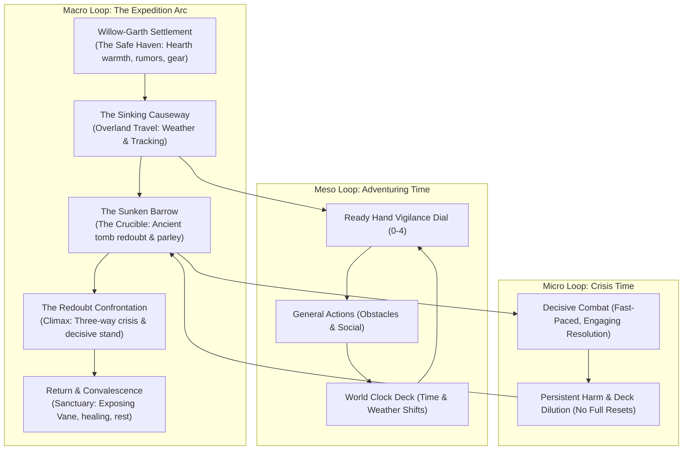

# Scenario Workshop: The Outlaw of Weeping Fen

This directory contains the active design sketch and structural outline for **"The Outlaw of Weeping Fen"**, a short, complete campaign scenario designed as a primary development benchmark for _caRdPG_. Its purpose is to guide the implementation of both rules and engine code by modeling a full, multi-scene adventure—connecting overland travel, exploration, non-combat challenges, tactical combat, and downtime recovery in our default **Grounded Heroism** setting.

---

## 1. Scenario Vision & Core Themes

_The Outlaw of Weeping Fen_ is a low-fantasy scenario blending frontier adventure, moral stakes, and grounded physical realism:

- **Grounded Heroism with Dynamic Range:** Violence has authentic physical weight and injuries require dedicated recovery arcs, but the protagonists are defined by their courage, competence, and resolve. They are seasoned heroes standing up for vulnerable folk against real physical odds—neither invulnerable superheroes nor helpless victims of attrition. Peril in the wild is thrown into vivid relief by warm hearths, good food, and village fellowship.
- **The Living Environment (Atmospheric Contrast):** The fenland is a landscape of both wild danger and primeval natural wonder: treacherous peat mires, clinging fog, and sudden squalls contrast with golden sedge swaying in the breeze, tranquil water-lily channels, majestic weeping willows, and ancient moss-covered stone causeways catching the dawn light.
- **High-Stakes Conflict (Ruthless Ambition vs. Resolute Defense):** Bridges the gap between clear, calculating opposition (Bailiff Vane's land theft and mercenary enforcers) and nuanced human drama (an honorable Marcher knight desperately protecting his fever-stricken daughter and proud frontier villagers caught in the middle).
- **The Fast-Paced Combat Engine:** Demonstrates _caRdPG_'s core design advantage over traditional tabletop games: simultaneous planning and card-count resolution mean combats resolve in 5–10 minutes of intense, high-stakes decision-making.

---

## 2. The Campaign Lifecycle & Architecture

The scenario exercises the three interconnected tiers of the _caRdPG_ engine, directly following the canonical adventure lifecycle:

---

## 3. Workshop Directory Contents

- [narrative-arc.md](narrative-arc.md): The narrative outline, key factions, NPCs, dramatic dilemmas, and act-by-act story beats.
- [world-clock.md](world-clock.md): The narrative design and event concepts for the World Clock deck (weather, time of day, posse tracking, sickness progression).
- [challenges-and-encounters.md](challenges-and-encounters.md): High-level breakdown of the non-combat scenes, terrain hazards, and combat encounters.

---

## 4. Primary Development Targets Exposed by this Scenario

Designing and implementing this scenario directly drives the engineering and rules roadmap:

1. **Campaign / Scenario Data Model:** Moving beyond single-combat scenarios (`starter.yaml`) to multi-scene campaign definitions with transitions, locations, and narrative prompts.
2. **Persistent Actor State:** Preserving deck state, fatigue, condition cards, and equipment wear across multiple scenes and rests.
3. **Adventuring Time Engine:** Implementing the Ready Hand vigilance dial, Effort Cycles, and General Action flip-resolution outside the combat grid.
4. **The Living World Clock Engine:** A table-shared deck drawn during travel, multi-hour rests, or extended tasks that drives dynamic narrative and environmental changes.
5. **Multi-Character Dynamics:** Packaged 2-character party dynamics demonstrating mutual defense, skill assistance, and complementary roles.
