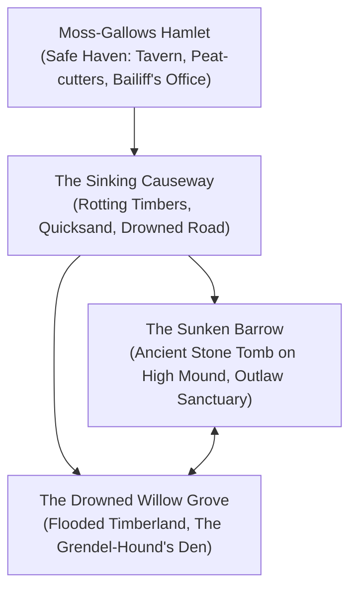
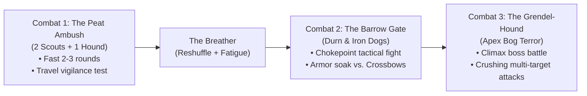

# Challenges & Encounters: The Weeping Fen

This document sketches the primary locations, non-combat challenges, and tactical combats in **"The Outlaw of Weeping Fen"** at a high level. Rather than fixing exact card numbers or stats, it defines the narrative stakes, physical environment, tactical dilemmas, and the mechanical virtues each encounter is designed to test.

---

## 1. Key Locations of the Fen

1. **Moss-Gallows Hamlet:** A miserable cluster of sod-roofed hovels clinging to the edge of the wetlands. Smells of peat smoke and damp wool. The only dry haven before the marsh.
2. **The Sinking Causeway:** An ancient paved military road that has fractured and sunken into the black bog. Safe to walk on in sections, but broken by 10-to-20-meter spans of deep, sluggish water and treacherous mudbanks.
3. **The Sunken Barrow:** A massive stone tumulus dating back to a forgotten era, perched on the only high, rocky knoll for miles. Surrounded by a natural moat of dark water and tangled brambles.
4. **The Drowned Willow Grove:** The devastated area where Bailiff Vane's illegal logging crew drained the bog. Tangled stumps, stagnant black pools, and the hollowed root-nest of the Grendel-Hound.

---

## 2. The Non-Combat Challenge Palette

These challenges test the **General Action** framework, emphasizing cooperation between the Shield-Fighter (endurance, brute force, military protocol) and the Swashbuckler (agility, fast-talk, stealth, perception).

### Challenge 1: The Broken Causeway Culvert (Environmental Peril)

- **The Situation:** A 15-meter section of the stone causeway has completely collapsed into a deep, bubbling peat sinkhole. Rushing brown water cuts off forward progress.
- **Approaches:**
  - _Agile Traversal (Swashbuckler):_ Leaping across slippery, rotting timber pylons while carrying a guide line to anchor on the far side.
  - _Brute Engineering (Shield-Fighter):_ Wading through the chest-deep mire to lever a fallen cypress log into place with raw muscle and shields.
- **The Stakes:** High impact means slipping into the freezing mire, soaking provisions, or taking `Bruised Shins` and burning cards of stamina.

### Challenge 2: Distinguishing the Tracks (Investigation & Forensics)

- **The Situation:** Around a half-sunken rowboat, the mud is churned with blood and prints. Bailiff Vane claimed Kenneth butchered a fishing family here.
- **Approaches:**
  - _Forensic Analysis (Perception / Lore):_ Examining claw marks on the gunwales and the crushed bones of the victims to deduce the truth—this was the work of an apex predator with four-inch talons, not human blades.
  - _Following the Blood Trail:_ Differentiating the beast's deep, clawed gait from the bootprints of fleeing men.
- **The Stakes:** Discovering the truth provides leverage in future social confrontations and eliminates doubt about Kenneth's guilt.

### Challenge 3: The Barrow Threshold (Tense Social De-escalation)

- **The Situation:** Reaching the archway of the Sunken Barrow, the heroes are confronted in the shadows by Ser Kenneth and his two retainers with drawn, notched blades. Kenneth assumes the heroes are Vane's headhunters.
- **Approaches:**
  - _Appealing to Knightly Honor (Shield-Fighter):_ Presenting military credentials, reciting the Marcher code of arms, or lowering weapons to prove peaceful intent.
  - _Fast-Talk & Empathy (Swashbuckler):_ Revealing knowledge of the real beast, offering clean medicine, and warning them of Durn's approaching hounds.
- **The Stakes:** Failure results in an unnecessary, tragic skirmish with desperate, starving men. Success turns the outlaws into grateful, vital allies.

### Challenge 4: Treating the Marsh-Rot (Medical & Logistical Care)

- **The Situation:** Elsbeth is burning with Black-Water Ague inside the damp crypt. Her fever is peaking.
- **Approaches:**
  - _Crafting the Fever-Draft:_ Boiling clean water, crushing wild willow-bark, and applying cooling moss compresses to break the fever.
  - _Physical Comfort & Shelter:_ Repairing the barrow's drafts, building a smokeless stone hearth, and keeping her warm.
- **The Stakes:** Success stabilizes the child and preserves Kenneth's fighting spirit for the upcoming battle; failure adds a severe complication and forces Kenneth into suicidal despair.

---

## 3. The Combat Encounters (Fast, Decisive, 3–5 Rounds)

Combats in this scenario are designed to be fast and lethal, proving the speed of _caRdPG_ relative to traditional RPGs:

### Combat 1: The Peat Ambush (Outdoor Skirmish)

- **Combatants:** 2 Mercenary Scouts (leather jerkins, spears) + 1 War Mastiff (fast pounce, pinning bite).
- **Setting:** Open peat field with scattered reeds and standing puddles.
- **Tactical Focus:** Tests entering combat from the travel vigilance dial. The mastiff rushes the unarmored Swashbuckler, while the spearmen try to keep the Shield-Fighter at distance with reach.
- **Expected Length:** 2–3 rounds (under 5 minutes at the table).

### Combat 2: The Barrow Gate Breach (Tactical Defense)

- **Combatants:** Sergeant Durn (heavy chain, military billhook) + 2 Crossbowmen with pavise shields.
- **Setting:** The narrow stone threshold of the barrow archway.
- **Tactical Focus:** Chokepoint defense. The Shield-Fighter can plant their shield in the 2-meter doorway, forcing Durn to engage in grinding close-quarters combat while the Swashbuckler flanks through a collapsed side fissure to threaten the crossbowmen.
- **Expected Length:** 3–4 rounds.

### Combat 3: The Grendel-Hound (Climactic Boss Encounter)

- **Combatant:** The Grendel-Hound (Massive bog beast; thick water-soaked hide acting as heavy natural armor; devastating sweep and crushing jaw attacks).
- **Setting:** The flooded courtyard of the barrow during a raging downpour. Deep mud hampers footwork; lightning illuminates the black water.
- **Tactical Focus:** Multi-enemy management or boss focus. The beast hits with crushing `{Red}` Strength that threatens even the Shield-Fighter's guard, requiring the Swashbuckler to dart in and exploit its blind flank with `{Yellow}` precision strikes while dodging thrashing claws.
- **Expected Length:** 4–5 rounds of high-tension card play.

---

## 4. State Persistence & Endurance Test

The core test of this scenario is how character state carries across these encounters:

- **No Combat Resets:** Damage suffered against the scouts in Combat 1 does not vanish when entering the barrow.
- **Deck Dilution:** Flipped stamina cards convert into Fatigue during cycles; taking a Breather between fights saves cards at the cost of clock ticks, but characters will enter the final confrontation with noticeably leaner, more fatigue-laden decks.
- **Victory Through Resource Management:** Success against the Grendel-Hound is earned because players conserved their highest-value action cards and managed their fatigue across the entire journey.
