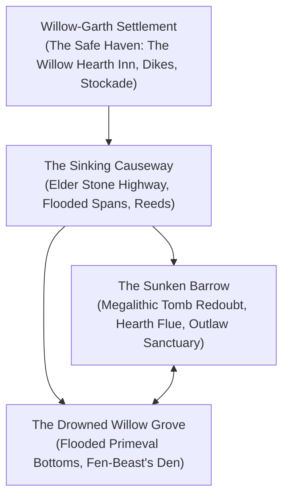
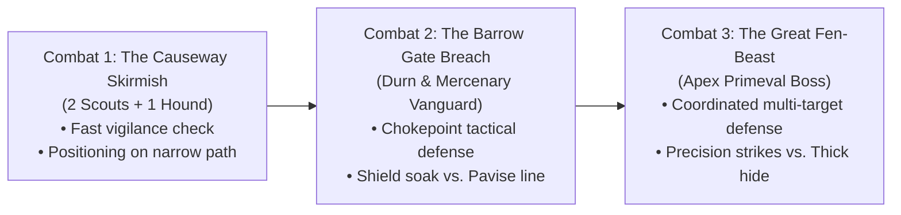

# Challenges & Encounters: The Weeping Fen

This document sketches the primary locations, non-combat challenges, and tactical combats in **"The Outlaw of Weeping Fen"** at a high level. Rather than fixing rigid stats, it defines the narrative stakes, physical environment, tactical dilemmas, and the mechanical virtues each encounter is designed to test under our **Grounded Heroism** philosophy.

---

## 1. Key Locations of the Fen

1. **Willow-Garth Settlement:** A thriving, resilient border settlement of timber-and-fieldstone cottages protected by earthen dikes and willow windbreaks. At its center stands _The Willow Hearth_ inn—a beacon of warmth, roasted meats, hot cider, and hospitable fellowship that anchors the region's dynamic range.
2. **The Sinking Causeway:** An ancient paved military highway cutting through the fen. While solid and dry across long spans, several 10-to-20-meter sections have collapsed into slow brown water, requiring careful poling, athletic leaps, or timber bridging.
3. **The Sunken Barrow:** A solemn cyclopean stone tumulus dating to an elder age, resting high on a dry granite island. Surrounded by a natural moat of deep water and water lilies, its massive lintels shelter a defensible antechamber with an ancient working chimney flue.
4. **The Drowned Willow Grove:** A primeval wetland forest of massive, moss-draped willows recently flooded by Bailiff Vane's unauthorized timber dikes. Root-snags and floating logs surround the hollowed earth mound where the Great Fen-Beast made its ancestral den.

---

## 2. The Non-Combat Challenge Palette

These scenes test the **General Action** framework, emphasizing cooperation between the Shield-Fighter (endurance, athletic brute force, military protocol) and the Swashbuckler (agility, fast-talk, stealth, keen perception).

### Challenge 1: The Broken Causeway Culvert (Environmental Peril & Teamwork)

- **The Situation:** A 15-meter span of the elder stone road has fractured and fallen into a slow-moving channel of deep bog water. Rushing current cuts off forward progress.
- **Approaches:**
  - _Agile Traversal (Swashbuckler):_ Leaping across exposed stone footings while hauling a stout guide cord to anchor on the far abutment.
  - _Brute Engineering (Shield-Fighter):_ Wading into the shallows to lever a drift-log into place with raw muscle and stout shields, creating a firm bridge.
- **Tactical Stakes:** Success preserves pace and dry rations; complications mean a soak in cold water, forcing an expenditure of dry fuel or burning stamina to dry out before evening.

### Challenge 2: Frontier Forensics at the Stockade (Investigation & Deduction)

- **The Situation:** Inspecting the smashed sheepfold timber gates in Willow-Garth where Bailiff Vane claimed Sir Kenneth butchered livestock.
- **Approaches:**
  - _Forensic Inspection (Perception / Lore):_ Examining the splintered oak and identifying four-inch claw gouges and crushed bone patterns characteristic of a massive apex beast, proving human blades were not involved.
  - _Tracking the Withdrawal:_ Differentiating the heavy, padded tracks of the bog predator heading toward the drowned groves from human bootprints.
- **Tactical Stakes:** Uncovering the physical truth eliminates doubt about Kenneth's innocence and arms the party with undeniable leverage when confronting Bailiff Vane.

### Challenge 3: The Barrow Threshold (Martial Honor & De-escalation)

- **The Situation:** Reaching the megalithic portal of the Sunken Barrow, the heroes are challenged in the shadows by Sir Kenneth and his two yeomen with leveled steel. Kenneth fears Vane’s headhunters have arrived to finish his line.
- **Approaches:**
  - _Appealing to Knightly Honor (Shield-Fighter):_ Lowering weapons, displaying military credentials, reciting the Marcher soldier's oath, and parleying with formal respect.
  - _Diplomatic Candor (Swashbuckler):_ Presenting the forensic claw evidence, explaining Vane's timber scheme, and offering fresh medicinal supplies for the sick child.
- **Tactical Stakes:** De-escalates a tragic misunderstanding into an alliance. Kenneth shares vital intelligence on the beast's movements and pledges his shield for the final stand.

### Challenge 4: Breaking the Marsh-Chill (Wilderness Caretaking & Craft)

- **The Situation:** Elsbeth is feverish and shivering in the barrow's stone antechamber. Her cold-water immersion has settled into an acute fever that requires immediate care.
- **Approaches:**
  - _Crafting the Fever-Draft:_ Boiling clean water over a smokeless fire, steeping willow-bark and fever-root, and preparing cooling herbal compresses.
  - _Sanctuary Preparation:_ Clearing the ancient chimney flue, sealing damp drafts with dry sheepskins, and creating a dry, warm microclimate for recovery.
- **Tactical Stakes:** Success stabilizes the child, removes the emotional ticking clock, and restores Kenneth's full focus and martial discipline for the impending battle.

---

## 3. The Combat Encounters (Fast, Decisive Table Pacing)

Combat in _caRdPG_ is designed to resolve in **5–10 minutes** of intense, simultaneous decision-making:

### Combat 1: The Causeway Skirmish (Outdoor Travel Skirmish)

- **Combatants:** 2 Mercenary Scouts (leather armor, spears) + 1 War Mastiff (fast dash, takedown).
- **Setting:** A narrow, mossy span of the stone causeway bounded by deep water and reeds.
- **Tactical Focus:** Tests entering combat from the Ready Hand vigilance dial. The mastiff aims for the mobile Swashbuckler, while the spearmen attempt to keep the Shield-Fighter contained.
- **Table Pacing:** Fast opening engagement (resolves in 2–3 rounds / ~5 minutes).

### Combat 2: The Barrow Gate Breach (Tactical Chokepoint Defense)

- **Combatants:** Sergeant Durn (heavy ring-mail, billhook) + 2 Mercenary Crossbowmen behind pavises.
- **Setting:** The 2-meter megalithic archway of the Sunken Barrow.
- **Tactical Focus:** Chokepoint management. The Shield-Fighter can plant their heavy shield to anchor the threshold, while the Swashbuckler exploits high stone ledges or side arrow-slits to disrupt the crossbowmen.
- **Table Pacing:** Methodical, high-impact tactical engagement testing armor absorption, guard economy, and non-lethal submission options.

### Combat 3: The Great Fen-Beast (Climactic Boss Encounter)

- **Combatants:** The Great Fen-Beast (Massive ancient predator; thick mud-caked hide acting as natural armor; sweeping paw strikes and crushing charges).
- **Setting:** The barrow's outer megalithic courtyard during a nocturnal rainstorm.
- **Tactical Focus:** Asymmetric boss battle. The beast deals heavy `{Red}` kinetic blows requiring the Shield-Fighter's braced stances, while the Swashbuckler darts around heavy swings to target vulnerable soft points with `{Yellow}` precision strikes.
- **Table Pacing:** High-intensity climax requiring team coordination, stance synergies, and resource conservation.

---

## 4. State Persistence & Earned Recovery

This scenario models the complete macro lifecycle of an expedition:

- **No Mid-Adventure Amnesia:** Wounds and fatigue sustained during the travel skirmish carry forward into the barrow defense.
- **Full Convalescence Cycle:** Returning to the safe haven of Willow-Garth initiates the recovery arc: injuries are medically dressed, turning severe condition cards into temporary fatigue, which is then fully flushed through warm hearths, wholesome food, and days of honest rest before advancing character decks.
