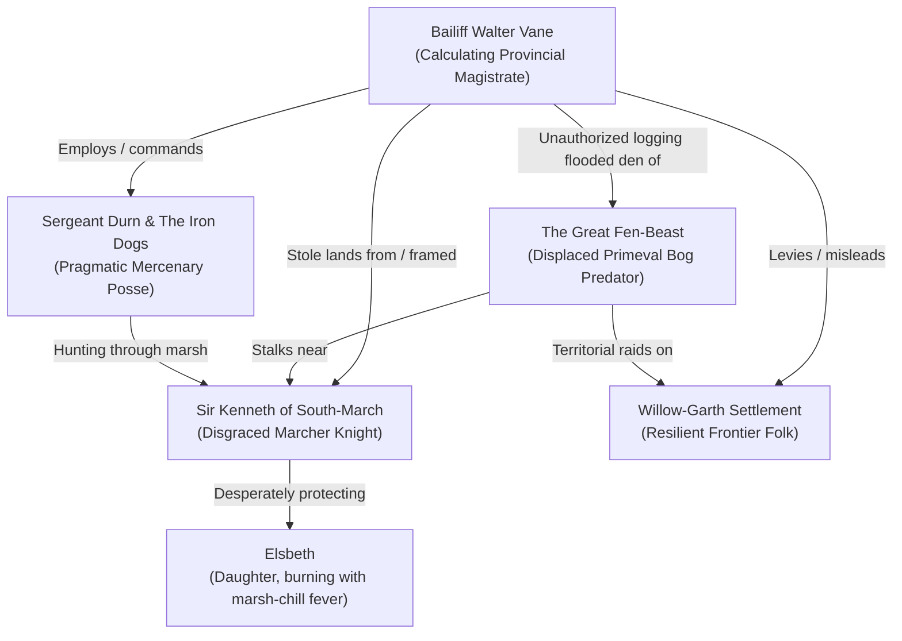

# Narrative Arc: The Outlaw of Weeping Fen

This document details the story outline, dramatis personae, faction motives, and act-by-act narrative structure for **"The Outlaw of Weeping Fen"**. Grounded in our **Grounded Heroism** design philosophy, it focuses on human-scale drama, tactical competence, atmospheric dynamic range, and earned moral victory without falling into cynical despair or cartoon villainy.

---

## 1. The Core Premise & The Dramatic Question

On the border of the civilized Marches lies the **Weeping Fen**—a vast frontier wetland where ancient moss-draped willows, tranquil lily channels, and waving golden sedge give way to treacherous peat mires and shifting fog banks.

Two months ago, **Sir Kenneth**, an honorable Marcher border captain of modest estate, was accused of treason and summarily stripped of his ancestral oaklands by **Bailiff Walter Vane**, the regional magistrate. Rather than submit to a rigged tribunal, Kenneth withdrew into the fen with his retainers and his twelve-year-old daughter, **Elsbeth**.

Recently, violent nocturnal attacks have struck the outlying sheepfolds and timber stockades of **Willow-Garth**: pens smashed, stout timber gates splintered, and livestock killed by a marauding terror. Bailiff Vane seized upon the panic, branding Kenneth a desperate outlaw and "bloodthirsty renegade," offering a royal bounty for the knight’s head.

**The Dramatic Question:** _Can the protagonists navigate the treacherous fen, uncover the true nature of the predator menacing the frontier, and vindicate an honorable knight before innocent lives are lost and an ambitious magistrate secures an unjust conquest?_

---

## 2. Dramatis Personae & Factions

### The Outlaws (The Resolute Fugitives)

- **Sir Kenneth of South-March:** An experienced, decorated border officer. Kenneth is weary, weathered, and his mail bears the mud and scrapes of hard travel, but he carries himself with quiet military dignity and unbroken resolve. He is no bandit or desperate killer; he is a disciplined father and sworn knight determined to protect his child, preserve his honor, and uncover the truth.
- **Elsbeth:** Kenneth’s 12-year-old daughter. Bedridden in the dry upper antechamber of an ancient stone barrow, she is suffering from severe **Marsh-Chill Fever** after cold-water exposure during their flight. Without clean boiled water, herbal willow-bark drafts, and warm shelter, her condition will reach a critical turning point within days. Her recovery provides a compelling medical and logistics puzzle for competent heroes.
- **Bran & Tomas:** Two veteran household yeomen who refused to abandon their lord. Weary and watchful, but disciplined soldiers who understand martial courtesy, watch rotations, and mutual defense.

### The Law & The Frontier Settlement

- **Bailiff Walter Vane:** A polished, punctilious provincial magistrate dressed in fine dyed wool and wearing an official seal-ring. Outwardly courteous and concerned for public safety, Vane presents himself as an overworked official trying to protect a frightened settlement. In reality, Vane fabricated the treason accusations to confiscate Kenneth's valuable ancestral oak timberlands. With royal circuit judges arriving in three weeks to inspect provincial tenures, Vane urgently needs Kenneth eliminated before the crown examines the confiscated deeds.
- **Sergeant Durn & The Iron Dogs:** Vane’s hired border mercenaries. A squad of disciplined, pragmatic veterans equipped with crossbows, pavise shields, and trained tracking mastiffs. Durn is no sadistic butcher, but a calculating professional soldier: he respects capable warriors, avoids headlong charges, and relies on cordons, tracking, and defensive advantage.
- **Mistress Martha & The Willow-Garth Folk:** Resilient peat-cutters, graziers, and weavers who gather around the great oak hearth at _The Willow Hearth_ inn. They are honest, hospitable folk who take pride in their border home. They remember Sir Kenneth as a just protector who defended their herds from raiders, and they harbor quiet doubts about Vane’s sudden accusations.

### The True Menace (The Wild)

- **The Great Fen-Beast:** The true predator behind the nocturnal raids. A primeval bog predator—a scarred, ancient mire-bear or bog-wolf of massive proportions with water-hardened hide and four-inch bone talons.
- **The Ecological Cause:** Bailiff Vane's aggressive, unauthorized timbering and drainage dikes deep in the willow bottoms flooded the beast's ancestral nesting hummock, driving the territorial predator outward toward human livestock.

---

## 3. Act-by-Act Narrative Progression

### Act 1: Willow-Garth Settlement (The Safe Haven)

- **The Warm Hearth:** The heroes arrive at _The Willow Hearth_ inn amidst a driving border rainstorm. Inside, the contrast is immediate: a roaring peat-and-oak fire, steaming bowls of mutton-and-barley pottage, crusty hearth-loaves, and warm spiced cider. Villagers gather around the hearth to share news and seek fellowship.
- **The Public Writ:** Posted by the mantle is a formal royal bounty bearing Bailiff Vane’s seal, offering a substantial pouch of silver for the capture or head of Sir Kenneth, branded a renegade butcher.
- **The Magistrate's Commission:** Bailiff Vane meets the party with polished professionalism. He appeals to their martial standing, describing the threat to innocent farmers with sober regret, offering coin and supply support to track Kenneth into the fen. Sergeant Durn watches quietly, checking his dogs and crossbow strings.
- **Frontier Forensics & Discovery:**
  - Speaking with _Mistress Martha_ over hot tea reveals that Kenneth never harmed a tenant, and that the splintered timber at the sheepfold bore claw gouges "four inches wide and deep as a chisel"—marks made by no human steel.
  - Discreet inquiries or scouting the timber docks reveal that Vane’s lumber crews recently cut deep into the forbidden elder grove, right before the nocturnal attacks began.
- **Expedition Preparation:** The heroes provision gear from the village dry-goods store: seasoned ash marsh-poles, waterproof tallow for boots, oil lanterns, dry rations, and medicinal herbs before departing into the wetlands.

### Act 2: The Sinking Causeway (The Overland March)

- **Living Wetland Dynamic Range:** The journey crosses the Weeping Fen along the ruins of an elder stone causeway. The landscape shifts between primeval natural majesty—golden sedge rippling under morning sun, wide pools patterned with white water lilies, and ancient weeping willows—and treacherous tactical terrain of black peat slurry and sunken culverts.
- **Tactical Terrain Dilemmas:**
  - Choosing whether to follow the high, exposed causeway (fast travel, but telegraphs position to Durn's scouts) or navigate hidden reed waterways (concealed, but demands careful poling and risks wet provisions).
  - Navigating a collapsed stone span using rope anchors and athletic teamwork.
- **The Skirmish (Vigilance in the Reeds):**
  - An advance scout team of Durn’s mercenaries with two leashed tracking dogs tries to spring a flank ambush at a reed crossing.
  - Fast, decisive combat (resolving in 5–10 minutes) testing Ready Hand vigilance and positioning. The heroes defeat the scouts or drive them off, gaining intelligence on Durn's main cordon.

### Act 3: The Sunken Barrow (The Crucible & Revelation)

- **Archaeological Wonder:** Rising from a rocky island above the marsh mist stands an ancient stone barrow—a solemn monument of massive megalithic granite lintels and lichen-covered runic stones from an elder age.
- **The Tense Threshold:** Infiltrating the barrow's forecourt, the party is halted by Bran and Tomas with leveled spears, followed by Sir Kenneth himself with blade drawn.
- **Martial Honor & Parley:**
  - Rather than a chaotic brawl, the confrontation is a tense tactical standoff. The heroes can present evidence of the claw marks, appeal to the Marcher knight's code, or offer medical assistance.
  - Kenneth lowers his blade: he reveals that he fled to protect his dying daughter from Vane’s assassins, and that he has been tracking the true beast to clear his family's name.
- **The Caretaking Challenge:**
  - Elsbeth is feverish in the inner chamber. The heroes use the barrow's ancient working smoke flue to light a clean, warm fire, boil clean water, and administer herbal willow-bark drafts (General Action: Medicine & Craft), stabilizing the child and renewing Kenneth's hope and fighting spirit.

### Act 4: The Convergence (The Climax)

- **The Multi-Front Crucible:** Night falls and a sudden fen downpour begins. Two threats converge on the barrow simultaneously:
  1. **Sergeant Durn and the Iron Dogs** locate the island, bringing up pavises and crossbows to force the narrow stone archway.
  2. **The Great Fen-Beast**, attracted by scent and noise, crashes through the willow perimeter into the outer courtyard.
- **Dynamic Tactical Opportunities:**
  - _Option A (Defensive Chokepoint & Flank):_ The heroes hold the stone archway in mutual defense with Sir Kenneth while directing the beast toward the mercenary line, breaking Durn's formation.
  - _Option B (Apex Monster Hunt):_ The heroes focus on felling the great predator in a decisive boss battle, using its massive carcass as undeniable physical proof to force Durn’s surrender.
  - _Option C (Tactical Capture):_ Subduing and capturing Sergeant Durn during the confusion, breaking his company's morale and securing a living witness against Bailiff Vane.

### Act 5: Sanctuary, Justice & Convalescence

- **The Return to Willow-Garth:** The heroes return under morning sun with Kenneth, Elsbeth, and decisive proof: the beast's carcass and either captured mercenary testimony or Vane's forged muster papers.
- **Exposing the Magistrate:** Confronting Bailiff Vane before the gathered villagers and the vanguard of the arriving Royal Circuit Court. Vane’s scheme collapses under physical evidence, Kenneth’s name and ancestral timberlands are restored, and the frontier community is freed from fear and extortion.
- **Earned Convalescence:**
  - Returning to the warm hearth of _The Willow Hearth_. Mistress Martha and local healers tend to the party’s wounds, converting severe condition cards into manageable Fatigue.
  - Wholesome food, clean dry bedding, hot hearth-fires, and grateful fellowship flush fatigue from player decks over several days of earned downtime.
  - Players upgrade their decks with new martial stances, community bonds, and seasoned frontier techniques, ready for their next journey.
