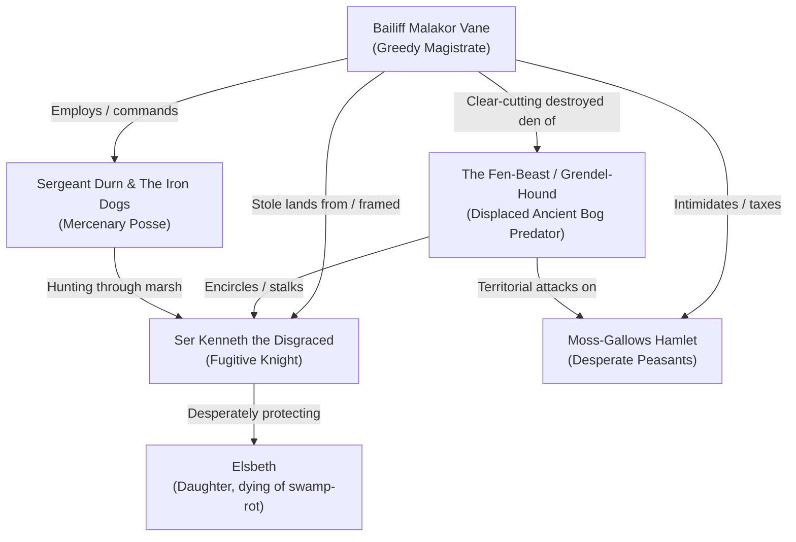

# Narrative Arc: The Outlaw of Weeping Fen

This document details the story outline, dramatis personae, faction motives, and act-by-act narrative structure for **"The Outlaw of Weeping Fen"**. It focuses on human-scale drama, believable conflicts, and moral complexity without relying on generic fantasy tropes or cartoon villains.

---

## 1. The Core Premise & The Dramatic Question

On the border of the civilized Marches lies the **Weeping Fen**, a sprawling, fog-drenched expanse of peat bogs, drowning pools, and dead willows.

Two months ago, **Ser Kenneth**, a respected hedge knight of modest means, was accused of treason and summarily stripped of his ancestral estate and timberlands by **Bailiff Malakor Vane**, the regional magistrate. Rather than submit to a rigged hanging, Kenneth fled into the fen with his retainers and his twelve-year-old daughter, **Elsbeth**.

Recently, a wave of horrific nocturnal slaughter has struck the outlying hamlet of **Moss-Gallows**: farmsteads broken into, livestock eviscerated, and a shepherd killed. Bailiff Vane publicly brands Kenneth an apostate outlaw and "blood-drinking butcher," offering a royal bounty for the knight’s head.

**The Dramatic Question:** _Can the protagonists survive the treacherous fen, uncover the true nature of the predator terrorizing the border, and resolve a bitter blood feud before innocent lives—and their own souls—are consumed by the marsh?_

---

## 2. Dramatis Personae & Factions

### The Outlaws (The Desperate Fugitives)

- **Ser Kenneth the Disgraced:** Once an honorable line-officer in the Marches, Kenneth is now exhausted, hollow-eyed, and gaunt. His rusted mail hangs loose on his shoulders. He is not a revolutionary or a bandit; he is a proud father trapped in an untenable nightmare, determined to keep his daughter alive at all costs.
- **Elsbeth:** Kenneth’s 12-year-old daughter. She is bedridden in a damp stone barrow, burning with **Black-Water Ague** (a lethal marsh fever). Without clean water and medicinal willow-bark/moss, she has only a couple of days to live. Her condition is a ticking emotional clock.
- **Bran & Tomas:** The two surviving household guards who refused to abandon their lord. Battered, hungry, and deeply suspicious of any strangers entering the bog.

### The Law & The Village

- **Bailiff Malakor Vane:** A calculating, well-dressed provincial magistrate who uses the machinery of the law as an extortion racket. Vane fabricated the charges against Kenneth to claim the knight's valuable oak-wood timber rights. Vane knows that royal circuit judges are arriving in three weeks; Kenneth must be dead before the crown can inspect the deeds.
- **Sergeant Durn & The Iron Dogs:** Vane’s personal enforcers. A dozen hard-bitten mercenaries equipped with crossbows, boiled leather armor, and vicious tracking hounds. Durn is brutal but practical: he prefers ambushes, poison, and setting fire to hiding spots rather than risking a fair fight with seasoned veterans.
- **Mother Martha & The Moss-Gallows Folk:** Peasant farmers, peat-cutters, and sheep herders. They are caught between Vane’s heavy levies and the terrifying attacks on their homesteads. They are deeply superstitious and distrustful of outsiders, but desperate for protection.

### The True Menace (The Wild)

- **The Grendel-Hound (The Marsh Stalker):** The real beast behind the farmstead slaughter. It is not an unnatural demon, but a massive, primeval bog predator—a scarred, half-blind mire-wolf or bog-grizzly the size of a warhorse.
- **The Ecological Cause:** Bailiff Vane's illegal, aggressive logging and peat-draining operations deep in the fen flooded the creature’s ancient nesting barrows and drove away its normal prey, driving the ravenous beast to hunt the edges of human civilization.

---

## 3. Act-by-Act Narrative Progression

### Act 1: The Hamlet of Moss-Gallows (The Departure)

- **Opening Scene:** The heroes arrive at the waterlogged tavern in Moss-Gallows. Outside, the rain falls in steady sheets. Nailed to the tavern post is a royal writ of execution and a pouch of gold coins for Kenneth's head.
- **Social Investigation & Rumors:**
  - Talking with _Mother Martha_ reveals that Kenneth was known as a gentle, quiet lord who never stole a turnip in his life, and that the tracks around the slaughtered sheep pens were "far too large to belong to any man on two legs."
  - A confrontation with _Sergeant Durn_ and his drunken guards at the bar establishes their cruelty and warns the players that Vane's hounds are already moving into the fen.
- **Preparation:** Securing local guides, marsh poles, waterproofing boots, or purchasing herbal poultices before stepping off solid ground.

### Act 2: The Sinking Causeway (Travel & Survival)

- **The Environment:** Traveling into the Weeping Fen. The old Roman-style stone causeway has collapsed into black mud, drowned willow tangles, and sulfurous bubbling pools.
- **Non-Combat Peril:**
  - Navigating a submerged quicksand sinkhole or flooded culvert.
  - Finding the trail using broken reeds, mud prints, and disturbed birds.
- **The First Skirmish (The Bog Ambush):**
  - The party encounters a detached scout team of Durn’s mercenaries with two snarling hounds, or a territorial pack of lesser marsh-wolves drawn by the scent of fresh blood.
  - Demonstrates fast, decisive combat: 2–3 rounds of tactical skirmishing in difficult, muddy terrain.

### Act 3: The Sunken Barrow (The Revelation)

- **The Location:** A partially collapsed pre-human stone barrow sitting on an elevated knoll surrounded by black standing water.
- **The Encounter:** The heroes infiltrate Kenneth’s sanctuary. They find no bandit treasure or blood-soaked raiders—only two shivering men with notched swords guarding a delirious child burning with fever.
- **The Moral Crux:**
  - Kenneth stands ready to fight to the death with his sword, believing the heroes are Vane’s assassins.
  - If parleyed with, the truth comes out: Kenneth has been hunting the _real_ beast to protect his daughter and clear his name, but his men are too injured and starved to corner it.
  - **The Immediate Challenge:** Elsbeth needs immediate medical care (a General Action combining herbal knowledge, clean water, and warmth) before she succumbs to the fever.

### Act 4: The Convergence (The Climactic Crisis)

- **The Gathering Storm:** The narrative threads collide at the barrow:
  1. The **Grendel-Hound**, attracted by the scent of blood and meat from recent hunts, circles the ruins in the dark.
  2. **Sergeant Durn and the Iron Dogs** close the cordon, tracking the party’s footsteps with their hounds, intending to burn the barrow with everyone inside.
- **Dynamic Resolution Options:**
  - _Option A (The Monster Hunt):_ The heroes lure the beast into a killing ground, using its corpse as undeniable proof of what was killing the villagers.
  - _Option B (Turning the Tables):_ The heroes use the terrain and the beast's arrival to scatter Durn’s mercenaries, capturing Durn alive to extract a confession against Bailiff Vane.
  - _Option C (The Desperate Defense):_ Fighting a two-front battle inside the ancient barrow, holding the narrow stone archway against the mercenaries while the beast stalks the shadows outside.

### Act 5: Resolution & The Cost

- **Confronting Vane:** Returning to Moss-Gallows with the beast’s carcass, Durn’s confession, or Kenneth under escort. Exposing Vane's land theft before the villagers and forcing his hand before the royal judges arrive.
- **Downtime & Real Rest:** The survivors set up camp or take rooms at the inn. The hours of quiet rest allow the heroes to clean their wounds, purge their fatigue, and nurse Elsbeth back to health—showing the lasting mechanical and narrative satisfaction of an earned victory.
