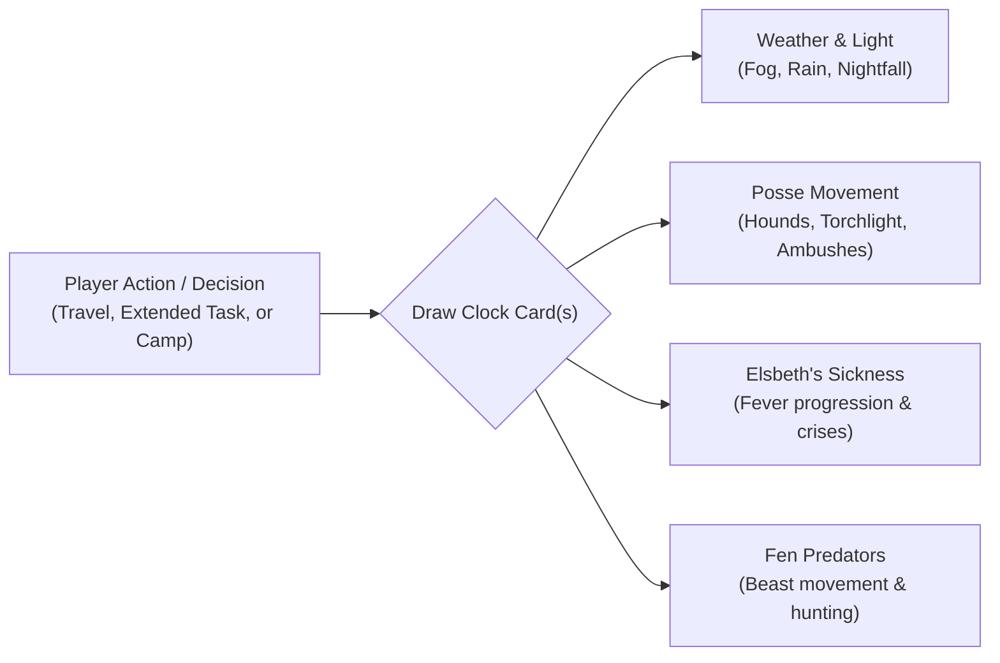

# World Clock: Pacing and Time in the Weeping Fen

This document outlines the design and card catalog concepts for the **World Clock Deck** in _The Outlaw of Weeping Fen_. In _caRdPG_, the World Clock is not an artificial doomsday countdown, but a living engine of verisimilitude: it makes the world reactive, gives time tangible mechanical weight, and ensures that tactical resting and delays have genuine, observable consequences.

---

## 1. Operating Philosophy of the Fen Clock

In the Weeping Fen, time is measured by the natural rhythm of the marsh:

1. **The Sun and the Fog:** Daylight is precious; night in the bog is cold, pitch-black, and disorienting.
2. **The Posse's Net:** Sergeant Durn and his hounds do not freeze in place while the heroes deliberate. Every hour spent searching or resting allows the mercenaries to cast their tracking net wider.
3. **The Biological Reality:** Sickness does not wait. Elsbeth's fever burns through her reserves, creating emotional urgency without needing an arbitrary timer bar.
4. **The Rest Dilemma:** Taking a multi-hour Camp clears fatigue from character decks, but directly advances the World Clock by several cards, shifting the tactical environment.

---

## 2. Clock Triggers: When Does Time Advance?

The GM draws from the World Clock Deck under the following standard triggers:

- **Overland Travel Leg:** Traversing a major zone or following a waterway draws **1 Clock Card**.
- **Extended Adventuring Tasks:** Spending an hour carefully searching an ancient ruin, picking a complex locking mechanism, or laying a complex hunting snare draws **1 Clock Card**.
- **Real Rest / Camp (4–8 Hours):** Pitching camp to sleep and clear Fatigue cards draws **2 to 3 Clock Cards**.
- **Failure with Delay:** Complications on certain General Actions may include a "Lost Time" outcome (e.g. getting stuck in waist-deep mire for an hour), drawing **1 Clock Card**.

---

## 3. Candidate World Clock Cards (Narrative & Mechanical Bites)

### Category A: Weather, Light & Atmospheric Shifts

- **Card: _Dense Willow Mist_**
  - _Narrative:_ A thick, cold blanket of river fog creeps across the standing pools, muffling sound and hiding landmarks.
  - _Mechanical Effect:_ Line of sight is reduced to 4 meters (no long-range attacks or spotting). Ambush checks favor stealth, but navigation checks suffer an added difficulty flip.
- **Card: _Torrential Bog Downpour_**
  - _Narrative:_ Rain lashes the fen in deafening sheets, turning dried peat paths into slick, black grease.
  - _Mechanical Effect:_ Open torches and small campfires are immediately extinguished. Tactical movement on mud costs +1 meter per hex/step. Bowstrings slacken (-2 Strength to missile attacks).
- **Card: _Dusk Gathers_**
  - _Narrative:_ The pale sun dips below the rotting cypress trees. Shadows stretch long across the dark water.
  - _Mechanical Effect:_ Darkness falls. Characters without a light source (lantern, torch) must fight or search at severe disadvantage. Nocturnal predator checks activate.
- **Card: _The Midnight Mire Chill_**
  - _Narrative:_ The temperature plummets as midnight settles over the wetlands. Damp clothing freezes stiff against the skin.
  - _Mechanical Effect:_ If the party has not found dry shelter or built a windbreak/fire, both characters must resolve a physical stamina check against cold exposure or suffer an `Exhaustion` fatigue penalty.

### Category B: The Posse's Hunt (Sergeant Durn & The Iron Dogs)

- **Card: _Distant Baying of Hounds_**
  - _Narrative:_ Across the silent water, the mournful howling of tracking mastiffs echoes through the reeds.
  - _Mechanical Effect:_ The posse has picked up a trail. The players know the hounds are approximately 1 hour behind them.
- **Card: _Torchlight on the Causeway_**
  - _Narrative:_ Pinpricks of orange flame flicker through the trees along the old stone causeway.
  - _Mechanical Effect:_ Durn’s main company has reached the primary road. The causeway is now guarded; traveling on it guarantees an armed confrontation.
- **Card: _The Cordon Tightens_**
  - _Narrative:_ Mercenary scouts begin fanning out into the side channels, cutting off obvious escape routes.
  - _Mechanical Effect:_ The next combat or travel transition adds 1 mercenary scout or war dog reinforcement to the encounter.

### Category C: Elsbeth's Sickness (The Biological Clock)

- **Card: _Shivering Delirium_**
  - _Narrative:_ The girl's skin burns hot to the touch, and she mumbles incoherently about shadows in the water.
  - _Mechanical Effect:_ Kenneth's emotional distress escalates; he becomes desperate and hyper-vigilant, making social negotiation harder if the party arrives during this state.
- **Card: _Fever Crisis_**
  - _Narrative:_ The marsh-rot reaches Elsbeth's lungs; her breathing turns ragged and shallow.
  - _Mechanical Effect:_ She will not survive another night without dedicated medical treatment (General Action: Blue/Red Herbalism & Warmth) or fresh medicinal ingredients.

### Category D: The Wild & The Fen-Beast

- **Card: _Freshly Eviscerated Carcass_**
  - _Narrative:_ The half-eaten carcass of a swamp stag hangs from a low willow branch, its ribcage crushed by immense jaw pressure.
  - _Mechanical Effect:_ Confirms the massive size of the real predator. Yields tracking clues that provide an advantage in the upcoming beast encounter.
- **Card: _The Stalker Circles_**
  - _Narrative:_ Water ripples silently behind the reeds. Heavy breathing and the musk of ancient mud drift on the wind.
  - _Mechanical Effect:_ The Grendel-Hound is shadowing the party. If combat breaks out with mercenaries, the beast may crash into the fight as an unpredictable third faction.

---

## 4. Player Agency: Buying Time & Countering the Clock

A crucial design rule of _caRdPG_ is that clocks must be interactive, not merely punitive. Players can take proactive actions to delay or manipulate clock threats:

- **Scent Masking:** Burning wild sage or wading through sulfur pools removes the hounds' tracking trail, discarding a drawn _Hounds_ card or delaying the posse by 2 hours.
- **Herbal Poultice:** Foraging medicinal moss or fever-root stabilizes Elsbeth, nullifying the next _Fever Crisis_ card drawn.
- **False Trail:** Setting a decoy campfire or leading a trail toward deep sinkholes lures Durn’s scouts away from the barrow.
