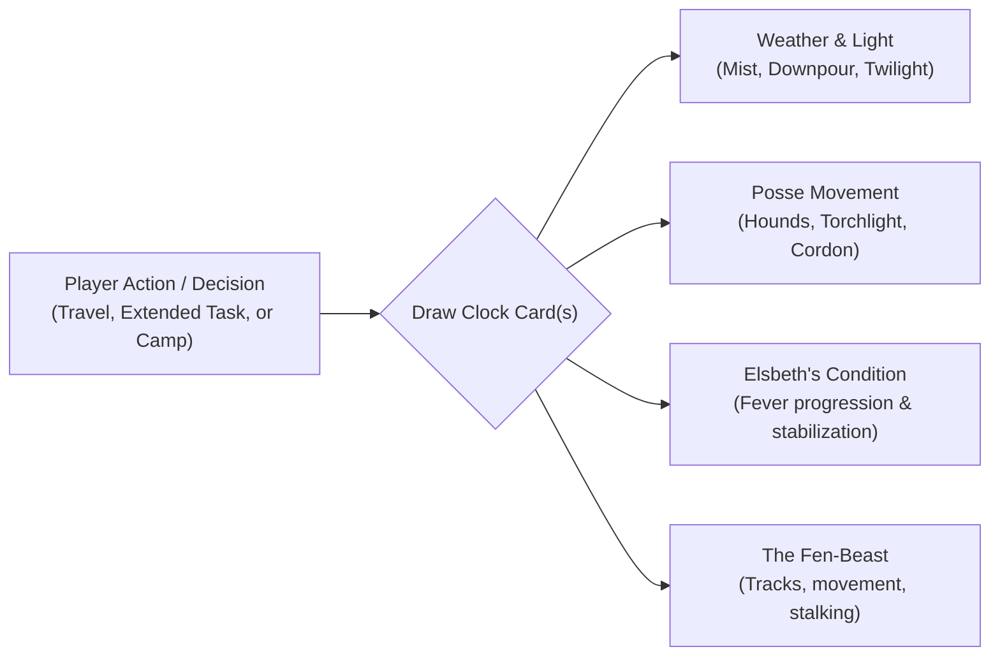

# World Clock: Pacing and Time in the Weeping Fen

This document outlines the design and card catalog concepts for the **World Clock Deck** in _The Outlaw of Weeping Fen_. In _caRdPG_, the World Clock is not an artificial doomsday countdown, but a living engine of verisimilitude: it makes the world reactive, gives time tangible mechanical weight, and ensures that tactical resting and delays have genuine, observable consequences under our **Grounded Heroism** philosophy.

---

## 1. Operating Philosophy of the Fen Clock

In the Weeping Fen, time is measured by the natural rhythms of the frontier:

1. **The Sun and the Fog:** Daylight is precious; twilight in the wetlands brings rising river mists, cooling air, and shifting light conditions.
2. **The Posse's Net:** Sergeant Durn and his hounds do not freeze in place while the heroes deliberate. Every hour spent searching or resting allows the mercenaries to cast their tracking net wider.
3. **The Biological Urgency:** Elsbeth's marsh fever requires warm shelter and prompt herbal care, creating emotional urgency without an arbitrary video game timer.
4. **The Rest Dilemma:** Halting to pitch camp or take a long breather clears fatigue from character decks, but directly advances the World Clock by several cards, shifting the tactical environment.

---

## 2. Clock Triggers: When Does Time Advance?

The GM draws from the World Clock Deck under standard expedition triggers:

- **Overland Travel Leg:** Traversing a major zone or following a waterway draws **1 Clock Card**.
- **Extended Adventuring Tasks:** Spending an hour carefully searching an ancient barrow antechamber, engineering a timber bridge, or setting a complex snare draws **1 Clock Card**.
- **Full Camp / Rest (4–8 Hours):** Pitching camp to sleep, dry gear by the fire, and flush Fatigue cards draws **2 to 3 Clock Cards**.
- **Failure with Delay:** Complications on certain General Actions may include a "Lost Time" outcome (e.g., getting a pack animal unstuck from wet silt), drawing **1 Clock Card**.

---

## 3. Candidate World Clock Cards (Narrative & Mechanical Shifts)

### Category A: Weather, Light & Atmospheric Shifts

- **Card: _Dense Willow Mist_**
  - _Narrative:_ A thick, cool blanket of river fog rolls across the waterways, muffling sound and softening distant landmarks.
  - _Mechanical Effect:_ Line of sight is reduced to 4 meters (no long-range attacks or spotting). Ambush checks favor stealth, but overland navigation checks face an added difficulty flip.
- **Card: _Torrential Fen Squall_**
  - _Narrative:_ Sudden sheets of rain lash across the golden sedge, drumming against shields and turning dried paths into slick clay.
  - _Mechanical Effect:_ Open torches are extinguished unless sheltered under cloaks or in lanterns. Movement on exposed mud costs +1 meter per step. Bowstrings slacken (-2 Strength to missile attacks).
- **Card: _Dusk Gathers_**
  - _Narrative:_ The orange sun sinks beneath the horizon, casting long purple shadows across the tranquil meres before darkness settles.
  - _Mechanical Effect:_ Darkness falls. Characters without lanterns or torches suffer disadvantage on perception and tactical skirmishing. Nocturnal predator checks activate.
- **Card: _The Midnight Mire Chill_**
  - _Narrative:_ As midnight settles, the temperature plunges. Damp air bites through wool and settles frost on exposed iron.
  - _Mechanical Effect:_ If the party has not secured a dry shelter or lit a hearth fire, heroes must pass an endurance check against cold exposure or gain a temporary `Chilled` fatigue card.

### Category B: The Posse's Hunt (Sergeant Durn & The Iron Dogs)

- **Card: _Distant Baying of Hounds_**
  - _Narrative:_ Across the quiet waterways, the deep howling of tracking mastiffs echoes through the willows.
  - _Mechanical Effect:_ The posse has picked up a warm scent. The players know Durn is approximately 1 hour behind them.
- **Card: _Torchlight on the Causeway_**
  - _Narrative:_ Pinpricks of orange lantern flame flicker through the trees along the old stone causeway.
  - _Mechanical Effect:_ Durn’s main detachment has secured the primary stone road; traveling along it directly guarantees an armed confrontation.
- **Card: _The Cordon Tightens_**
  - _Narrative:_ Mercenary scouts fan out along the tributary channels, scanning for boat poles and smoke.
  - _Mechanical Effect:_ The next combat encounter adds 1 mercenary scout or war hound reinforcement.

### Category C: Elsbeth's Condition (The Caretaking Clock)

- **Card: _Shivering Ague_**
  - _Narrative:_ The child tosses fitfully in her blankets, murmuring incoherently as the marsh fever peaks.
  - _Mechanical Effect:_ Sir Kenneth's emotional distress escalates; he becomes hyper-vigilant and defensive, increasing the difficulty of social negotiation if the party has not yet earned his trust.
- **Card: _Fever Crisis_**
  - _Narrative:_ Elsbeth's breathing turns shallow and rapid. Her strength is failing without warmth and medicinal care.
  - _Mechanical Effect:_ The child must be stabilized with dedicated medical care (General Action: Medicine & Warmth) within the next two scene transitions, or Kenneth is forced to surrender to Vane to seek a town chirurgeon.

### Category D: The Wild & The Great Fen-Beast

- **Card: _Splintered Willows & Crushed Reeds_**
  - _Narrative:_ Freshly broken saplings and massive saucer-sized pad prints in the peat mud indicate the great predator passed here within the hour.
  - _Mechanical Effect:_ Confirms the immense scale of the apex beast and grants tactical foresight (+1 advantage flip on the first round of combat against the beast).
- **Card: _The Stalker Shadows_**
  - _Narrative:_ Water ripples through the tall sedge. Heavy breathing and the wild musk of the deep fen drift on the breeze.
  - _Mechanical Effect:_ The Great Fen-Beast is stalking nearby. If combat erupts with mercenaries, the beast may crash into the fray as an unpredictable third faction.

---

## 4. Player Agency: Interactive Clock Counterplay

A core invariant of _caRdPG_ is that clocks are dynamic tactical puzzles for competent heroes to manipulate, never passive penalties:

- **Scent Masking:** Burning sweet-grass or wading through running gravel streams erases tracking scent, discarding a drawn _Hounds_ card or delaying the posse by 2 hours.
- **Wilderness Herbalism:** Foraging willow bark and wild fever-root along the banks stabilizes Elsbeth in advance, nullifying the next _Fever Crisis_ card drawn.
- **Decoy Camps:** Lighting a false campfire on an empty knoll lures Durn’s scouts away from the ancient barrow, giving the party time for an undisturbed rest.
