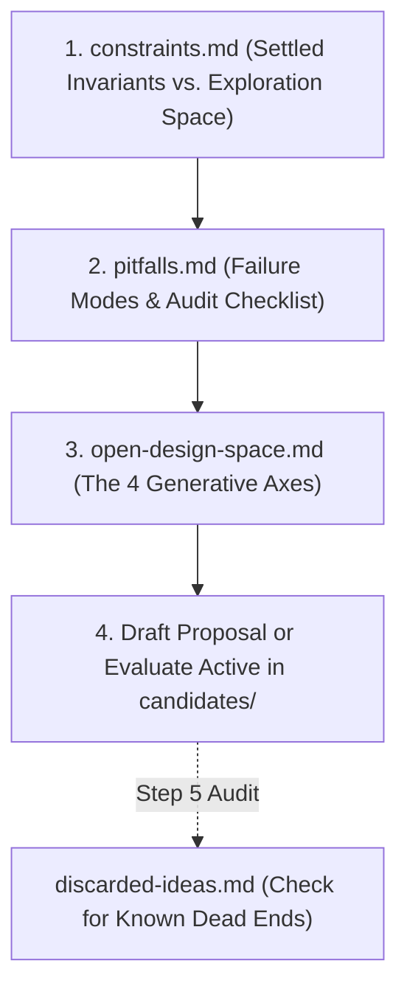

# Core Resolution Mechanics Workshop

This directory is the dedicated workshop for designing, evaluating, and stress-testing candidate **Core Resolution Mechanics** in _caRdPG_.

> [!IMPORTANT]
> **Scope of Exploration: Post-Impact Resolution**
> Action generation (`Strength`, `Color`), card-driven reactive `Defend` actions, and flipping cards from the deck to meet `Strength` (`1 flipped card = 1 Impact`) are working well and treated as **settled invariants**.
>
> Brainstorming and proposals in this workshop should focus on **what happens after we have an `Impact` number**—how armor and defensive stats mitigate `Impact`, and how unmitigated `Impact` translates into consequences, escalation, and defeat. Only propose changes to `Impact` determination / defense flips if you have a **particularly elegant option** that grants meaningful defender agency without adding fiddly rules overhead or analysis paralysis (AP) / card-counting points.

---

## 1. Foundational Documents & Reading Order

When initiating a new design thread or evaluating a proposal, load the core workshop references in this order:

### Core Resolution References (Load for Brainstorming & Drafting)

1. **[constraints.md](constraints.md)** — **The Specification.** Defines what is fixed (the 24-card tri-color engine, Action Stacking input, Defender-Centric flips to generate `Impact`, reactive `Defend` cards, Vigilance, scale invariance) versus what is open for exploration.
2. **[pitfalls.md](pitfalls.md)** — **The Linter.** Catalogs recurring mechanical failure modes (Stagnation Trap, False Dilemmas, Alpha-Strike Hoarding, Flat-Soak Collapse, etc.) and provides the proposal audit checklist.
3. **[open-design-space.md](open-design-space.md)** — **The Generative Canvas.** Maps the 4 open post-Impact design axes (Armor Soak, Defender Agency, Harm Escalation, Swarm Batching) unburdened by past failures.

### Reference & Audit Catalogs (Consult as Needed)

- **[discarded-ideas.md](discarded-ideas.md)** — **The Clearinghouse.** One-stop catalog of discarded ideas, fleeting sketches, and retired candidates with 2-sentence pitches, fatal flaws, and deep-dive links. Consult during Step 5 audits or when spot-checking if a concept has already been explored.
- **[history.md](history.md)** — **The Chronicle.** Authoritative narrative of playtested and superseded engine generations (_Defend from Hand_, _Allowed Severity Tables_, _Canon Defense+Resilience_).

---

## 2. The 5-Step Brainstorming Protocol

To keep brainstorming sharp, concise, and focused on post-Impact dynamics, new resolution proposals should follow this 5-step template before drafting extensive card sets:

### Step 1: The 30-Second Teach Test (Post-Impact Core Loop)

Assume standard `Impact` generation (defender plays any reactive `Defend` stack, then flips cards from deck until `Strength` is met; `1 flipped card = 1 Impact`). State the **post-Impact resolution procedure** in **5 bullet points or fewer**:

- How armor or defensive stats mitigate or filter incoming `Impact`.
- How unmitigated `Impact` translates into consequence cards, severity tiers, or escalation steps.
- What choices (if any) the defender and/or attacker make when selecting or applying consequences.
- _(Exception only)_: If the proposal modifies how defense flips or `Impact` determination work, explicitly justify how it grants defender agency **without** introducing per-flip stops, card-counting incentives, or AP traps.

### Step 2: Armor, Tiers, and Minion Math

- How does heavy armor (e.g., Full Plate) differentiate from unarmored clothing against small vs. large `Impact` totals?
- How are minions/mooks handled symmetrically via stats (e.g., `Resilience 0/1` or `Pool Size 1`) without ad-hoc monster rules?
- How many severity tiers are used, and what does the terminal exit state (`Taken Out` / crisis rescue clock) look like?

### Step 3: Decisive Downward Spiral & Domain Decoupling

- Why does combat not stagnate (Pitfall 1)? How do suffered consequences escalate to force a decisive conclusion?
- How are non-combat domains (Social, Environmental) resolved using the same math without causing **Unified Doom** (social consequences pre-filling physical lethality tracks)?

### Step 4: Three Micro-Benchmark Walkthroughs

Walk through three concrete post-Impact exchanges using real numbers:

1. **The Knight's Harness:** A mundane sword blow (`Strength 8`, generating `2–3 Impact` on flips) strikes a knight in Full Plate. (Does the armor shrug off the routine blow without lasting injury, while leaving non-hoarding tactical pathways like posture/prone, `Pierce`, or tag escalation?)
2. **The Goblin Mob:** Three goblins attack a single hero in the same simultaneous round (generating e.g. `1–2 Impact` each). (Does it resolve cleanly without alpha-strike wipes or multi-phase procedural bottlenecks?)
3. **Debate to Ambush:** A diplomat suffers a severe political rebuke in court (`Social`), then gets ambushed in an alleyway (`Combat`). (Does shaken composure create plausible friction without advancing the physical death track?)

### Step 5: Pitfall & Prior Discard Self-Audit

- Explicitly audit the proposal against the failure modes in [pitfalls.md](pitfalls.md#3-the-resolution-proposal-audit-checklist).
- Scan [discarded-ideas.md](discarded-ideas.md) to confirm the proposal does not reintroduce a known fatal flaw or previously retired candidate mechanic.

---

## 3. Candidate Proposals (`candidates/`)

See **[candidates/README.md](candidates/README.md)** for candidate details and the retired catalog:

- **Active Candidate:** **[candidates/consequence-pool-tag-escalation/](candidates/consequence-pool-tag-escalation/README.md)** _(Full Proposal Suite)_: Post-Impact layered pool fill (`1 Impact = 1 Card`) + _"I Cut, You Choose"_ consequence drafting market + localized leaf-tag escalation.
- **Retired Candidates & Post-Mortems:** Preserved in **[`candidates/retired/`](candidates/README.md#2-retired-candidates--post-mortems-retired)** (including _Standalone Tag Escalation_, _Consolidated 3-Tier Cards_, _Declared Defense Effort_, and _Push Your Luck_). For the 2-sentence summary clearinghouse, see **[discarded-ideas.md](discarded-ideas.md)**.
