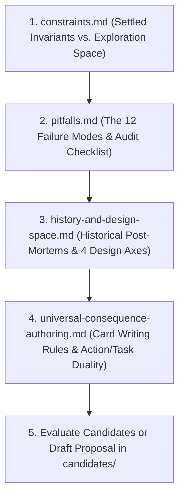

# Core Resolution Mechanics Workshop

This directory is the dedicated workshop for designing, evaluating, and stress-testing candidate **Core Resolution Mechanics** in _caRdPG_.

---

## 1. Reading Order for Brainstorming & Auditing

When initiating a new design thread or evaluating a proposal, load documents in this order:

1. **[constraints.md](constraints.md)**: **The Specification.** Defines what is fixed (the 24-card tri-color engine, Action Stacking input, Defender-Centric flips, reactive `Defend` cards, Vigilance, scale invariance) versus what is open for exploration.
2. **[pitfalls.md](pitfalls.md)**: **The Linter.** Catalog recurring mechanical failure modes (Stagnation Trap, False Dilemmas, Alpha-Strike Hoarding, Combinatorial Partition Traps, Analysis Paralysis) with an authoritative audit checklist.
3. **[history-and-design-space.md](history-and-design-space.md)**: **The Context.** Captures why prior mechanics were retired (Canon Defense+Resilience, Legacy Defend from Hand, Legacy Allowed Severity) and outlines the 4 open design axes.
4. **[universal-consequence-authoring.md](universal-consequence-authoring.md)**: **The Style Guide.** Universal rules for writing consequence and condition cards in caRdPG (no "damage" terminology, continual passives, `action:` vs. `task:` duality, `Requires:` vs. `Cost:`, Anvil Principle).
5. **[consequence-scaling-and-recovery.md](consequence-scaling-and-recovery.md)**: **Progression & Scale Invariance.** Examines fixed numerical checks vs. scale-invariant card counts on consequence cards.

---

## 2. The 5-Step Brainstorming Protocol

To keep brainstorming sharp, concise, and focused on system dynamics, every new resolution proposal should follow this 5-step template before drafting extensive card sets:

### Step 1: The 30-Second Teach Test (Core Loop)

State the core resolution procedure in **5 bullet points or fewer**:

- How incoming attack Strength is met.
- How `Impact` or stamina cost is counted.
- How armor modifies or mitigates the result.
- What choice (if any) the attacker makes.
- What choice (if any) the defender makes.

### Step 2: Armor, Tiers, and Minion Math

- How does heavy armor (e.g. Full Plate) differentiate from unarmored clothing?
- How are minions/mooks handled symmetrically without ad-hoc monster rules?
- How many severity tiers are used, and what does the terminal exit state look like?

### Step 3: Decisive Downward Spiral & Domain Decoupling

- Why does combat not stagnate (Pitfall 1)? What forces the fight to end?
- How are non-combat domains (Social, Environmental) resolved without causing **Unified Doom** (social consequences pre-filling physical injury tracks)?

### Step 4: Three Micro-Benchmark Walkthroughs

Walk through three concrete mechanical exchanges using real numbers:

1. **The Knight's Harness:** A mundane sword blow (`Strength 8`) strikes a knight in Full Plate. (Does it realistically bounce without lasting injury, while leaving tactical pathways like prone or pierce?)
2. **The Goblin Mob:** Three goblins attack a single hero in the same simultaneous round. (Does it resolve cleanly without alpha-strike wipes or multi-phase bottlenecks?)
3. **Debate to Ambush:** A diplomat suffers a severe political rebuke in court (`Social`), then gets ambushed in an alleyway (`Combat`). (Does shaken composure drain stamina without advancing the physical death track?)

### Step 5: The 12-Point Pitfall Self-Audit

Explicitly audit the proposal against the 12 failure modes in [pitfalls.md](pitfalls.md#3-the-resolution-proposal-audit-checklist).

---

## 3. Directory Manifest & Active Candidates

### Foundational Documents

- **[constraints.md](constraints.md)**: Authoritative architectural constraints and evaluation criteria.
- **[pitfalls.md](pitfalls.md)**: Authoritative catalog of recurring mechanical failure modes and audit checklist.
- **[history-and-design-space.md](history-and-design-space.md)**: Prior mechanics post-mortems and the 4 open design axes.
- **[universal-consequence-authoring.md](universal-consequence-authoring.md)**: Universal style and authoring guide for cards and conditions.
- **[consequence-scaling-and-recovery.md](consequence-scaling-and-recovery.md)**: Design brief on character progression and consequence recovery economics.

### Proposals & Candidate Exploration (`candidates/`)

- **[candidates/README.md](candidates/README.md)**: Candidate catalog and comparison overview.
- **[candidates/consequence-pool-tag-escalation/](candidates/consequence-pool-tag-escalation/README.md)**: Comprehensive proposal suite (Layered Pool Fill + "I Cut, You Choose" drafting market).
- **[candidates/consolidated-tiered-cards-and-triage.md](candidates/consolidated-tiered-cards-and-triage.md)**: Lean physical architecture (single 15-card deck with 3-tier cards, in-place pip markers, post-combat triage).
- **[candidates/declared-defense-effort.md](candidates/declared-defense-effort.md)**: Early exploration (declaring $K$ defense flips upfront with accepted costs).
- **[candidates/push-your-luck-buyoff.md](candidates/push-your-luck-buyoff.md)**: Early exploration (sequential flips with consequence buy-offs).
