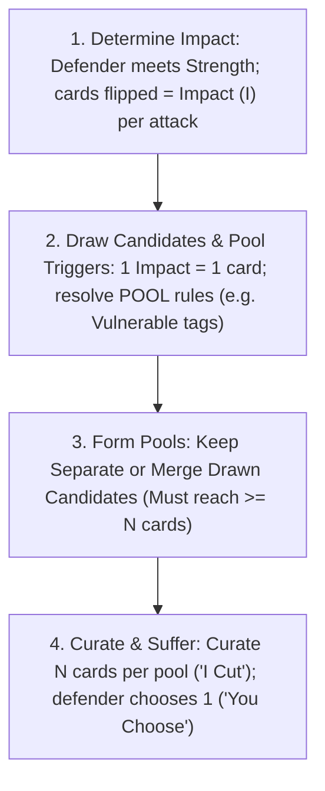

# Consequence Pool & Tag Escalation Resolution Engine

## Executive Summary & Design Overview

This directory contains the settled design proposal, play traces, equipment architecture, prototype consequence database, and authoring guidelines for replacing the legacy `Defense` and `Resilience` resolution mechanics with the **Consequence Pool & Tag Escalation Engine**.

In this new engine, resolution is reframed as an **"I Cut, You Choose" consequence drafting market**:

1. **Layered Pool Fill**: $1\text{ Impact} = 1\text{ Card Drawn}$. Cards fill tiers of width $N$ (the defender's Pool Size) from Severity 1 upward, procedurally building the pool without integer partition math.
2. **Pool Size is the Soak Multiplier**: The defender's gear and nature determine the pool threshold $N$ that attackers must reach before they can present consequences.
3. **Clean Soak Threshold ($< N$ Candidates)**: To present a Consequence Pool to a defender, the pool must reach the defender's Pool Size $N$. If an attack generates fewer candidates than $N$ ($I < N$) and is not merged, it fails to penetrate armor or poise—no consequences are suffered (an isolated attacker generating $I < N$ does not need to draw cards). Multiple attackers can merge their drawn candidates into a shared pool to reach $N$ without escalating card severity.
4. **Single-Touchpoint `POOL:` Triggers & Tag Vulnerabilities**: Escalation hooks are consolidated into a single touchpoint in Step 2 (Draw Candidates). The prototypical hook is an evergreen **`POOL: Vulnerable: [Tags]`** block (`positioning`, `limbs`, `torso`, `head`, `armor`, `exertion`, `fear`). Matching an unplaced candidate (Tier $K \le S$) to an active condition (Tier $S$) lets the attacker place that candidate onto the condition to **draw +1 additional card from Tier $K+1$**, then scoop all candidates back into the pool in Step 4 to curate $N$ cards—building an escalating **Consequence Pyramid** when $I \ge N$.

---

## 1. Directory Manifest & Key Documents

| File                                                                     | Purpose & Contents                                                                                                                                                                          |
| :----------------------------------------------------------------------- | :------------------------------------------------------------------------------------------------------------------------------------------------------------------------------------------ |
| **[proposal.md](proposal.md)**                                           | **The Core Rules Patch**: The normative replacement text for `design/rules/core-rules.md` (`## 2. Facing a Challenge`, `### Defend Actions`, and `### General Actions`).                    |
| **[keyword-glossary-patch.md](keyword-glossary-patch.md)**               | **Keyword Glossary Patch**: Updates `design/rules/keyword-glossary.md` with Pool terminology and the evergreen `Vulnerable` keyword.                                                        |
| **[players-guide-patch.md](players-guide-patch.md)**                     | **Player's Guide Patch**: Tactical strategy for consequence curation ("I Cut") and intra-tier evaluation.                                                                                   |
| **[gamemaster-guide-patch.md](gamemaster-guide-patch.md)**               | **Gamemaster's Guide Patch**: Antagonist curation tactics (brutes, swarms, combined assaults), minion batching, and General Actions calibration.                                            |
| **[guide-to-writing-consequences.md](guide-to-writing-consequences.md)** | **Authoring & Style Guide**: Standards for writing consequence cards (Continual Passives, Action vs. Task Duality, `Requires:` vs. `Cost:`, color qualifiers, ban on "damage" terminology). |
| **[consequences.yaml](consequences.yaml)**                               | **Prototype Card Database**: Prototype cards with in-combat actions, downtime tasks, tag vulnerabilities, and clinical/biomechanical notes.                                                 |
| **[equipment.yaml](equipment.yaml)**                                     | **Item & Armor Baseline**: Demonstrates how protective gear and domain traits establish Consequence Pool Size ($N$).                                                                        |

---

## 2. Core Resolution Loop Overview

> [!IMPORTANT]
> **Normative Rules Specification:** Read **[proposal.md](proposal.md)** for the exact rules text to be promoted into `design/rules/core-rules.md`. The sections below provide the visual summary, mathematical rationale, and design discussion for evaluating the proposal.

### The Single-Touchpoint `POOL:` Architecture & Table Glanceability

Rather than embedding escalation logic into a dedicated procedural phase of the core rules, caRdPG localizes all pool modifiers into a **single touchpoint in Step 2 (Draw Candidates)**, referenced on cards via a dedicated **`POOL:`** block.

#### 1. Glanceability on the Tableau

During Crisis Time, condition cards contain dense text describing in-combat actions, downtime clinical tasks, and continual passive penalties affecting the defender's turn.

By isolating pool rules into a dedicated `POOL:` block (rendered at the bottom of the card with a distinct border or color to pop visually):

- **Attacker focus:** When drawing candidates in Step 2, the attacker scans _only_ the `POOL:` area on active table cards. If no cards have a `POOL:` clause, they skip it entirely.
- **Defender focus:** `PASSIVE:` defense modifiers (e.g., _Defenses suffer +1 Impact_) affect the defense resolution and impact determination in step 1.

#### 2. Open Design Runway (Beyond Tags)

While `Vulnerable: [Tags]` is the universal baseline used by physical injuries, having a single `POOL:` hook in Step 2 cleanly hosts future mechanics without altering the core rules.

---

## 3. Character Tiers & Pool Size Architecture

An entity's **Consequence Pool Size ($N$)** defines the number of consequence slots the attacker must fill to guarantee harm. Pool size is contextual and domain-specific:

- **Armor defines Pool Size against Physical Harm:** Physical armor (gambeson, maille, full plate) increases Pool Size specifically against physical trauma and melee/ranged strikes.
- **Domain Cards & Relevant Standing:** Table cards and traits define pool sizes for non-physical spheres (e.g., a `Silver Tongue` card gives Pool Size 3 for social debate and composure defense).
- **Universal Baseline Fallback ($N = 2$):** For any challenge or situation where an entity does not have a specific armor, skill, or table card in play, their Consequence Pool Size defaults to **2**. Minions have an inherent Pool Size of **1** across all domains.

| Archetype / Armor                           | Pool Size ($N$) |          Soak Threshold (Sev 1)          | Tactical Profile                                                                |
| :------------------------------------------ | :-------------: | :--------------------------------------: | :------------------------------------------------------------------------------ |
| **Minions / Mooks**                         |      **1**      |         Instant Hit ($I \ge 1$)          | No drafting choice; single slot means every point of Impact buys harm directly. |
| **Universal Baseline / Unarmored**          |      **2**      | $I \le 1$ ($2\text{ Impact for Sev } 1$) | Base heroic drafting choice ($2 \times S$); requires active hand defense.       |
| **Light Armor (Gambeson / Boiled Leather)** |  **3 (Phys)**   | $I \le 2$ ($3\text{ Impact for Sev } 1$) | Reliable frontline baseline; soaks stray blows ($3 \times S$).                  |
| **War Armor (Maille Hauberk / Brigandine)** |  **4 (Phys)**   | $I \le 3$ ($4\text{ Impact for Sev } 1$) | Heavy battlefield protection; cushions swarms and power strikes ($4 \times S$). |
| **Full Plate Harness / Giant Monsters**     |  **5 (Phys)**   | $I \le 4$ ($5\text{ Impact for Sev } 1$) | Walking fortress; immune to diffuse hits; requires tag setup or heavy strikes.  |

### Symmetrical Minion Design

Minions have `Consequence Pool Size: 1` printed on their Nature card. When PCs attack a minion and generate 2 Impact, the attacker simply spends 2 Impact to draw 1 Severity 2 card. There is no second slot. The minion takes the card. Because minions have Pool Size 1, even moderate attacks inflict immediate, unavoidable consequences. When an attack reaches terminal severity or compounded trauma overwhelms them, they drop cleanly. This eliminates GM drafting overhead while making mook-cleaving fast and satisfying.

---

## 4. The Severity Scale & Downward Spiral Mathematics

| Tier  | Category                               | Description & Gameplay Effect                                                                                                                                                                    | Examples / Manifestation                                                                        |
| :---: | :------------------------------------- | :----------------------------------------------------------------------------------------------------------------------------------------------------------------------------------------------- | :---------------------------------------------------------------------------------------------- |
| **1** | **Tactical Impairments & Setbacks**    | Sparring band: clearable friction (Priority 1–3) to stiff action/movement locks (Priority 4–5). Real table presence; kindling for tag escalation.                                                | `Poor Footing`, `Dust in Eyes`, `Winded`, `Off Balance`, `Afraid`, `Bleeding Cut`               |
| **2** | **Moderate Trauma & Posture Collapse** | Major tactical disruption, stance loss, concussive fog, cracked ribs, or deep lacerations. Operational divergence (Platform vs Biological vs Suppressive).                                       | `Knocked Prone`, `Mild Concussion`, `Cracked Ribs`, `Deep Laceration`, `Terrified`, `Hamstrung` |
| **3** | **Severe Structural Trauma**           | Structural failure of bodily integrity, bone fractures, arterial bleeding, chest trauma, severe concussion. Orthogonal pillar collapse; zero soft options.                                       | `Broken Arm`, `Severe Concussion`, `Sucking Chest Wound`, `Arterial Hemorrhage`                 |
| **4** | **Taken Out / Incapacitated**          | Incapacitated, unconscious, dying, or completely removed from the conflict. Resolved as **actionable crisis clock / incapacitation** (never instant death; physical cards evaluated separately). | Narrative / Clock: `Unconscious`, `Pinned & Captured`, or `3-Round Mortal Bleedout Clock`       |

### Anti-Alpha Strike & Downward Spiral Mathematics

Under the $\text{Impact} = \text{Pool Size } (N) \times \text{Tier } (S)$ formula:

- **To One-Shot an Unarmored Hero ($N=2$, Tier 4)**: Attackers need $2 \times 4 = \mathbf{8\text{ Impact}}$ (~16–20 unmet Strength undefended). Fresh PCs with defensive cards in hand easily absorb or parry incoming Strength, preventing opening-turn defeats unless caught completely unprepared and undefended.
- **To One-Shot a Combatant in Light Armor ($N=3$, Tier 4)**: Attackers need $3 \times 4 = \mathbf{12\text{ Impact}}$ (~24–30 unmet Strength).
- **To One-Shot a Warrior in War Armor ($N=4$, Tier 4)**: Attackers need $4 \times 4 = \mathbf{16\text{ Impact}}$ (~35–40 unmet Strength).
- **To One-Shot a Knight in Full Plate ($N=5$, Tier 4)**: Attackers need $5 \times 4 = \mathbf{20\text{ Impact}}$ (~45–50 unmet Strength).

Combatants rarely reach Tier 4 via a single massive direct purchase. Instead, combat follows an accelerating, non-linear downward spiral driven by the **Consequence Pyramid** and **Tag Vulnerability Exploitation**:

- **Initial Foothold (Opening Exchanges)**: Attackers test defenses and search for openings. Early hits reaching $I \ge N$ inflict Tier 1 friction (`Poor Footing`, `Winded`, `Dust in Eyes`, `Off Balance`) or use merged pools to establish active `Vulnerable` tags on the table.
- **Cracking the Armor Shell**: Against heavily armored combatants ($N=4\text{–}5$), individual minor strikes generating $I < N$ fail to reach the threshold on their own—so attackers must coordinate attacks (merging drawn candidate pools to reach $\ge N$ cards) or exploit active vulnerabilities to escalate draws into higher tiers.
- **Building the Consequence Pyramid (Vertical Escalation)**: When the pool reaches $N$ cards ($I \ge N$), each bonus Tier $K+1$ card drawn from exploiting an active vulnerability allows the attacker to curate out softer lower-tier options and eventually saturate all $N$ slots with **Tier 2 platform/biological trauma** (`Knocked Prone`, `Cracked Ribs`, `Mild Concussion`) without requiring impossible single-hit Impact spikes.
- **Defensive Breakdown & Structural Trauma**: Once Tier 2 conditions are active on the table (often carrying broad `Vulnerable` lists like `Knocked Prone` compromising `positioning, limbs, torso, head`), matching Tier 2 draws are promoted directly into **Tier 3 structural trauma** (severe bodily injury like `Broken Arm`, `Sucking Chest Wound`, or `Severe Concussion`).
- **Terminal Resolution**: Matching a Tier 3 draw against an active Tier 3 condition's `Vulnerable` tags draws a **Tier 4 (Taken Out)** candidate.

### The Tapering Funnel & Meaningful Escalation

Dynamic range within consequence decks does not repeat uniformly across tiers; it **progressively narrows** as severity ascends:

1. **Tier 1 (The Sparring Band - Wide Dynamic Range):**
   - _Dynamic Range:_ Spans from clearable friction (Priority 1–3, e.g. `Poor Footing`, `Winded`) to stiff tactical locks (Priority 4–5, e.g. `Off Balance`, `Afraid`, `Strained Offense`).
   - _Opening Maneuvers:_ Tier 1 models early tactical sparring where combatants can react, steady themselves, or clear footing before severe structural harm occurs.
2. **Tier 2 (Operational Divergence - Platform vs. Biological):**
   - _Operational Divergence:_ Cards split between **Platform conditions** (`Knocked Prone`, severe immediate tactical vulnerability with in-combat recovery actions), **Biological trauma** (`Cracked Ribs`, `Mild Concussion`, persistent ongoing taxes that cannot be cured mid-combat), and **Suppressive trauma** (`Deep Laceration`, requiring direct card commitment). There are zero "soft outs."
3. **Tier 3 (Orthogonal Pillar Collapse - Zero Soft Options):**
   - Every Tier 3 card is an existential collapse of one foundational capability:
     - **Offense:** `Broken Arm` (drops weapons, blocks 2-handed weapons/shields, $+2$ Fatigue on Red).
     - **Respiration & Stamina:** `Sucking Chest Wound` (severe thoracic trauma, collapses tidal volume and caps hand size).
     - **Planning & Hand:** `Severe Concussion` (hand size hard-capped at 3, blocks Blue actions).
     - **Life Clock:** `Arterial Hemorrhage` (life-threatening vascular trauma and acute bleedout clock).
   - Drafting is a tragic triage: _"Which pillar of my character can I afford to lose to survive this round?"_
4. **Meaningful Escalation:** Every consequence tangibly alters the tactical situation, restricts options, or ratchets immediate danger rather than absorbing hits as passive padding.

---

## 5. General Actions Adaptation (Non-Crisis Resolution)

General Actions resolve using the exact same core engine and Vigilance mechanics from [core-rules.md](../../rules/core-rules.md):

1. The GM declares the challenge's **Color** and **Strength** (e.g. Blue 10 to pick a complex lock; Yellow 25 to leap a chasm).
2. **Commit Vigilance (Optional):** Per [core-rules.md](../../rules/core-rules.md), the player may resolve the task using deck flips alone, or pick up their **[[Vigilance]]** pool to either play an applicable reactive/mitigation Action Stack (e.g., a skill or tool modifier) or substitute high-value cards from hand directly into the flipped stack (counting as flips toward Impact, then flushing remaining hand cards afterward).
3. **Meet Strength & Count Impact:** The player flips cards (and/or inserts committed Vigilance cards) into their **flipped stack** to meet the Strength. The number of cards in the flipped stack equals the **Impact**.
4. The GM spends the Impact to build a Consequence Pool of the player's domain Pool Size (fallback 2, or modified by relevant skills/tools).
5. If Impact is at least $N$, the player drafts 1 consequence from the curated $N$-card pool.

### Sub-Threshold Flips and Clean Success ("Saying Yes")

When a player meets the required Strength with a single card flip ($\text{Impact} = 1$), against the baseline Pool Size ($N = 2$), Impact is less than Pool Size ($I < N$):

- **No cards are drawn.** The player succeeds cleanly with zero complications beyond the single card expended from their deck.
- Complications emerge when tasks demand genuine strain or opposition ($\text{Impact} \ge N$).

---

## 6. Multi-Attacker Combat & Swarm Scaling

When multiple attackers target the same defender during Crisis Time, resolution remains completely simultaneous and order-independent through **Per-Attack Draw & Optional Pool Merging**:

1. **Per-Attack Impact & Candidate Draws**:
   - The defender meets each incoming attack's `Strength` individually; the cards flipped for an attack equal that attack's **Impact ($I$)**.
   - Each attacker independently converts their own attack's Impact into candidate cards by filling tiers of width $N$ (the defender's Pool Size) from the bottom up. Because individual minion hits usually generate $I \le N$, each minion natively draws **Tier 1** cards from the Severity 1 consequence deck without cross-deck ordering issues. Severity is strictly determined per attack, never by combining Impact across attacks.
2. **Form Pools (Separate vs. Merged Tactical Choice)**:
   - **Separate Pools vs. Low-$N$ Targets:** Against an unarmored skirmisher ($N=2$), four goblins generating 2 Impact each draw 2 Tier 1 cards apiece. Because each goblin already fills an $N=2$ pool (`[Sev 1, Sev 1]`), they keep their 4 pools separate—forcing the skirmisher to suffer **4 Tier 1 consequences simultaneously** (burying them in tactical friction and exposing `Vulnerable` tags for Round 2 without one-shotting them on Round 1).
   - **Merged Pools vs. Heavy Armor ($N=4\text{–}5$):** Against a knight in Full Plate ($N=5$), three goblins generating `1, 2, 2` Impact would each fail to meet the pool threshold ($I < N$) on their own. Each goblin draws Tier 1 cards for their attack, and by **merging their drawn candidates into a single shared pool** ($1 + 2 + 2 = 5\text{ cards}$), they reach the $N=5$ threshold to present a full 5-card pool and force the knight to suffer **1 Tier 1 consequence**. Crucially, merging pools combines drawn cards; it **never increases the severity tier** of the drawn cards.
3. **Simultaneous Vulnerability Exploitation ("Place to Draw, Scoop to Curate")**:
   - Each Consequence Pool may exploit active conditions that were on the defender **at the start of the round** via printed `POOL:` triggers in Step 2 (at most 1 placed candidate per active condition **per pool**) to draw $+1$ candidate from Tier $K+1$.
   - Because placed candidates are scooped back into their pool before Step 4 curation, separate pools resolving in parallel never collide physically on the defender's tableau or compete over the defender's active conditions.
   - Consequences inflicted during the round enter play simultaneously at the end of the round, preventing same-round chain-promotion kills.
4. **Deck Attrition as Mob Danger**: Beyond condition drafting, defending against a swarm forces multiple flips in rapid succession, draining the defender's 24-card deck and accelerating Fatigue Cycles toward Defensive Collapse.

---

## 7. Evaluation Against Design Precepts

| Design Precept                   | Alignment in Proposed System                                                                                                                                                                     |
| :------------------------------- | :----------------------------------------------------------------------------------------------------------------------------------------------------------------------------------------------- |
| **Default to Success at a Cost** | **Perfect alignment**. Tasks and attacks land; resolution determines the exact tactical cost chosen by the defender.                                                                             |
| **Mechanical Elegance**          | **High**. Removes two abstract character sheet stats (`Defense` and `Resilience`). Replaces division math with physical card drafting.                                                           |
| **Ludonarrative Harmony**        | **Contextual & Thematic**. Wounds compound contextually via tags rather than through an arbitrary global counter. Armored fighters absorb diffuse blows; targeted tags cause realistic collapse. |
| **Player Agency**                | **Very High**. Both attacker (allocating impact and hunting tag synergies) and defender (choosing the manageable penalty) make active, high-stakes decisions every turn.                         |

### Architectural Strengths & Known Friction Points

#### Why `1 Impact = 1 Card` Pulls Multi-Duty Weight

In this proposal, drawing 1 candidate card per point of Impact into tiers of width $N$ functions as a **physical analog state computer** that solves five problems with a single primitive:

1. **Clean Soak Threshold:** Attacks generating $I < N$ fail to fill a pool, bouncing off without subtraction math.
2. **Multiplicative Top-End Scaling (The 2 / 8 / 12 Curve):** Tier thresholds scale proportionally ($N, 2N, 3N, 4N$), allowing `Impact 8` to drop a fragile minion ($N=1\text{–}2$) while a knight in plate ($N=5$) survives `Impact 12` from fresh.
3. **Continuous Intra-Tier Leverage:** Surplus Impact ($I = N+1 \dots 2N-1$) is never wasted remainder; every extra card gives the attacker sharper curation (`"I Cut"`) and more opportunities to match active vulnerability tags.
4. **Safe Swarm Merging:** Multiple attackers can merge sub-threshold Tier 1 draws into a shared pool to reach $N$ against heavy armor without promoting those cards to lethal higher tiers.
5. **Variance Dampening:** Defender choice (`"You Choose"` 1 of $N$) absorbs early RNG spikes, while Attacker curation (`"I Cut"` down to $N$) prevents late-combat tag starvation.

#### Known Friction Points (Targets for Further Iteration or Alternative Primitives)

1. **Resolution Ceremony & Step Count:** The core procedure in `core-rules.md` is still a bit of an increase from the legacy system with 4 stages and two decision points.
2. **Hard Initial Shell on Heavy Armor ($I < N$):** Against high Pool Size ($N=4\text{–}5$), an isolated attack generating $I < N$ bounces off completely (`0 cards drawn`) unless merged with allies or bypassed via specialized card text (`Pierce`), offering no native incremental foothold on its own.
3. **High-Impact Card Draw Volume:** Heavy hits against armored targets ($I=6\text{–}10$) require drawing, inspecting, curating, and returning a relatively large number of physical cards across multiple severity decks.

---

## 8. Suggested Next Steps for Promotion

1. **Core Rules Integration**:
   - Promote [proposal.md](proposal.md) into `design/rules/core-rules.md` (updating `## 2. Facing a Challenge`, `### Defend Actions`, and `### General Actions`).
   - Apply [players-guide-patch.md](players-guide-patch.md) and [gamemaster-guide-patch.md](gamemaster-guide-patch.md) to `design/rules/players-guide.md` and `design/rules/gamemaster-guide.md`.
2. **Consequence & Equipment YAML Schema Upgrade**:
   - Update [consequences.yaml](consequences.yaml) and `data/cards/consequences/*.yaml` to use `vulnerable: [Tags]` and `priority:` ratings per [guide-to-writing-consequences.md](guide-to-writing-consequences.md).
   - Audit [equipment.yaml](equipment.yaml), `data/cards/pc/*.yaml`, and `data/cards/monsters/*.yaml` to align armor Pool Size ($N$) with the new engine.
3. **Expanding Domain Consequence Decks**:
   - Author specialized domain consequence decks for _Exploration & Environmental Trauma_, _Social & Relational Fallout_, and _Arcane & Alchemical Backdrafts_.
