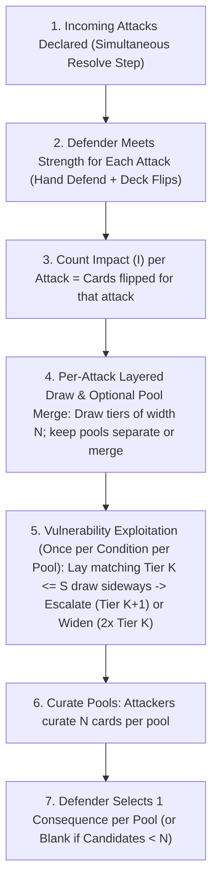

# Consequence Pool & Tag Escalation Resolution Engine

## Executive Summary & Design Overview

This directory contains the settled design proposal, play traces, equipment architecture, prototype consequence database, and authoring guidelines for replacing the legacy `Defense` and `Resilience` resolution mechanics with the **Consequence Pool & Tag Escalation Engine**.

In this new engine, resolution is reframed as an **"I Cut, You Choose" consequence drafting market**:

1. **Layered Pool Fill**: $1\text{ Impact} = 1\text{ Card Drawn}$. Cards fill tiers of width $N$ (the defender's Pool Size) from Severity 1 upward, procedurally building the pool without integer partition math.
2. **Pool Size is the Soak Multiplier**: The defender's gear and nature determine the row width $N$ that attackers must saturate before breaking into higher severity tiers.
3. **Implicit Blanks ("No Consequence")**: Unfilled Tier 1 slots ($I < N$) become "No Consequence", creating an emergent armor soak threshold without requiring abstract divisor stats.
4. **Tag Vulnerability Exploitation (Escalate or Widen) Replaces Global Resilience**: Active conditions expose specific **`Vulnerable: [Tags]`** (`positioning`, `limbs`, `torso`, `head`, `armor`, `exertion`, `fear`). Matching a drawn candidate to an active vulnerability allows the attacker to lay that card sideways over the active condition and choose either to **Escalate** (draw 1 replacement from Tier $K+1$) or **Widen** (draw 2 replacements from Tier $K$, adding +1 net candidate to consume blank soak slots)—building an escalating **Consequence Pyramid** and systematically cracking heavy armor shells.

---

## 1. Directory Manifest & Key Documents

| File                                                                           | Purpose & Contents                                                                                                                                                                                    |
| :----------------------------------------------------------------------------- | :---------------------------------------------------------------------------------------------------------------------------------------------------------------------------------------------------- |
| **[proposal.md](proposal.md)**                                                 | **The Core Rules Patch**: The concise, focused replacement text for `## Defend Actions` in `core-rules.md`.                                                                                           |
| **[players-guide-patch.md](players-guide-patch.md)**                           | **Player's Guide Patch**: Tactical strategy for consequence curation ("I Cut") and intra-tier evaluation.                                                                                             |
| **[gamemaster-guide-patch.md](gamemaster-guide-patch.md)**                     | **Gamemaster's Guide Patch**: Antagonist curation tactics (brutes, swarms, combined assaults), minion batching, and General Actions calibration.                                                      |
| **[guide-to-writing-consequences.md](guide-to-writing-consequences.md)**       | **Authoring & Style Guide**: Standards for writing consequence cards (Continual Passives, Action vs. Task Duality, `Requires:` vs. `Cost:`, color qualifiers, ban on "damage" terminology).           |
| **[consequences.yaml](consequences.yaml)**                                     | **Prototype Card Database**: Fully drafted cards across Severities 1–3 (plus Tier 4 exit states) with rules, in-combat actions, downtime tasks, escalation clauses, and clinical/biomechanical notes. |
| **[equipment.yaml](equipment.yaml)**                                           | **Item & Armor Architecture**: Two-sided armor models (`Intact` vs. `Damaged`), 1–5 Pool Size spectrum, and stepped Pierce mechanics.                                                                 |
| **[critique-and-brainstorming-seeds.md](critique-and-brainstorming-seeds.md)** | **Active Critiques & Brainstorming Seeds**: Tabletop ergonomics, tag dilution, and candidate consolidation seeds.                                                                                     |

---

## 2. Core Resolution Engine (Crisis Time)

### Step 1: Meet Strength & Count Impact

1. **Reactive "Defend" Actions (Optional)**: For each incoming attack, the defender may play an applicable **Defend** card from hand as an [[Action Stack]] (paying its printed [[Cost]] in additional hand cards). The card's printed rules text defines how it modifies the resolution.
2. **Flip from Deck**: If the attack's Strength is not yet met, flip cards from the top of the deck one by one into a **flipped stack** until the cumulative value in the attack's Color meets or exceeds the attack's Strength.
3. **Count Impact**: The number of cards flipped for an attack is that attack's **Impact ($I$)**.

### Step 2: Draw Candidate Consequences & Form Pools

Each attacker independently converts their attack's Impact ($I$) into candidate cards by filling tiers of width $N$ (the defender's Pool Size) from the bottom up, with **1 Impact = 1 card drawn**:

1. **Tier 1 (Severity 1)**: The first $N$ Impact draws up to $N$ cards from the **Severity 1** deck.
   - If an attack's Impact is less than $N$, remaining unfilled slots are implicit **"No Consequence" blanks** (clean armor soak) unless filled by merging pools or widening during Step 3.
2. **Tier 2 (Severity 2)**: Once Tier 1 has $N$ cards, each additional point of Impact (from $N+1$ to $2N$) draws 1 card from the **Severity 2** deck.
3. **Tier 3 (Severity 3)**: Once Tier 2 has $N$ cards, each additional point of Impact (from $2N+1$ to $3N$) draws 1 card from the **Severity 3** deck.
4. **Tier 4 (Taken Out)**: Once Tier 3 has $N$ cards, each additional point of Impact (from $3N+1$ to $4N$) allocates one **Severity 4 (Taken Out)** candidate.

**Separate or Merged Pools:**

- Each attacker may keep their drawn candidates as an independent Consequence Pool (allowing multiple attacks that each reach $\ge N$ cards to inflict multiple consequences simultaneously), **or** multiple attackers targeting the same defender this round may **merge their drawn candidate cards into a shared pool** before Step 3 (allowing smaller hits to fill $N$ slots together and eliminate blanks).

### Step 3: Exploit Active Vulnerabilities (Escalate vs. Widen)

Active conditions in play in front of the defender at the start of the round list **`Vulnerable: [Tags]`**—specific openings created by that condition.

Within each Consequence Pool (after any pool merging), attackers evaluate that pool's candidates against the defender's start-of-round active conditions to either escalate severity or expand pool volume:

1. **Matching:** An active condition of **Severity $S$** can exploit any drawn candidate in the pool of **Severity $K \le S$** that matches one of its `Vulnerable` tags.
2. **Tactile Exploitation (Escalate or Widen):** The attacker places the matching Tier $K$ candidate sideways and chooses one:
   - **Escalate (Vertical):** Draw **1 replacement card from the Severity $K+1$ deck** (or allocate a Tier 4 Taken Out candidate when promoting a Tier 3 card via an active Tier 3 condition). Use this once the pool has enough cards to fill $N$, driving toward platform ceilings, broken limbs, and incapacitation.
   - **Widen (Horizontal):** Draw **2 replacement cards from the Severity $K$ deck** (adding +1 net candidate to the pool). Use this to crack heavy armor shells by converting implicit "No Consequence" blank slots into active consequences when $I < N$, or to expand curation choices within the tier.
3. **Limit (Once per Pool):** Each active condition on the defender can be exploited at most **once per Consequence Pool** (holding at most 1 sideways card per pool). Separate pools resolving in parallel may each independently exploit the defender's start-of-round active conditions once.
4. **Chained Exploitation:** Within a pool, a newly drawn replacement card may be exploited again only if the defender has another unspent active condition (not yet exploited by that pool) of its tier with a matching `Vulnerable` tag.

### Step 4: Curate Consequence Pools (The "I Cut" Step)

For each Consequence Pool, from the active candidates remaining after promotions and widening, attackers **choose any $N$ cards** to form the final curated pool:

- **Check Pool Size ($N$)**: The defender's traits and equipped gear set the Consequence Pool Size ($N$) (typically 1 for minions, 2 for unarmored heroes, 3 for gambeson/leather, 4 for maille/brigandine, 5 for full plate; see Section 3 for full breakdown).
- **The Consequence Pyramid:** Promoted higher-tier cards fill slots in the pool, squeezing out soft Tier 1 options first and, as active conditions accumulate, eventually saturating all $N$ slots with Tier 2 or Tier 3 traumas even against heavy armor ($N=4\text{–}5$).
- **The Bottleneck Slot:** When higher tiers are partially filled, attackers use surplus lower-tier draws to place the sharpest tactical lock or vulnerability-enabler into the remaining lower-tier slot.
- **Implicit Blanks:** In any presented pool where total active candidates (base draws plus net cards gained from merging and widening) are less than $N$, unfilled slots are presented as "No Consequence" blanks. If candidates in a pool meet or exceed $N$, all $N$ slots are filled with consequence cards (zero blanks).

### Step 5: Defender Suffers Consequences (The "You Choose" Step)

1. Each curated pool of $N$ cards (and any "No Consequence" blanks) is presented to the defender.
2. For each presented pool, the defender **chooses exactly 1 consequence** to suffer.
3. If "No Consequence" is in a pool, the defender may select it to suffer no additional harm from that pool beyond the stamina/fatigue cards already flipped.
4. **Applying Consequences (Simultaneous):**
   - All consequences suffered during the round enter play simultaneously at the end of the round (they cannot be exploited for Step 3 vulnerability promotions during the same round they are inflicted).
   - **Direct Placement:** Place each chosen card directly into play in front of the defender. If the card's text specifies that it replaces a weaker state on the same posture/mental track (e.g., `Knocked Prone` discarding `Poor Footing` or `Off Balance`), discard the superseded card.
   - **Tier 4 (Taken Out / Crisis Clock):** If the defender selects a Severity 4 candidate, the character is functionally out of the fight (never instant death). The attacker or narrative context defines an actionable exit state or rescue clock (e.g., knocked `Unconscious`, `Pinned & Captured`, or placed on an emergency `3-Round Mortal Bleedout Clock` that allies must stabilize).
5. **Clean Up:** All unchosen cards in the pools and all cards placed sideways on active conditions during Step 3 are returned to their respective decks.

---

## 3. Character Tiers & Pool Size Architecture

An entity's **Consequence Pool Size ($N$)** defines the number of consequence slots the attacker must fill to guarantee harm. Pool size is contextual and domain-specific:

- **Armor defines Pool Size against Physical Harm:** Physical armor (gambeson, maille, full plate) increases Pool Size specifically against physical trauma and melee/ranged strikes.
- **Domain Cards & Relevant Standing:** Table cards and traits define pool sizes for non-physical spheres (e.g., a `Silver Tongue` card gives Pool Size 3 for social debate and composure defense).
- **Universal Baseline Fallback ($N = 2$):** For any challenge or situation where an entity does not have a specific armor, skill, or table card in play, their Consequence Pool Size defaults to **2**. Minions have an inherent Pool Size of **1** across all domains.

| Archetype / Armor                           | Pool Size ($N$) |          Soak Threshold (Sev 1)          | Pierce Interactions                                          | Tactical Profile                                                                |
| :------------------------------------------ | :-------------: | :--------------------------------------: | :----------------------------------------------------------- | :------------------------------------------------------------------------------ |
| **Minions / Mooks**                         |      **1**      |         Instant Hit ($I \ge 1$)          | N/A                                                          | No drafting choice; single slot means every point of Impact buys harm directly. |
| **Universal Baseline / Unarmored**          |      **2**      | $I \le 1$ ($2\text{ Impact for Sev } 1$) | N/A                                                          | Base heroic drafting choice ($2 \times S$); requires active hand defense.       |
| **Light Armor (Gambeson / Boiled Leather)** |  **3 (Phys)**   | $I \le 2$ ($3\text{ Impact for Sev } 1$) | Pierce 4 reduces to 2                                        | Reliable frontline baseline; soaks stray blows ($3 \times S$).                  |
| **War Armor (Maille Hauberk / Brigandine)** |  **4 (Phys)**   | $I \le 3$ ($4\text{ Impact for Sev } 1$) | Pierce 4 reduces to 3; Pierce 8 reduces to 2                 | Heavy battlefield protection; cushions swarms and power strikes ($4 \times S$). |
| **Full Plate Harness / Giant Monsters**     |  **5 (Phys)**   | $I \le 4$ ($5\text{ Impact for Sev } 1$) | Pierce 4 reduces to 4; Pierce 8 reduces to 3; Pierce 12 to 2 | Walking fortress; immune to diffuse hits; requires tag setup or armor-piercing. |

### Symmetrical Minion Design

Minions have `Consequence Pool Size: 1` printed on their Nature card. When PCs attack a minion and generate 2 Impact, the attacker simply spends 2 Impact to draw 1 Severity 2 card. There is no second slot. The minion takes the card. Because minions have no blank slots to dilute incoming harm, even moderate attacks inflict immediate, unavoidable consequences. When an attack reaches terminal severity or compounded trauma overwhelms them, they drop cleanly. This eliminates GM drafting overhead while making mook-cleaving fast and satisfying.

---

## 4. The Severity Scale & Downward Spiral Mathematics

| Tier  | Category                                | Description & Gameplay Effect                                                                                                                                                                    | Examples / Manifestation                                                                           |
| :---: | :-------------------------------------- | :----------------------------------------------------------------------------------------------------------------------------------------------------------------------------------------------- | :------------------------------------------------------------------------------------------------- |
| **1** | **Tactical Impairments & Setbacks**     | Sparring band: clearable friction (Priority 1–3) to stiff action/movement locks (Priority 4–5). Real table presence; kindling for tag escalation.                                                | `Poor Footing`, `Dust in Eyes`, `Winded`, `Off Balance`, `Afraid`, `Rattled Guard`, `Bleeding Cut` |
| **2** | **Platform Ceilings & Moderate Trauma** | Major tactical disruption, stance loss, concussive fog, cracked ribs, or deep lacerations. Operational divergence (Platform vs Biological vs Suppressive).                                       | `Knocked Prone`, `Mild Concussion`, `Cracked Ribs`, `Deep Laceration`, `Terrified`, `Hamstrung`    |
| **3** | **Severe Structural Trauma**            | Structural failure of defense, bone fractures, arterial bleeding, sundered plate, severe trauma. Orthogonal pillar collapse; zero soft options.                                                  | `Broken Arm`, `Severe Concussion`, `Sundered Armor`, `Arterial Hemorrhage`                         |
| **4** | **Taken Out / Incapacitated**           | Incapacitated, unconscious, dying, or completely removed from the conflict. Resolved as **actionable crisis clock / incapacitation** (never instant death; physical cards evaluated separately). | Narrative / Clock: `Unconscious`, `Pinned & Captured`, or `3-Round Mortal Bleedout Clock`          |

### Anti-Alpha Strike & Downward Spiral Mathematics

Under the $\text{Impact} = \text{Pool Size } (N) \times \text{Tier } (S)$ formula:

- **To One-Shot an Unarmored Hero ($N=2$, Tier 4)**: Attackers need $2 \times 4 = \mathbf{8\text{ Impact}}$ (~16–20 unmet Strength undefended). Fresh PCs with defensive cards in hand easily absorb or parry incoming Strength, preventing opening-turn defeats unless caught completely unprepared and undefended.
- **To One-Shot a Combatant in Light Armor ($N=3$, Tier 4)**: Attackers need $3 \times 4 = \mathbf{12\text{ Impact}}$ (~24–30 unmet Strength).
- **To One-Shot a Warrior in War Armor ($N=4$, Tier 4)**: Attackers need $4 \times 4 = \mathbf{16\text{ Impact}}$ (~35–40 unmet Strength).
- **To One-Shot a Knight in Full Plate ($N=5$, Tier 4)**: Attackers need $5 \times 4 = \mathbf{20\text{ Impact}}$ (~45–50 unmet Strength).

Combatants rarely reach Tier 4 via a single massive direct purchase. Instead, combat follows an accelerating, non-linear downward spiral driven by the **Consequence Pyramid** and **Tag Vulnerability Exploitation (Escalate vs. Widen)**:

- **Initial Foothold (Opening Exchanges)**: Attackers test defenses and search for openings. Early hits inflict Tier 1 friction (`Poor Footing`, `Winded`, `Dust in Eyes`, `Rattled Guard`) or exploit an unarmored defender's smaller pool size ($N=2$) to establish active `Vulnerable` tags on the table.
- **Cracking the Armor Shell via Widening ($I < N$)**: Against heavily armored combatants ($N=4\text{–}5$), moderate strikes generating $I < N$ would normally leave "No Consequence" blanks. However, matching drawn Tier 1 candidates against the defender's active `Vulnerable` tags allows attackers to **Widen** (laying the card sideways to draw 2 replacement cards at the same tier). This adds +1 net candidate to the pool, consuming the blank soak slots and ensuring that even a 3- or 4-Impact strike penetrates a knight's heavy harness once their posture or guard is compromised.
- **Building the Consequence Pyramid (Vertical Escalation)**: Once the candidate pool has enough cards to fill all $N$ slots, attackers switch to **Escalate** (laying matching candidates sideways to draw from Tier $K+1$). Promoted higher-tier cards consume safe slots—forcing the defender into harsher Tier 1 locks—and as active conditions accumulate, saturate the pool to guarantee **Tier 2 platform/biological trauma** (`Knocked Prone`, `Cracked Ribs`, `Mild Concussion`) without requiring impossible single-hit Impact spikes.
- **Defensive Breakdown & Structural Trauma**: Once Tier 2 conditions are active on the table (often carrying broad `Vulnerable` lists like `Knocked Prone` compromising `positioning, limbs, torso, head, armor`), matching Tier 2 draws are promoted directly into **Tier 3 structural trauma** (`Sundered Armor` flipping armor to Damaged and shrinking $N$, or severe bodily injury like `Broken Arm` or `Severe Concussion`).
- **Terminal Resolution**: Matching a Tier 3 draw against an active Tier 3 condition's `Vulnerable` tags promotes the candidate to **Tier 4 (Taken Out)**.

### The Tapering Funnel & Meaningful Escalation

Dynamic range within consequence decks does not repeat uniformly across tiers; it **progressively narrows** as severity ascends:

1. **Tier 1 (The Sparring Band - Wide Dynamic Range):**
   - _Dynamic Range:_ Spans from clearable friction (Priority 1–3, e.g. `Poor Footing`, `Winded`) to stiff tactical locks (Priority 4–5, e.g. `Off Balance`, `Afraid`, `Rattled Guard`).
   - _Opening Maneuvers:_ Tier 1 models early tactical sparring where combatants can react, steady themselves, or clear footing before severe structural harm occurs.
2. **Tier 2 (Operational Divergence - Platform vs. Biological):**
   - _Operational Divergence:_ Cards split between **Platform conditions** (`Knocked Prone`, severe immediate tactical vulnerability with in-combat recovery actions), **Biological trauma** (`Cracked Ribs`, `Mild Concussion`, persistent ongoing taxes that cannot be cured mid-combat), and **Suppressive trauma** (`Deep Laceration`, requiring direct card commitment). There are zero "soft outs."
3. **Tier 3 (Orthogonal Pillar Collapse - Zero Soft Options):**
   - Every Tier 3 card is an existential collapse of one foundational capability:
     - **Offense:** `Broken Arm` (drops weapons, blocks 2-handed weapons/shields, $+2$ Fatigue on Red).
     - **Defense:** `Sundered Armor` (flips armor to Damaged, permanently shrinking Pool Size $N$).
     - **Planning & Hand:** `Severe Concussion` (hand size hard-capped at 3, blocks Blue actions).
     - **Life Clock:** `Arterial Hemorrhage` (life-threatening vascular trauma and acute bleedout clock).
   - Drafting is a tragic triage: _"Which pillar of my character can I afford to lose to survive this round?"_
4. **Meaningful Escalation:** Every consequence tangibly alters the tactical situation, restricts options, or ratchets immediate danger rather than absorbing hits as passive padding.

---

## 5. General Actions Adaptation (Non-Crisis Resolution)

General Actions resolve using the exact same core engine and Vigilance mechanics from [core-rules.md](../../rules/core-rules.md):

1. The GM declares the challenge's **Color** and **Strength** (e.g. Blue 10 to pick a complex lock; Yellow 25 to leap a chasm).
2. **Commit Vigilance (Optional):** Per [core-rules.md](../../rules/core-rules.md), the player may resolve the task using deck flips alone, or pick up their **[[Vigilance]]** pool to either play an applicable reactive/mitigation Action Stack (e.g., a skill or tool modifier) or substitute high-value cards from hand directly into the flipped stack (counting as flips toward Impact, then flushing remaining hand cards afterward).
3. **Meet Strength & Count Impact:** The player flips cards (and/or inserts committed Vigilance cards) into their **flipped stack** to meet the Strength. The number of cards in the flipped stack equals the **Impact**.
4. The GM spends the Impact to build a Consequence Pool of the player's domain Pool Size (fallback 2, or modified by relevant skills/tools).
5. The player drafts 1 consequence (or "No Consequence" if an empty slot remains).

### Single-Card Flips and Clean Success ("Saying Yes")

When a player meets the required Strength with a **single card flip** ($\text{Impact} = 1$):

- The GM draws 1 candidate card from the appropriate domain Severity 1 deck.
- Against the baseline Pool Size ($N = 2$), the second slot is an **implicit "No Consequence" blank**.
- The player selects "No Consequence," succeeding cleanly with zero complications beyond the single card expended from their deck.

A single-card flip ($\text{Impact} = 1$) represents routine effort, allowing the player to select the blank slot and succeed without complications. Complications emerge when tasks demand genuine strain or opposition ($\text{Impact} \ge N$).

## 6. Multi-Attacker Combat & Swarm Scaling

When multiple attackers target the same defender during Crisis Time, resolution remains completely simultaneous and order-independent through **Per-Attack Draw & Optional Pool Merging**:

1. **Per-Attack Impact & Candidate Draws**:
   - The defender meets each incoming attack's `Strength` individually; the cards flipped for an attack equal that attack's **Impact ($I$)**.
   - Each attacker independently converts their own attack's Impact into candidate cards by filling tiers of width $N$ (the defender's Pool Size) from the bottom up. Because individual minion hits usually generate $I \le N$, each minion natively draws **Tier 1** cards.
2. **Simultaneous Vulnerability Exploitation (Once per Condition per Pool)**:
   - After attackers decide whether to keep their drawn candidate pools separate or merge them, each Consequence Pool may exploit active conditions that were on the defender **at the start of the round** (at most 1 sideways card per active condition **per pool**) to **Widen** or **Escalate**.
   - Separate pools resolving in parallel never compete over the defender's active conditions (each pool gets to exploit each active condition once), while a merged pool exploits each active condition once as a single combined pool.
   - Consequences inflicted during the round enter play simultaneously at the end of the round, preventing same-round chain-promotion kills.
3. **Separate vs. Merged Pools (Tactical Choice)**:
   - **Separate Pools vs. Low-$N$ Targets:** Against an unarmored skirmisher ($N=2$), four goblins generating 2 Impact each draw 2 Tier 1 cards apiece. Because each goblin already fills an $N=2$ pool (`[Sev 1, Sev 1]`), they keep their 4 pools separate—forcing the skirmisher to suffer **4 Tier 1 consequences simultaneously** (burying them in tactical friction and exposing `Vulnerable` tags for Round 2 without one-shotting them on Round 1).
   - **Merged Pools vs. Heavy Armor ($N=4\text{–}5$):** Against a knight in Full Plate ($N=5$), three goblins generating `1, 2, 2` Impact would each leave "No Consequence" blanks on their own. By **merging their drawn candidate cards into a single shared pool**, their 5 Tier 1 cards fill all 5 slots (`[Sev 1 x 5]`, zero blanks), forcing the knight to suffer **1 Tier 1 consequence**.
4. **Deck Attrition as Mob Danger**: Beyond condition drafting, defending against a swarm forces multiple flips in rapid succession, draining the defender's 24-card deck and accelerating Fatigue Cycles toward Defensive Collapse.
5. **Optional Rules Module — Surplus Crush (2-for-1 Merge Escalation)**:
   - For tables that want large swarms or coordinated party strikes to be able to push directly into higher severity tiers on Round 1 against a fresh target: when multiple attackers merge their candidate cards into a shared pool, once a severity tier contains $N$ cards, the attackers may return **2 surplus candidate cards** of that tier to draw **1 card from the next higher severity tier ($K+1$)**.

---

## 7. Evaluation Against Design Precepts

| Design Precept                   | Alignment in Proposed System                                                                                                                                                                     |
| :------------------------------- | :----------------------------------------------------------------------------------------------------------------------------------------------------------------------------------------------- |
| **Default to Success at a Cost** | **Perfect alignment**. Tasks and attacks land; resolution determines the exact tactical cost chosen by the defender.                                                                             |
| **Mechanical Elegance**          | **High**. Removes two abstract character sheet stats (`Defense` and `Resilience`). Replaces division math with physical card drafting.                                                           |
| **Ludonarrative Harmony**        | **Contextual & Thematic**. Wounds compound contextually via tags rather than through an arbitrary global counter. Armored fighters absorb diffuse blows; targeted tags cause realistic collapse. |
| **Player Agency**                | **Very High**. Both attacker (allocating impact and hunting tag synergies) and defender (choosing the manageable penalty) make active, high-stakes decisions every turn.                         |

---

## 8. Suggested Next Steps for Future Threads

### Next Action Priorities

1. **Core Rules Integration**:
   - Draft the formal replacement section for `design/rules/core-rules.md` (replacing `## Defend Actions` using [proposal.md](proposal.md)).
   - Update `design/rules/players-guide.md` and `design/rules/gamemaster-guide.md` to reflect Consequence Pool drafting.
2. **Expanding Domain Consequence Decks**:
   - Author specialized decks following [guide-to-writing-consequences.md](guide-to-writing-consequences.md) and the Organic Asymmetry Standard for:
     - _Exploration & Environmental Trauma_ (`Cold`, `Heat`, `Dehydration`, `Trench Foot`).
     - _Social & Relational Fallout_ (`Status`, `Ostracized`, `Exposed Lie`, `Blackmail`).
     - _Arcane & Alchemical Backdrafts_ (`Mana Burn`, `Crystallization`, `Planar Distortion`).
3. **PC & Monster Deck Audits**:
   - Audit `data/cards/pc/*.yaml` and `data/cards/monsters/*.yaml` to ensure passive traits and Pierce keywords align with the new armor pool mechanics.
