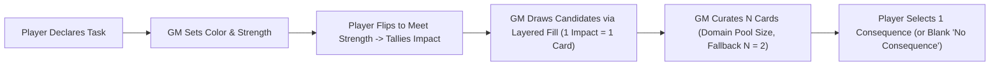

# Gamemaster's Guide Patch: Running the Consequence Engine

Patch and companion guide for `design/rules/gamemaster-guide.md`, integrating the **Consequence Pool & Tag Escalation Engine**.

---

## 1. The Gamemaster's Role in Consequence Drafting

Under the Consequence Pool engine, the GM exercises narrative direction and tactical adjudication through the tactile mechanics of card drafting:

1. **Curating for Antagonists ("I Cut")**: When monsters and NPCs attack player characters, the GM spends each attacker's generated Impact, builds a candidate hand, and curates an $N$-card pool to present to the player.
2. **Suffering for Bosses ("You Choose")**: When players strike an elite antagonist or boss, the GM evaluates the players' curated pool and chooses the consequence that makes the most narrative and tactical sense for the creature.
3. **Adjudicating General Actions**: In exploration and downtime challenges, the GM spends the player's flipped cards (Impact) to curate the collateral costs of success.

---

## 2. Antagonist Tactical Profiles: How Monsters "Cut"

Under Layered Pool Fill, monster types naturally produce different threat profiles without requiring GM math:

### The Brute / Heavy Hitter (e.g., Ogre, Troll, Giant)

- **High Impact**: A single heavy blow generates 3–5 Impact.
- **Natural Penetration**: Against unarmored targets ($N \le 2$), 4 Impact fills Tier 1 and Tier 2 completely, forcing guaranteed platform breaks (`Knocked Prone`) or trauma (`Cracked Ribs`). Against heavy armor ($N \ge 4$), a single 4-Impact strike saturates Tier 1, stripping clean soak blanks and landing punishing tactical locks (`Rattled Guard`, `Off Balance`) to soften the knight up.

### The Swarm / Pack (e.g., Goblins, Dire Wolves, Giant Rats)

- **Low Impact, High Multiplicity**: Swarms generate 1–2 Impact across multiple simultaneous strikes.
- **Collective Escalation**: Swarm hits combine their Impact against the target. Three goblins generating 2 Impact each ($I = 6$) against an armored hero ($N = 3$) completely fill Tier 1 and Tier 2, guaranteeing Tier 2 trauma (`[Sev 2, Sev 2, Sev 2]`).
- **Deck Drain**: Beyond consequences, defending against multiple attacks forces continuous card flips, rapidly exhausting the defender's draw deck toward Fatigue Cycles.

### The Combined Assault (Boss + Minions)

When a boss and minions attack the same character in a round:

- Minions contribute the base Impact that saturates Tier 1, eliminating clean soak blanks.
- The boss's heavy blow pushes the total Impact straight into Tier 2 and Tier 3.
- The GM curates the pool: presenting the boss's heavy trauma alongside the minions' sharpest tactical locks or active tag escalations.

---

## 3. Tabletop Ergonomics: Fast Minion Adjudication

To prevent multi-attacker rounds from bogging down the table, use these GM pacing heuristics:

### The Minion Batching Heuristic

When a group of 3–5 identical mooks (e.g., kobolds or goblins) each generate 1 Impact:

1. **Do Not Make Micro-Decisions**: Do not deliberate over what each individual minion buys.
2. **Batch Draw**: Count the total 1-Impact minions (e.g., 4) and draw that exact number of cards (4) straight off the **Tier 1** deck.
3. **Five-Second Exploitation & Curation**:
   - Glance at the target's active conditions starting at lowest severity. Does any drawn card match an active condition's `Vulnerable` tags? If yes, lay it sideways on that condition and choose:
     - **If candidates < N:** **Widen** (draw 2 replacement cards from Tier 1 to eliminate a blank soak slot).
     - **If candidates >= N:** **Escalate** (draw 1 replacement card from Tier 2 to force platform or biological trauma).
   - Select the $N$ highest-threat cards (highest Severity, then highest Priority number) and present them to the player.
4. **Return the Rest**: Return unchosen candidates and sideways-tucked cards to their respective decks.

### Priority Numbers & Default Curation (VTT and Zero-Friction Play)

Every consequence card features a printed **`Priority` rating (1 to 5)** representing its aggregate tactical threat within its severity tier.

When a GM is running combat without a strong tactical opinion, wants to keep the pace blistering, or is automating enemy turns via **Virtual Tabletop (VTT)** software, use the **Default Curation Algorithm**:

1. **Vulnerability Exploitation First (Widen vs. Escalate)**: Check drawn candidates against the defender's active conditions (highest tier first). For each active Tier $S$ condition, if a drawn candidate of Tier $K \le S$ matches one of its `Vulnerable` tags, lay that candidate sideways on the active condition and choose:
   - **If total active candidates < N:** **Widen** (draw 2 replacement cards from the Severity $K$ deck) to consume implicit blank slots and guarantee harm.
   - **If total active candidates >= N:** **Escalate** (draw 1 replacement card from the Severity $K+1$ deck) to push candidates into higher severity tiers.
2. **Highest Severity & Priority Fill the Pool**: Sort all active candidates by **Severity descending**, then **Priority descending**, and select the top $N$ cards. (If total candidates are still less than $N$, unfilled slots are presented as "No Consequence" blanks).
3. **Drop the Lowest**: Return unselected candidates and sideways-tucked cards to their respective decks.

#### Example at the Table:

A GM draws three Tier 1 candidate cards for a pack of wolves attacking a fighter:

- `Slightly Battered` (Priority 1)
- `Winded` (Priority 2)
- `Off Balance` (Priority 4)

If the fighter has Pool Size $N = 2$, the GM doesn't need to read the full text of all three cards. In two seconds, the GM checks for active tags (none match), keeps the highest priority cards (`Off Balance` [4] and `Winded` [2]), and tosses `Slightly Battered` [1] back into the deck.

---

### Symmetrical Minion Defenses ($N = 1$)

Remember that minions have **Consequence Pool Size: 1** printed on their Nature card:

- With $N = 1$, each tier has width 1: 1 Impact draws Tier 1; 2 Impact reaches Tier 2; 3 Impact reaches Tier 3; 4 Impact allocates Narrative Defeat.
- There is **no curation step** and no second slot. The minion takes the top-tier card drawn directly.
- If the card defeats the minion (or if the minion has a trait like _Fragile: Drops at Tier 2_), the minion is removed from play immediately. This keeps minion-cleaving fast, visceral, and satisfying.

---

## 4. General Actions: Adjudicating Non-Combat Consequences

Outside of Crisis Time, General Actions use the exact same consequence engine:

### Domain Pool Sizes & The Universal Fallback

- **Armor Does Not Protect Outside Its Domain:** Equipped physical armor (Full Harness, Gambeson) defines Pool Size _strictly for physical trauma and physical attacks_. It does not expand pool size when negotiating with a merchant, climbing a slippery cliff, or deciphering an ancient rune.
- **Domain Cards & Relevant Skills:** Table cards and traits define pool sizes for their specific spheres (e.g., `Silver Tongue` or `Noble Bearing` grants Pool Size 3 for social friction and composure defense).
- **The Universal Fallback ($N = 2$):** For any task, domain, or hazard where a character does not have a more specific skill, tool, armor, or table card in play, their Consequence Pool Size defaults to **2**.

### Thematic Consequence Decks for General Actions

In non-combat scenes, draw from domain-appropriate consequence decks rather than the combat trauma deck:

- **Exploration & Environmental**: `Lost Gear`, `Exhaustion`, `Torn Boots`, `Dehydration`, `Hypothermia`.
- **Social & Intrigue**: `Suspicion`, `Slighted Honor`, `Rumor Spread`, `Exposed Lie`, `Blackmail Marker`.
- **Arcane & Crafting**: `Mana Burn`, `Ruined Tool`, `Crystalline Resonance`, `Volatile Residue`.

### Single-Card Flips, Clean Success, and Saying "Yes"

Under a baseline Pool Size of $N = 2$, meeting a challenge's Strength with a **single card flip** produces **1 Impact**:

1. The GM spends 1 Impact to draw 1 candidate card from the appropriate Tier 1 deck.
2. The remaining slot in the pool of 2 is an **implicit "No Consequence" blank**.
3. The player selects "No Consequence," taking no complications beyond the single card expended from their deck.

#### GM Adjudication Heuristic: When to Check vs. When to Say "Yes"

- **Single Flips Mean Clean Success:** Resolving a task with a single flip ($\text{Impact} = 1$) allows the player to select the blank slot and succeed without complications.
- **Reserve Checks for Meaningful Friction:** Only call for General Action flips when the task carries real opposition, environmental friction, or genuine stakes where multiple flips ($\text{Impact} \ge 2$) threaten to fill both pool slots with complications. If an action is simple enough to pass on a single card, consider saying "yes" without calling for a flip.
