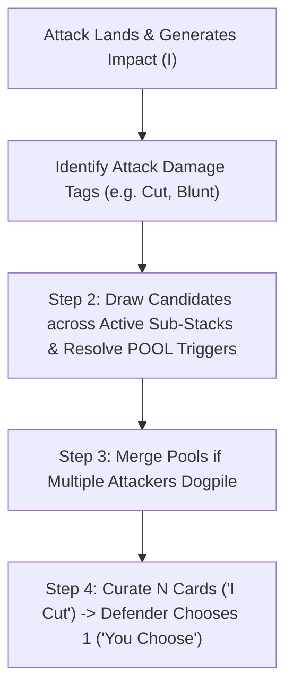

# Multi-Deck Integration & Consequence Pool Resolution

This document details how the **Consequence Pool & Tag Escalation** resolution candidate integrates with the broader **[Multi-Deck Consequence Ecosystem](../../../architecture/consequence-ecosystem.md)**.

---

## 1. Resolution Flow

When an attack lands and generates Impact, the 4-step Action Resolution integrates with the active decks as follows:



---

## 2. Step-by-Step Multi-Deck Mechanics

### Step 1: Determine Impact

The defender meets incoming `Strength` with Defend cards from hand and/or flips from the deck into a flipped stack. The number of cards in the flipped stack is the attack's **Impact ($I$)**.

### Step 2: Draw Candidates across Active Damage Decks & Resolve POOL Triggers

The defender's **Consequence Pool Size ($N$)** is determined by their armor/poise (baseline $N=2$).

- Candidates are drawn strictly based on the attack's damage tags (`[Cut]`, `[Blunt]`, `[Pierce]`, `[Burn]`, etc.).
- Drawing fills tiers of width $N$ from Severity 1 upward:
  - First $N$ Impact $\to$ Draw from **Tier 1** sub-stacks.
  - Next $N$ Impact ($N+1$ to $2N$) $\to$ Draw from **Tier 2** sub-stacks.
  - Next $N$ Impact ($2N+1$ to $3N$) $\to$ Draw from **Tier 3** sub-stacks.
  - Beyond $3N$ Impact $\to$ Draw from **Tier 4** sub-stacks.

#### Single-Tag vs. Multi-Tag Weapons (Hybrid Candidate Pools)

- **Single-Tag Attack:** If the attack has only one tag (e.g., an arming sword strike declared as a pure `[Cut]`), all candidates are drawn from the `Slashing` sub-stacks.
- **Multi-Tag Attack:** If the weapon or spell features multiple tags (e.g., a Morningstar with `[Blunt, Pierce]`, or a Flaming Greatsword with `[Cut, Burn]`), the attacker distributes their candidate draws among the matching active decks as they see fit.
  - _Example:_ An attack with a Flaming Greatsword generates $I = 3$ against a defender with $N = 2$. The attacker must draw two Tier 1 cards and one Tier 2 card. They may choose to draw **1 Tier 1 Slashing**, **1 Tier 1 Burning**, and **1 Tier 2 Burning** card into their candidate pool.

#### Cross-Deck Tag Vulnerability Escalation

The Tag Vulnerability Web connects all consequence decks together through standardized anatomical and positional **Leaf Tags**:
`[positioning]`, `[exertion]`, `[head]`, `[torso]`, `[limbs]`, `[bleeding]`, `[sensory]`, `[fear]`, `[mental]`

- **The Rule:** If an active condition on the defender has an exposed tag in its `pool: vulnerable:` list, any candidate card in the pool of Severity $K \le S$ carrying that leaf tag in its `tags:` may be placed onto that condition to draw **+1 additional candidate from the Severity $K+1$ sub-stack of the attacker's weapon**.
- **Cross-Deck Synergy:** Vulnerability exploitation works seamlessly across different damage types:
  1. Round 1: A warhammer blow inflicts **Cracked Ribs** (Tier 2, from the `Crushing` deck), exposing `pool: vulnerable: [torso, positioning, exertion]`.
  2. Round 2: An ally strikes with a spear (`[Pierce]`), generating $I=2$ ($N=2$) and drawing two Tier 1 piercing candidates, one of which is **Chest Graze** (`tags: [torso, limbs]`).
  3. The attacker places the Tier 1 **Chest Graze** onto the active Tier 2 **Cracked Ribs** (matching `[torso]`) and draws **+1 candidate from the Tier 2 Piercing sub-stack** (`Punctured Intercostal`).
  4. _Ludonarrative Result:_ Blunt trauma structurally weakened the torso; subsequent piercing thrusts effortlessly penetrate deeper.

### Step 3: Merging Candidate Pools Across Attackers

When multiple attackers targeting the same defender choose to merge candidate pools:

- Each attacker draws their candidates from their own weapon's active damage deck(s).
- The drawn cards are physically pooled together.
- _Result:_ A defender facing a goblin with a short sword (`[Cut]`) and a goblin with a club (`[Blunt]`) will see a curated pool containing both cutting lacerations and blunt contusions.

### Step 4: Curate ("I Cut") and Suffer ("You Choose")

The attacker scoops all placed candidates back into the pool, selects exactly $N$ cards to present, and the defender chooses and suffers exactly 1 consequence.

---

## 3. Maneuver Staking & Guaranteed Candidates

When designing specialized martial maneuvers, grappling moves, or specific spells (e.g., _Leg Sweep_, _Disarm_, _Shield Slam_), designers must not bypass the defender's armor or Pool Size.

Instead, maneuvers use the **Guaranteed Candidate** pattern:

```yaml
Leg Sweep:
  name: Leg Sweep
  cost: 1
  tags: [Positioning, Melee]
  rules: >
    Attack with Yellow. If this attack generates Tier 2 candidates,
    one guaranteed candidate is "Knocked Prone" (from the Positioning deck).
```

### How Guaranteed Candidates Resolve at the Table:

1. If the attack fails to achieve Tier 2 (e.g., $I < 2N$, only generating Tier 1 candidates), the defender resisted the takedown, suffering only minor Tier 1 footing slips or balance strains.
2. If the attack achieves Tier 2 ($I \ge 2N$), the attacker automatically places **Knocked Prone** into the candidate pool rather than drawing a random Tier 2 card.
3. The attacker curates **Knocked Prone** into the $N$ cards presented to the defender.
4. _Result:_ The signature tactical maneuver lands reliably whenever defense is broken, while fully respecting the core resolution engine and armor soak.

---

## 4. Draw Volume Analysis & Sub-Deck Stress-Testing

### 4.1. The High-Volume Tier 1 Tension

In playtests and systemic evaluations, the Consequence Pool engine creates significant draw volume at Tier 1:

- Under $N=2$, an attack generating $I=2$ draws 2 cards.
- A merged attack or an unarmored strike ($I=4$) draws 2 Tier 1 cards and 2 Tier 2 cards.
- In a 4 vs 4 skirmish round where 3 attacks penetrate, **6 to 8 candidate cards may be pulled in a single round**.

### 4.2. Ergonomic & Sub-Deck Requirements

To support this draw volume without running out of cards or feeling repetitive:

1. **Tier 1 Depth Requirement:** Each active damage deck must provide **12 to 16 distinct Tier 1 cards** (as specified in [consequence-ecosystem.md](../../../architecture/consequence-ecosystem.md)).
2. **Rapid Recycle:** Surplus candidates returned to the deck during Step 4 ("I Cut") return immediately to the bottom of their sub-stacks, ensuring the deck stays replenished during extended fights.
3. **Minion Threshold Optimization:** Minions or sub-threshold attacks that fail to meet $N$ generate **0 card draws** unless merged. This is critical: isolated weak hits ($I < N$) do not touch the consequence decks, preventing unnecessary physical churn.

---

## 5. Summary Evaluation Scorecard

| Criterion                                 |      Score       | Assessment                                                                                                  |
| :---------------------------------------- | :--------------: | :---------------------------------------------------------------------------------------------------------- |
| **Verisimilitude (Rolemaster Benchmark)** | 🌟 **Exemplary** | Weapons inflict biomechanically authentic injuries from matching active decks without lookup tables.        |
| **Table Ergonomics**                      | ⚠️ **Watchlist** | You can pull out the decks you need for a scene.                                                            |
| **Hybrid Weapon Expressiveness**          | 🌟 **Exemplary** | Multi-tag weapons split draws across active decks, creating rich tactical dilemmas in pool curation.        |
| **Maneuver Compatibility**                |  ✅ **Passed**   | Guaranteed Candidates allow signature martial maneuvers to function cleanly without bypassing defense math. |
| **Sub-Deck Draw Volume**                  | ⚠️ **Watchlist** | High Tier 1 draw volume requires 12–16 card sub-stack depth and diligent return of surplus cards.           |
