# Player's Guide Patch: The Strategy of Consequences

Patch and companion guide for `design/rules/players-guide.md`, integrating the **Consequence Pool & Tag Escalation Engine**.

---

## 1. The Dynamic of "I Cut, You Choose"

The consequence system transforms action resolution from passive damage calculation into an active psychological duel between attacker and defender. In every combat exchange, players experience both sides of this dynamic:

- **As the Attacker ("I Cut")**: You spend the Impact your attack generated to draw candidate consequence cards, exploit active vulnerabilities on the target, and curate a pool of $N$ cards tailored to punish your opponent.
- **As the Defender ("You Choose")**: You assess the curated pool of $N$ cards and decide which cost to absorb, weighing immediate tactical survival against long-term attrition and deadly condition cascades.

---

## 2. Attacker Strategy: Curating the Consequence Pool ("I Cut")

Each card flipped by the defender gives the attacking side **1 Impact = 1 candidate card drawn**. Candidates fill rows of width $N$ (the defender's Pool Size) tier-by-tier from Severity 1 upward:

- The first $N$ Impact of an attack draws up to $N$ Severity 1 cards. (If an isolated attack's Impact is less than $N$, it fails to reach the pool threshold—no consequences are suffered unless merged with allies' candidates).
- An attack only reaches higher tiers if that _individual attack's Impact_ exceeds $N$: once Tier 1 has $N$ cards, the next $N$ Impact draws up to $N$ Severity 2 cards.
- Once Tier 2 is full, the next $N$ Impact draws up to $N$ Severity 3 cards.
- Once Tier 3 is full, each additional point of Impact draws 1 card from the Severity 4 deck.
- _Severity is determined strictly per attack, never by combining Impact across attacks._

### Step 3: Forming Pools (Separate or Merged)

Attackers targeting the same defender choose whether to keep their drawn candidates as separate pools or merge them into a shared pool:

- **Separate Pools:** Each attack with $\ge N$ candidates forms its own pool, forcing the defender to suffer multiple consequences simultaneously.
- **Merged Pools:** Attackers merge their drawn candidate cards into a shared pool. This lets sub-threshold attacks combine their Tier 1 cards to reach $N$, or combines surplus candidates for curation. Merging pools combines drawn cards—it **never increases card severity**.

### Step 4: Vulnerability Exploitation ("Place to Draw")

Once candidate cards are drawn and pools are formed, attackers evaluate each pool against the defender's start-of-round active conditions:

- **Match & Place:** An active condition of **Severity $S$** can exploit one unplaced candidate in your pool of **Severity $K \le S$** whose tags match the condition's `Vulnerable` list. Place that matching Tier $K$ candidate onto the active condition and **draw 1 additional candidate from the Severity $K+1$ deck** into your hand (drawing from the Severity 4 deck when exploiting a Tier 3 match on an active Tier 3 condition).
- **Dual Effect (Pyramid Escalation & Curation Squeeze):**
  - **Squeezing the Pool:** Adding a Tier $K+1$ card while retaining all of your Tier $K$ draws gives you surplus candidates for Step 5, allowing you to include the higher-tier card and curate out your softest lower-tier draw.
  - **Reaching Platform Saturation:** By stacking multiple tag promotions across rounds, an attacker can curate an entire $N$-card pool filled exclusively with Tier 2 or Tier 3 trauma.

### Step 5: Scooping & Curating the Consequence Pool

Once all vulnerability exploitations for the pool are complete, **scoop the candidate cards placed on the defender's active conditions back into your pool** and curate the final $N$-card pool:

1. **The Higher-Tier Foundation:** Include your highest-tier cards (native and bonus draws) to occupy slots in the pool and force severe platform or structural trauma once all $N$ slots are saturated.
2. **Curating the Bottleneck Slot:** If higher tiers do not yet fill all $N$ slots, the remaining slot(s) must be filled from lower tiers. Because the defender will naturally pick the lowest-tier option to survive, **use your surplus lower-tier candidates to place the sharpest tactical lock or a key `Vulnerable`-enabler into that bottleneck slot**.

### Intra-Tier Curation: The Tapering Funnel

The way you curate candidate cards changes dramatically across tiers:

#### Tier 1: Filtering Out the Easy Outs

Within **Tier 1 (Tactical Impairments & Setbacks)**, cards feature an intentional **dynamic range**:

- **Softer / Clearable Band (Priority 1–3)**:
  - `Poor Footing`: Increases defensive Impact by +1; clearable mid-combat by tucking 2 cards from hand.
  - `Dust in Eyes`: Disables hand defense; clearable immediately via _Rub & Blink_ (costs 1 Pain card).
  - `Winded`: Attack declarations cost 1 Fatigue; clearable by spending Red 10.
  - `Rattled Nerves`: Start of round discards 1 card; clearable by spending Blue 15.
- **Sharp / Punishing Band (Priority 4–5)**:
  - `Off Balance`: Cannot Move or play Defend from hand; defenses suffer +1 Impact.
  - `Afraid`: Must expend 1 card from hand to attack or move closer.
  - `Rattled Guard`: Strips your armor's first Pierce threshold.
  - `Strained Offense`: Must expend 1 card from hand to declare an Attack Action.
  - `Bleeding Cut`: Heavy defenses expend extra cards from the draw deck.

When total candidates exceed $N$ (either from native higher-tier draws, merged pools, or bonus cards drawn via vulnerability exploitation), lower-tier draws exceed the remaining open slots in the pool.

> **The Power of the Cut:** Having surplus lower-tier candidates allows the attacking team to **curate away softer, clearable options** (like `Poor Footing` or `Winded`) and fill remaining bottleneck slots with the most punishing tactical locks (`Off Balance`, `Afraid`, `Rattled Guard`).

#### Tier 2: Platform Takedown vs. Biological Attrition

At Tier 2, there are no "soft outs." Your choice is operational:

- Do you offer **`Knocked Prone`** (doubling incoming Pierce and exposing broad vulnerabilities to set up an ally's killing strike)?
- Or do you offer **`Cracked Ribs`** or **`Mild Concussion`** (persistent stamina/hand taxes that weaken them for the rest of the fight)?

#### Tier 3: Orthogonal Pillar Collapse

At Tier 3, curate candidates specifically to dismantle the opponent's core archetype:

- Against heavy frontliners $\to$ force **`Broken Arm`** (cannot wield two-handed weapons) or **`Sundered Armor`** (strips pool size).
- Against spellcasters or commanders $\to$ force **`Severe Concussion`** (caps hand size at 3).
- Against defensive tanks $\to$ force **`Arterial Hemorrhage`** (acute bleedout clock).

#### Tier 4: Terminal Climax & Rescue Clocks

At Tier 4, the character faces defeat or fatal trauma. However, choices still matter: curating between immediate coma (safe, stable incapacitation like `Unconscious [Traumatic Coma]`) and acute hemorrhagic shock (`Mortal Bleedout`, which starts a 3-round emergency clock allowing allies to intervene with in-combat hemostasis) presents the defender with an agonizing trade-off between immediate loss of agency and high-stakes survival.

#### Defensive Hand Strategy: Severity Suppression & Curation Denial

Playing **Defend** cards from hand is valuable even when an attack cannot be fully soaked:

- **Scenario**: You wear Padded Gambeson ($N = 3$). An incoming strike threatens to generate **5 Impact**.
- **If you hoard your cards**: At 5 Impact, the attack fills Tier 1 (3 cards) and draws 2 cards from Tier 2. The attacker presents two Tier 2 traumas and one curated Tier 1 lock (e.g., `[Knocked Prone, Cracked Ribs, Off Balance]`).
- **If you play a Defend card**: Your hand defense reduces the attack from 5 Impact to **3 Impact**. The attack is contained entirely within Tier 1 (drawing 3 Tier 1 cards, e.g., `[Poor Footing, Winded, Off Balance]`). You completely prevent Tier 2 trauma from entering the pool and can select a clearable setback like `Poor Footing`.
- **The Takeaway:** Hand defense suppresses incoming severity tiers and preserves accessible recovery options.

#### Using Printed Priority Numbers

Every consequence card features a printed **`Priority` rating (1 to 5)** representing its baseline disruption within that tier. If you are not sure, picking the higher (attacker) or lower (defender) priority is a decent default.

- **Context Trumps Generic Priority:** While printed Priority numbers provide a quick baseline threat ranking, situational context matters more. A card penalizing movement may be trivial against a stationary archer but devastating to an agile skirmisher. Target your opponent's specific posture and tactical role.

### Hunting Tag Synergies: Building the Consequence Pyramid

Against heavily armored foes ($N=4$ or $N=5$), you don't need to generate 12–15 Impact in a single blow. Instead, you can dismantle them by combining `Pierce` weapons/maneuvers with a **Consequence Pyramid**:

1. **Establish the Base (Tier 1 Vulnerabilities):** Early hits land Tier 1 conditions (`Poor Footing`, `Winded`, `Dust in Eyes`, `Rattled Guard`), each exposing 2–4 `Vulnerable` tags (`positioning`, `limbs`, `torso`, `head`, `armor`).
2. **Exploit Vulnerabilities to Squeeze the Pool:** On subsequent hits, whenever you draw a Tier 1 card matching an active Tier 1 condition's `Vulnerable` tags, place it on that condition to draw **+1 Tier 2 card** (then scoop all candidates to curate $N$). That bonus card squeezes out soft Tier 1 options and builds toward saturating all $N$ slots with Tier 2 trauma.
3. **Climb to Tier 3 & Finish:** Once a Tier 2 condition (like `Knocked Prone` or `Cracked Ribs`) is in play, matching Tier 2 candidates can be placed on it to draw **Tier 3 structural trauma** (`Sundered Armor`, `Broken Arm`, `Severe Concussion`), and from an active Tier 3 condition into the **Tier 4 Climax Deck** (inflicting fatal trauma, emergency bleedout clocks, or incapacitation).

### Coordinated Party Assaults

When multiple party members attack the same foe in a round, each attacker first draws candidate cards independently based on their own attack's Impact against the target's Pool Size ($N$). The party then decides whether to keep their candidate pools separate or merge them before exploiting vulnerabilities:

- **Splitting Pools (Piling On Conditions & Parallel Promotions):** Against low-$N$ targets (or when multiple attackers each generate $\ge N$ Impact), attackers can keep their pools separate to land **multiple consequences simultaneously** in a single round—and because vulnerability exploitation is limited to **once per condition per pool** (with placed cards scooped back in Step 5), each separate pool can independently exploit the target's start-of-round active conditions without competing over them.
- **Merging Pools (Cracking Heavy Armor & Curation Leverage):** Against high-$N$ targets ($N=4\text{–}5$), probing hits from skirmishers ($I < N$) cannot penetrate armor on their own. However, each skirmisher draws candidate cards from Tier 1 for their attack, and attackers can **merge their drawn candidates into a shared pool** (or merge them into a frontliner's pool). Once the combined candidates reach at least $N$, the pool can be presented to the defender. Crucially, **merging pools combines drawn cards; it never escalates card severity**. Two Tier 1 attacks merged together provide surplus Tier 1 candidates to curate the sharpest locks—they never generate a Tier 2 card. Only a single attack whose individual Impact exceeds $N$ draws from higher severity decks natively.

---

## 3. Quick-Reference: The Decision Checklist

```mermaid
flowchart TD
    subgraph Attacker Decision ["Attacker ('I Cut')"]
        A1["1. Attacks Resolve -> Count Impact (I) per Attack"] --> A2["2. Draw Candidates per Attack (1 Impact = 1 Card; Severity Determined per Attack)"]
        A2 --> A3["3. Form Pools: Keep Separate or Merge Drawn Candidates (Must Reach >= N Cards)"]
        A3 --> A4["4. Exploit Start-of-Round Vulnerabilities (Once per Condition per Pool: Place Matching Tier K <= S Card -> Draw +1 Tier K+1 Card)"]
        A4 --> A5["5. Scoop Placed Cards & Curate N Cards per Pool: Include Highest Tiers, Squeeze Bottlenecks"]
    end

    subgraph Defender Decision ["Defender ('You Choose')"]
        D1["Inspect Each Curated Pool of N Cards"] --> D2["Weigh Immediate Passives, Vulnerable Tags Exposed, and Recovery Options"]
        D2 --> D3["Select 1 Consequence per Pool (Applied Simultaneously)"]
    end
```

