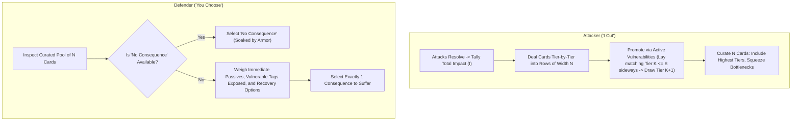

# Player's Guide Patch: The Strategy of Consequences

Patch and companion guide for `design/rules/players-guide.md`, integrating the **Consequence Pool & Tag Escalation Engine**.

---

## 1. The Dynamic of "I Cut, You Choose"

The consequence system transforms action resolution from passive damage calculation into an active psychological duel between attacker and defender. In every combat exchange, players experience both sides of this dynamic:

- **As the Attacker ("I Cut")**: You spend the Impact your attack generated to draw candidate consequence cards, and then curate a pool of $N$ cards tailored to exploit your opponent's vulnerabilities.
- **As the Defender ("You Choose")**: You assess the curated pool of $N$ cards and decide which cost to absorb, weighing immediate tactical survival against long-term attrition and deadly condition cascades.

---

## 2. Attacker Strategy: Curating the Consequence Pool ("I Cut")

Each card flipped by the defender gives the attacking side **1 Impact = 1 candidate card drawn**. Candidates fill rows of width $N$ (the defender's Pool Size) tier-by-tier from Severity 1 upward:

- The first $N$ Impact draws up to $N$ Severity 1 cards. (If total Impact is less than $N$, unfilled slots are implicit "No Consequence" blanks).
- Once Tier 1 is full, the next $N$ Impact draws up to $N$ Severity 2 cards.
- Once Tier 2 is full, the next $N$ Impact draws up to $N$ Severity 3 cards.
- Once Tier 3 is full, subsequent Impact allocates Severity 4 (Taken Out) candidates.

### Step 3A: Vulnerability Promotion

Once all candidate cards are drawn, attackers evaluate the entire candidate pool against the defender's active conditions:

- **Exploit Active Vulnerabilities:** An active condition of **Severity $S$** can promote one matching candidate of **Severity $K \le S$** whose tags match the condition's `Vulnerable` list.
- **Promotion Action:** Place the matching Tier $K$ card **sideways across the exploited condition** and draw **1 replacement card from the Severity $K+1$ deck**.
- **Pool-Wide Evaluation:** Because promotion is its own substep after all draws are on the table, you evaluate the full candidate pool at once to decide which promotions create the strongest tactical leverage.

### Step 3B: Curating the Consequence Pool

From all active candidates remaining after promotions, attackers curate the final $N$-card pool:

1. **The Higher-Tier Foundation:** Include your highest-tier cards (native and promoted) to squeeze out safe low-tier slots and force severe platform or structural trauma.
2. **Curating the Bottleneck Slot:** If higher tiers are only partially filled, the remaining slot(s) must be filled from lower tiers. Because the defender will naturally seek to pick the lowest-tier option to survive, **use your surplus lower-tier draws to place the sharpest tactical lock or a key `Vulnerable`-enabler into that bottleneck slot**.

### Intra-Tier Curation: The Tapering Funnel

The way you curate candidate cards changes dramatically across tiers:

#### Tier 1: Filtering Out the Easy Outs

Within **Tier 1 (Tactical Impairments & Setbacks)**, cards feature an intentional **dynamic range**:

- **Softer / Clearable Band (Priority 1–3)**:
  - `Poor Footing`: Increases defensive Impact by +1; clearable mid-combat by tucking 2 cards from hand.
  - `Dust in Eyes`: Disables hand defense; clearable immediately via _Rub & Blink_ (costs 1 Pain card).
  - `Winded`: Attack declarations cost 1 Fatigue; clearable by spending Red 10.
  - `Rattled Nerves`: Start of round discards 1 card; clearable by spending Blue 15.
- **Sharp / Punishing Band (Priority 4–5)**:
  - `Off Balance`: Cannot Move or play Defend from hand; defenses suffer +1 Impact.
  - `Afraid`: Must expend 1 card from hand to attack or move closer.
  - `Rattled Guard`: Strips your armor's first Pierce threshold.
  - `Strained Offense`: Must expend 1 card from hand to declare an Attack Action.
  - `Bleeding Cut`: Heavy defenses expend extra cards from the draw deck.

When total Impact reaches higher tiers without completely filling the pool, lower-tier draws exceed the remaining open slots (e.g., generating 5 Impact against $N = 3$ draws three Tier 1 cards and two Tier 2 cards, leaving only one pool slot for Tier 1).

> **The Power of the Cut:** Having surplus lower-tier draws allows the attacking team to **curate away softer, clearable options** (like `Poor Footing` or `Winded`) and fill remaining slots with the most punishing tactical locks (`Off Balance`, `Afraid`, `Rattled Guard`).

#### Tier 2: Platform Takedown vs. Biological Attrition

At Tier 2, there are no "soft outs." Your choice is operational:

- Do you offer **`Knocked Prone`** (doubling incoming Pierce to set up an ally's killing strike)?
- Or do you offer **`Cracked Ribs`** or **`Mild Concussion`** (permanent stamina/hand taxes that weaken them for the rest of the fight)?

#### Tier 3: Orthogonal Pillar Collapse

At Tier 3, curate candidates specifically to dismantle the opponent's core archetype:

- Against heavy frontliners $\to$ force **`Broken Arm`** (cannot wield two-handed weapons) or **`Sundered Armor`** (strips pool size).
- Against spellcasters or commanders $\to$ force **`Severe Concussion`** (caps hand size at 3).
- Against defensive tanks $\to$ force **`Arterial Hemorrhage`** (acute bleedout clock).

#### Defensive Hand Strategy: Severity Suppression & Curation Denial

Playing **Defend** cards from hand is valuable even when an attack cannot be fully soaked:

- **Scenario**: You wear Padded Gambeson ($N = 3$). An incoming strike threatens to generate **5 Impact**.
- **If you hoard your cards**: At 5 Impact, the attack fills Tier 1 (3 cards) and draws 2 cards from Tier 2. The attacker presents two Tier 2 traumas and one curated Tier 1 lock (e.g., `[Knocked Prone, Cracked Ribs, Off Balance]`).
- **If you play a Defend card**: Your hand defense reduces the attack from 5 Impact to **3 Impact**. The attack is contained entirely within Tier 1 (drawing 3 Tier 1 cards, e.g., `[Poor Footing, Winded, Off Balance]`). You completely prevent Tier 2 trauma from entering the pool and can select a clearable setback like `Poor Footing`.
- **The Takeaway:** Hand defense suppresses incoming severity tiers and preserves accessible recovery options.

#### Using Printed Priority Numbers

Every consequence card features a printed **`Priority` rating (1 to 5)** representing its baseline disruption within that tier. If you are not sure, picking the higher (attacker) or lower (defender) priority is a decent default.

- **Context Trumps Generic Priority:** While printed Priority numbers provide a quick baseline threat ranking, situational context matters more. A card penalizing movement may be trivial against a stationary archer but devastating to an agile skirmisher. Target your opponent's specific posture and tactical role.

### Hunting Tag Synergies: Building the Consequence Pyramid

Against heavily armored foes ($N=4$ or $N=5$), you don't need to generate 12–15 Impact in a single blow. Instead, you can dismantle them by building a **Consequence Pyramid**:

1. **Establish the Base (Tier 1 Vulnerabilities):** Early hits land Tier 1 conditions (`Poor Footing`, `Winded`, `Dust in Eyes`, `Rattled Guard`), each exposing 2–4 `Vulnerable` tags (`positioning`, `limbs`, `torso`, `head`, `armor`).
2. **Promote Draws to Squeeze the Pool:** On subsequent hits, whenever you draw a Tier 1 card matching an active Tier 1 condition's `Vulnerable` tags, lay it sideways on that condition to draw a **Tier 2** card. Initially, those promoted Tier 2 cards eat up safe slots in the defender's pool—forcing them into harsher Tier 1 locks—and once 2–3 conditions are active, promoted draws saturate the entire pool with Tier 2 trauma.
3. **Climb to Tier 3 & Finish:** Once a Tier 2 condition (like `Knocked Prone` or `Cracked Ribs`) is in play, matching Tier 2 draws can be laid sideways on it to promote directly into **Tier 3 structural trauma** (`Sundered Armor`, `Broken Arm`, `Severe Concussion`), and from an active Tier 3 condition into **Tier 4 (Taken Out)**.

### Coordinated Party Assaults

When multiple party members attack the same foe in a round, their Impact combines into a single pool:

- Probing hits from skirmishers saturate the target's Pool Size ($N$) at Tier 1, removing clean soak blanks and triggering `Vulnerable` promotions across the target's active conditions.
- Heavy strikes from frontliners push the combined Impact natively into Tier 2 and Tier 3.
- Together, the party promotes matching candidates and curates $N$ cards from the combined draw, cornering the foe into an inescapable tactical dilemma.

---

## 3. Quick-Reference: The Decision Checklist

