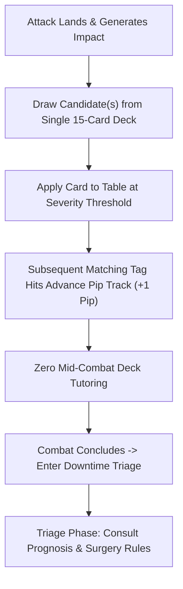

# Candidate Architecture: Consolidated 3-Tier Cards, Pip Tracks & Post-Combat Triage

## Concept Overview

This candidate architecture preserves the core mathematical and tactical strengths of caRdPG resolution (localized tag escalations, defender curation agency, and armor soak thresholds) while resolving the physical table bottlenecks discovered in multi-deck play: **table footprint**, **mid-combat deck tutoring**, and **in-combat cognitive drag**.

It synthesizes three complementary design innovations into a unified physical-and-digital framework:



---

## The Three Pillars of the Architecture

### 1. The Consolidated "Tiered Consequence Deck" (Single Deck on Table)

Instead of maintaining 3 to 5 separate physical trauma decks alongside character decks and tableaus, the table hosts **exactly one 15–20 card Consequence Deck**.

- Every card in the deck displays **3 printed severity tiers** on its face (Severity 1 / Severity 2 / Severity 3), concluding with a terminal **Taken Out** trigger.
- When an attack lands, candidate cards are drawn from this **single deck**.
- The Severity applied is determined by the Impact threshold achieved or the current escalation state of that card.

```
+-----------------------------------------------------+
| SHATTERED BALANCE                 [Tag: positioning] |
+-----------------------------------------------------+
| [o] Sev 1: Poor Footing                             |
|   Passive: The Impact of your defenses is +1.       |
|   Action: Regain Footing (Tuck 2 cards from hand)   |
+-----------------------------------------------------+
| [ ] Sev 2: Off Balance                              |
|   Passive: Cannot play Defend cards from hand.      |
|   Action: Recover Stance (Tuck 3 cards from hand)   |
+-----------------------------------------------------+
| [ ] Sev 3: Knocked Prone                            |
|   Passive: Attacks against you gain +2 Impact.      |
|   Action: Stand Up (Spend 1 Card + Suffer 1 Fatigue)|
+-----------------------------------------------------+
| [ ] Terminal: If escalated further -> Taken Out     |
+-----------------------------------------------------+
```

### 2. Persistent Condition Cards with Pip/Slider Tracks (Zero Mid-Combat Tutoring)

Condition cards feature printed multi-pip escalation tracks (tracked with a wooden cube, paperclip slider, or tucking card) that map 1:1 to the 4-tier model:

- **Pip 1 (Severity 1):** Minor setback or clearable tactical impairment.
- **Pip 2 (Severity 2):** Platform ceiling or moderate trauma.
- **Pip 3 (Severity 3):** Severe structural trauma (broken limb, sundered armor, severe concussion).
- **Pip 4 / Terminal:** Immediate **Narrative Taken Out** clause printed on the card (e.g., _"Unconscious / Slain / Pinned"_).

**Table Procedure:**

- When subsequent attacks target an active condition's tag, the player simply **advances the marker +1 Pip**, unlocking the next harsher passive rule printed on the card.
- **Result:** Completely eliminates rifling through card boxes or higher-tier decks mid-combat. Conditions evolve in place on the table.

### 3. Decoupled Crisis Conditions & Post-Combat Prognosis Triage

Separates the mechanical and narrative lifecycle of harm into two distinct, dedicated phases matching caRdPG's core modes of play: **Crisis Time (In-Combat Tactical Friction)** and **Downtime (Post-Combat Clinical Triage)**.

1. **In-Combat Condition Cards (Crisis Time):**
   - Contain **strictly in-combat information**: Title, Leaf Tag, immediate passive penalties across Tiers 1–3, desperate in-combat mitigation/suppression actions, and terminal defeat triggers.
   - Out-of-combat medical tasks (`task:`), clinic/tool requirements (`Requires:`), consumable costs (`Cost:`), and convalescence times are **completely stripped from combat cards**.
   - With an average word count of only 50–60 words per card, all 3 tiers fit comfortably on a single standard poker card with generous margins and clear typography.
2. **The Post-Combat Triage Ritual (Downtime / Triage Phase):**
   - When combat ends (Transition out of Crisis Time), the table enters a relaxed **Triage & Recovery Phase**.
   - **Tier 1 Impairments Clear Automatically:** Mild setbacks (`Poor Footing`, `Dust in Eyes`, `Winded`) represent transient physical friction and evaporate with 60 seconds of catching breath after the fight.
   - **Triage for Severe Trauma (Tiers 2 & 3):** Characters holding conditions at Tier 2 or Tier 3 consult the **Prognosis & Treatment System** to diagnose the injury, determine required medical checks, and identify tools, surgery, or convalescence time.
   - Because combatants rarely suffer more than 1–2 severe wounds across an entire encounter, the table only looks up 1–2 prognoses total after the fight.

#### Candidate Implementation Formats for Prognosis

- **Option A: The "Outlook & Prognosis" Card Deck:** A dedicated box of clinical downtime cards kept off the combat table.
- **Option B: The Chirurgeon's Field Manual (Reference Chart):** A 2-page lookup spread in the rulebook / GM screen (`[Condition Tag] × [Severity Tier]` $\to$ `[Check Difficulty, Required Tools, Rest Time]`).
- **Option C: Reversible / Two-Sided Cards (Combat Front / Prognosis Back):** Combat side features the 3-tier escalation track. Once combat concludes, the player flips the card over to read the downtime clinical treatment and surgery rules.

---

## Critical Analysis & Pitfall Audit

| Pitfall / Criterion                         |    Assessment    | Key Strengths & Tradeoffs                                                                                           |
| :------------------------------------------ | :--------------: | :------------------------------------------------------------------------------------------------------------------ |
| **Pitfall 1: Decisive Conclusion**          |  ✅ **Passed**   | Compounding pip tracks drive conditions decisively toward Tier 4 Taken Out without stalling.                        |
| **Pitfall 4: Tri-Color Compliance**         |  ✅ **Passed**   | Retains universal tri-color card anatomy; does not restrict cards by color.                                         |
| **Pitfall 8: Combinatorial Traps**          |  ✅ **Passed**   | Compatible with Layered Pool Fill or direct threshold drawing; eliminates coin-change partitioning.                 |
| **Pitfall 9: Table Ergonomics & Tutoring**  | 🌟 **Exemplary** | Shrinks table trauma footprint to **1 deck of 15–20 cards** and **completely eliminates mid-combat deck tutoring**. |
| **Pitfall 11: 10x Rule of Core Complexity** |  ✅ **Passed**   | Core resolution stays under 1 page; progression nuance lives on the face of the single card on the table.           |
| **VTT & Physical Synergy**                  | 🌟 **Exemplary** | Frictionless in VTT (updating a pip counter widget) while solving physical table constraints naturally.             |

---

## Next Steps for Exploration

1. **Test with Different Drafting Primitives:** Can this consolidated 3-tier card model pair with (a) _I Cut, You Choose_ drafting, (b) threshold draws (Impact $\ge$ Armor draws 1 card at Sev 1, etc.), or (c) reactive posture cards?
2. **Draft a Sample 12-Card Consolidated Deck:** Author 12 sample consolidated cards spanning `head`, `positioning`, `armor`, `bleeding`, `fear`, and `respiratory`.
