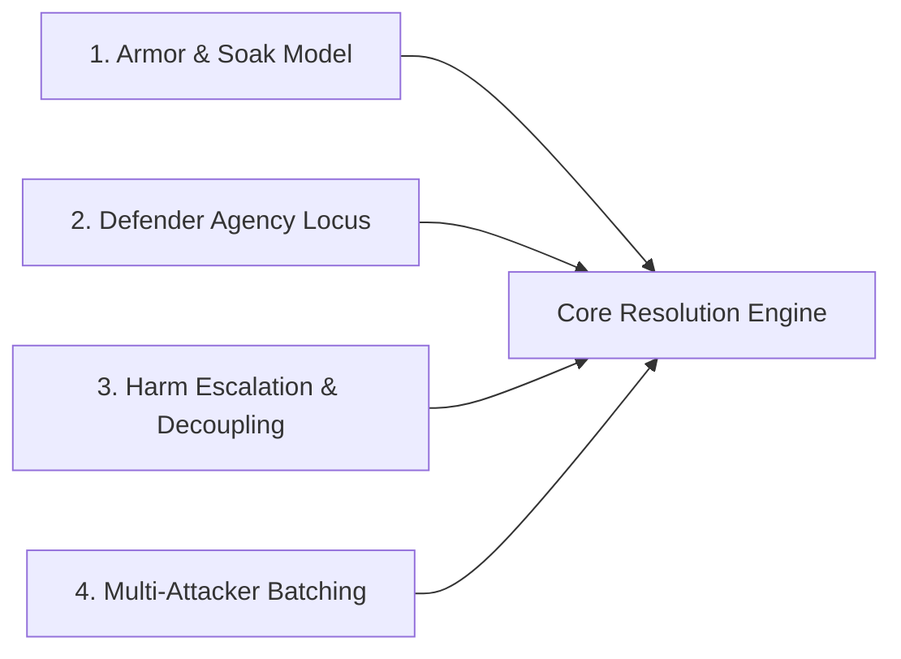

# Core Resolution Mechanics: History & Open Design Space

## Document Purpose

Authoritative reference for the **design journey**, **historical post-mortems**, and **open mechanical axes** of _caRdPG_'s core resolution engine.

It captures why earlier resolution mechanics were abandoned or modified, and defines the structural design space for brainstorming new candidates.

For the non-negotiable architectural invariants, see [constraints.md](constraints.md). For recurring failure modes, see [pitfalls.md](pitfalls.md). For candidate proposals, see [candidates/](candidates/README.md).

---

## 1. Historical Mechanics: Post-Mortems & Trade-Offs

### 1.1. Current Canon: Defense + Resilience

The current canon mechanic in `design/rules/core-rules.md` (flipping cards to meet Strength into a flipped stack; dividing Impact by `Defense` to count consequences; placing consequences in rows of width `Resilience` to advance severity):

- **Origin:** Designed under time pressure prior to a playtest campaign to fix a severe theoretical flaw in an earlier system where players always hoarded cards for a single knock-out alpha-strike.
- **Key Advantages:**
  - Provides reliable "warning shots" before inflicting severe trauma.
  - Makes small attacks relevant while preventing single attacks from one-shotting fresh combatants.
  - Symmetrical Minion modeling: setting `Resilience 0` or `1` creates fragile mooks who decline or drop in a single hit.
- **Critiques & Weaknesses:**
  1. _Tight Coupling to Global Survivability:_ Every consequence advances the character toward being taken out, risking **Unified Doom** (social embarrassment pre-filling physical trauma tracks).
  2. _Pseudo-Hit-Points:_ Can feel like an abstract HP track in disguise.
  3. _Low Tactical Interactivity:_ Blind deck flips mean defense is largely automated RNG unless the player holds specific reactive `Defend` cards in hand.

---

### 1.2. Legacy Mechanic: Defend from Hand (Fractional Thresholds)

Used in early _caRdPG_ prototypes before the modern concept of `Impact` was introduced:

- Armor provided 1–2 deck flips; the defender then expended additional cards from hand to meet incoming attack Strength.
- Severity was determined by fractional thresholds:

| Defense Met                      | Consequence Inflicted         |
| :------------------------------- | :---------------------------- |
| $\ge \text{Attack Strength}$     | No Effect                     |
| $\ge \text{Attack Strength} / 2$ | Minor Consequence             |
| $\ge \text{Attack Strength} / 4$ | Major Consequence             |
| $< \text{Attack Strength} / 4$   | Critical Consequence / Defeat |

- **Key Advantages:**
  - Highly interactive; intense tactical tempo play; intuitive to grasp.
- **Critiques & Failure Modes:**
  1. _Feel-Bad Action Denial:_ Spending cards saved up for an attack just to survive an enemy blow felt frustrating and demoralizing (especially for younger or casual players).
  2. _Underwhelming Big Attacks:_ Defenders routinely scraped together just enough cards to hit the $50\%$ threshold, trivially downgrading massive strikes into minor consequences.
  3. _Un-closable Combats:_ Players drew 2 cards per turn, which was almost always enough to hit the $25\%$ survival threshold, dragging combats out.
  4. _Monster Stun-Locking:_ Monsters pressured each turn spent all card draws defending, resulting in an un-fun state where they never attacked again.
  5. _The Empty-Hand Noob Trap:_ Spending an entire hand on an attack left a character completely defenseless against counter-attacks.

---

### 1.3. Legacy Mechanic: Allowed Severity Tables

Our first step away from "defend from hand" introduced defending by flipping from the deck and the modern concept of `Impact`:

- Armor provided an "Allowed Severity Table" mapping Impact counts to allowed severity tiers.
- The attacker drew candidate cards from a consequence deck (containing an equal mix of severities) equal to the Impact generated, and selected one card no higher than the armor's allowed severity.
- **Key Advantages:**
  - Always-increasing dynamic ramp (more Impact = higher probability of drawing dangerous cards).
  - Rich space for tuning different armor types via severity curves.
- **Critiques & Failure Modes:**
  1. _Rulebook Bloat:_ Required complex tables in the core rules.
  2. _Jeff's Theoretical Alpha-Strike Flaw:_ Delivering low-severity consequences felt underwhelming, leading to the theoretical conclusion that optimal play was hoarding cards for a massive strike to unlock high-severity table rows.
  3. _Table Clutter:_ Heavy extra card-deck fiddling on every action.
  4. _Rigid Deck Balancing:_ Required the consequence deck to maintain exact mathematical card proportions.

---

## 2. The Open Mechanical Design Space

When designing a new resolution mechanic, the non-negotiables in [constraints.md](constraints.md) are fixed. The **open exploration space** consists of four independent design axes:

### Axis 1: How Armor Mitigates Impact

- **Divisor Stats (Canon):** Group flipped cards into sizes of `Defense`. Simple math, but creates flat arithmetic divisions.
- **Layered Saturation / Pool Size ($N$):** Armor sets the width of tiers; Impact draws cards that saturate lower tiers before breaking into higher ones (as in Consequence Pool).
- **Direct Threshold Soak:** Armor absorbs the first $X$ Impact points cleanly (implicit blanks).
- **Card-Count Reductions:** Armor provides deterministic flips or cancels flips before they count toward Impact.

### Axis 2: Where Defender Agency Lives

- **Pre-Flip Agency:** Playing reactive `Defend` Action Stacks from hand or Vigilance (Settled Invariant).
- **Post-Flip Consequence Selection:** _"How I Take the Blow"_—curating from a pool of candidate cards, trading positional footing or armor wear to protect vital anatomy.
- **Mid-Flip Risk Management:** Sequential flips with push-your-luck buy-offs (requires careful anti-AP design).

### Axis 3: Harm Escalation & Domain Decoupling

- **Global Track vs. Localized Tags:** Does harm advance a single global ladder (risking Unified Doom), or do conditions escalate contextually via matching leaf tags (`positioning`, `head`, `armor`)?
- **Multi-Deck vs. Consolidated Cards:** Are consequences split across separate severity decks, or does each card carry a 3-tier escalation track with pip markers?
- **Crisis vs. Downtime Triage:** Are clinical tasks printed on combat cards, or decoupled into post-combat triage?

### Axis 4: Multi-Attacker & Swarm Scaling

- **Batched Round Impact:** All flips across incoming attacks sum into a single round Impact tally (prevents alpha-strike wipes).
- **Sequential Pool Drafting:** Resolving attacks in declaration order.
- **Mob Grouping:** Treating minion swarms as a single composite attacker.

---

## 3. Active Candidate Proposals

See the candidate briefs and proposal suites in [candidates/](candidates/README.md):

- **[Consequence Pool & Tag Escalation Engine](candidates/consequence-pool-tag-escalation/README.md)**
- **[Consolidated 3-Tier Cards, Pip Tracks & Triage](candidates/consolidated-tiered-cards-and-triage.md)**
- **[Declared Defense Effort](candidates/declared-defense-effort.md)**
- **[Push Your Luck & Buy-Off](candidates/push-your-luck-buyoff.md)**
