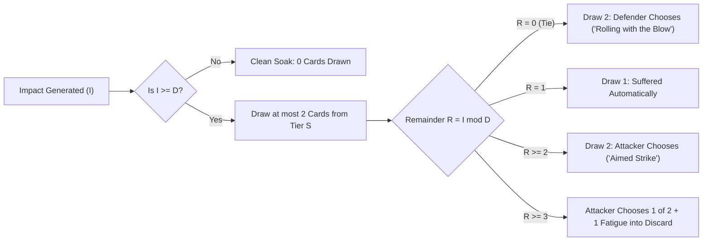

# Exploration: Incremental Impact Design Space

## Document Purpose

This document explores and evaluates candidate mechanics that make **incremental Impact ($I$) matter** in combat resolution without requiring the table to draw one physical card per point of Impact.

It directly addresses **Question 2** from [evaluation.md](candidates/consequence-pool-tag-escalation/evaluation.md):

> _"Is there any sensible (not even more complex than what we have here) design space that lets incremental impact matter without doing something like drawing one card per impact?"_

---

## 1. The Design Tension

In _caRdPG_, `Impact` ($I$) is measured by the number of cards flipped from the defender's deck to meet an attack's `Strength`.

Two conflicting failure modes dominate this design axis:

```
[The "Lost Remainder" Trap]                                [The "Card Drawing Flood" Trap]
Impact / Defense Division Math                             1 Impact = 1 Card Drawn
Leftover Impact (I mod D) is discarded.                   Drawing 6–10 cards per exchange
Extra effort feels completely wasted.                      swamps the table in card churn.
```

- **The Division / Remainder Flaw (Canon):** In canon `core-rules.md`, Impact is divided by `Defense` ($\lfloor I / D \rfloor$). Against a knight in Full Harness (`Defense 4`), an attack generating `Impact 3` yields 0 harm; an attack generating `Impact 7` yields 1 consequence and throws away 3 points of Impact. Players feel cheated when rolling high or investing heavily only to fall 1 card short of the next integer threshold.
- **The Pool Draw Flaw (Consequence Pool):** The Consequence Pool solved this by setting $1\text{ Impact} = 1\text{ Card Drawn}$. But drawing 6–10 cards per round for a single exchange causes severe deck depletion, requires constant reshuffling, and slows Crisis Time with reading overhead.

The objective is to find a **middle ground**: a mechanic where every point of Impact provides tangible mechanical leverage, while keeping the number of physical cards handled to **at most 2 or 3 cards per exchange**.

---

## 2. Five Candidate Architectures

---

### Candidate A: Remainder Shifts Curation Agency (The "Agency Tug-of-War")

**Core Mechanism:**
The base Severity Tier is determined by whether the attack meets the defense threshold ($I \ge D$). The **remainder ($R = I \pmod D$)** shifts _who chooses_ and _selection depth_ over a compact 2-card draw.



#### How It Works:

1. **$I < D$ (Sub-Threshold):** The blow is deflected by armor or poise. **0 cards drawn.**
2. **$R = 0$ (Barely Met):** Draw **2 cards** from the appropriate Severity deck. The **Defender chooses** which 1 to suffer. The defender can pick the milder setback or a condition that doesn't hinder their role.
3. **$R = 1$ (Moderate Margin):** Draw **1 card** from the Severity deck. The defender takes it directly.
4. **$R \ge 2$ (Strong Penetration):** Draw **2 cards** from the Severity deck. The **Attacker curates** which 1 the defender suffers (picking the sharpest lock or targeting a key tag).
5. **$R \ge 3$ (Overwhelming Margin):** Attacker curates 1 of 2, AND forces **1 Fatigue card** directly into the defender's discard pile (stamina spillover).

#### Assessment:

- **Card Draw Volume:** **Never exceeds 2 cards.** Completely eliminates deck depletion.
- **Incremental Value:** Every point of Impact moves the needle:
  $$\text{Clean Soak} \xrightarrow{+1} \text{Defender Choice} \xrightarrow{+1} \text{Random} \xrightarrow{+1} \text{Attacker Choice} \xrightarrow{+1} \text{Fatigue Spillover} \xrightarrow{+1} \text{Next Severity Tier}$$
- **Psychological Feel:** Outstanding. Hitting hard feels rewarding because the attacker steals agency from the defender; defending well allows the defender to mitigate the outcome.

---

### Candidate B: Remainder as Stamina & Posture Spillover

**Core Mechanism:**
Impact completes full Consequence cards at $\lfloor I / D \rfloor$ (drawing exactly 1 card), but any leftover remainder $R$ directly pressures the defender's stamina or hand economy.

#### How It Works:

- **Primary Consequence:** If $I \ge D$, draw 1 Consequence card.
- **Spillover Table (Simple Rule of Halves):**
  - **$R = 0$:** Clean cut; no spillover.
  - **$1 \le R < D/2$ (Minor Spillover):** The defender discards 1 card from the top of their draw deck to their expended pile (minor stamina drain).
  - **$R \ge D/2$ (Severe Posture Spillover):** The jarring impact forces the defender to choose:
    - **Tuck/expend 1 card from hand** (representing desperate bracing/stumbling), **OR**
    - **Add 1 `Fatigue` card** directly to their discard pile.

#### Assessment:

- **Card Draw Volume:** Exactly **1 card drawn** (or 0 if $I < D$).
- **Tactical Dynamics:** Directly attacks the defender's hand and deck economy without cluttering the table with extra condition cards. Armored knights who absorb heavy blows still feel their stamina and hand size get ground down by high-Impact strikes.
- **Ergonomics:** Zero card-reading overhead for the remainder; purely a physical action (expend a card or take a fatigue).

---

### Candidate C: Impact as Tactical Maneuver Currency

**Core Mechanism:**
Reaching the defense threshold ($I \ge D$) inflicts 1 Consequence card. Any remaining points of Impact ($R = I - D$) act as a fluid currency spent by the attacker to buy immediate tactical maneuvers.

#### Sample Menu:

- **1 Impact:** **Shove / Re-position:** Push the defender 1 zone away or alter relative reach.
- **1 Impact:** **Off-Balance:** The defender cannot declare a Move action next round.
- **2 Impact:** **Disarm / Strip Guard:** Force the defender to discard a readied card or cancel an active Stance.
- **2 Impact:** **Tag Exposure:** Name an anatomical tag (`[head]`, `[torso]`, `[limbs]`); the defender is treated as having that tag active for the next attack this round.
- **3 Impact:** **Knock Down:** Force the defender prone.

#### Assessment:

- **Tactical Depth:** Extremely high martial feel. Fighters can choose whether an attack focuses on tissue damage or battlefield control.
- **Drawback:** Introduces a mid-turn menu, which can slow down simultaneous Crisis Time resolution if players suffer analysis paralysis over how to spend 2 points of Impact.

---

### Candidate D: Discrete Impact Bands (The "Gloomhaven" Model)

**Core Mechanism:**
Armor establishes fixed numerical bands. An attack's Impact falls into a discrete bracket, each with a fixed, predetermined outcome:

| Impact Bracket                         | Outcome                                                            |
| :------------------------------------- | :----------------------------------------------------------------- |
| **$I < D$**                            | **Soaked:** 0 cards drawn.                                         |
| **$I = D \text{ to } (D + 2)$**        | **Glancing Hit:** Draw 1 Severity 1 card.                          |
| **$I = (D + 3) \text{ to } (2D - 1)$** | **Solid Strike:** Draw 2 Severity 1 cards; Attacker chooses 1.     |
| **$I \ge 2D$**                         | **Crushing Blow:** Inflict Severity 2 (or draw 1 Severity 2 card). |

#### Assessment:

- **No Continuous Remainder Math:** Brackets are fixed and easy to read from an armor card or player aid.
- **Preserves Incremental Leverage:** Pushing an attack 1 card higher can bump it from "Glancing" into "Solid Strike", unlocking curation without drawing a mountain of cards.

---

### Candidate E: Fixed 2-Card Pool with Tier Escalation Thresholds

**Core Mechanism:**
Whenever an attack penetrates armor ($I \ge D$), the attacker **always draws exactly 2 candidate cards** (neither more nor less). The defender selects 1.

Incremental Impact governs the _composition_ of those 2 cards:

- **Base Hit ($I = D\text{ to } D+1$):** Draw **[Sev 1, Sev 1]**.
- **Heavy Hit ($I = D+2\text{ to } 2D-1$):** Draw **[Sev 1, Sev 2]**. (The defender must choose between a milder Sev 1 setback or a severe Sev 2 trauma; or if paired with attacker curation, the attacker forces the harder choice).
- **Overwhelming Hit ($I \ge 2D$):** Draw **[Sev 2, Sev 2]**.
- **Terminal Hit ($I \ge 3D$):** Draw **[Sev 2, Sev 3]**.

#### Assessment:

- **Constant Table Footprint:** Exactly 2 cards drawn every single time an attack penetrates. Zero variable pool tracking.
- **Smooth Escalation:** Heavy strikes introduce higher-severity threats into the 2-card market naturally.

---

## 3. Comparative Synthesis & Recommendation

| Candidate                  | Max Cards Drawn | Remainder Mechanical Leverage                                | AP / Cognitive Friction |      Physical Table Ergonomics       |
| :------------------------- | :-------------: | :----------------------------------------------------------- | :---------------------: | :----------------------------------: |
| **A. Agency Tug-of-War**   |      **2**      | **High** (Shifts choice from defender to attacker + fatigue) |        Very Low         | ⭐⭐⭐⭐⭐ (Fast, tactile, exciting) |
| **B. Stamina Spillover**   |      **1**      | **Moderate** (Grinds deck/hand stamina directly)             |        Very Low         |  ⭐⭐⭐⭐⭐ (Pure physical gesture)  |
| **C. Maneuver Currency**   |      **1**      | **Very High** (Buys shoves, disarms, prones)                 |     High (Menu AP)      |  ⭐⭐⭐ (Requires reference chart)   |
| **D. Discrete Bands**      |      **2**      | **Moderate** (Crosses discrete outcome thresholds)           |           Low           |    ⭐⭐⭐⭐ (Clean table lookups)    |
| **E. Fixed 2-Card Market** |      **2**      | **High** (Upgrades candidate tiers directly)                 |        Very Low         |  ⭐⭐⭐⭐⭐ (Predictable card flow)  |

### Recommended Path Forward

If we wish to preserve **defender agency** and **attacker leverage** without the card-drawing bloat of the original Consequence Pool:

1. **Combine Candidate A (Agency Tug-of-War) with Tag Escalation:**
   - Draw at most **2 cards**.
   - If $R = 0$, Defender chooses 1 of 2.
   - If $R \ge 1$, Attacker chooses 1 of 2.
   - If an active matching tag exists on the defender, upgrade 1 candidate card to the next Severity tier.
2. This achieves **95% of the psychological and tactical benefits** of the Consequence Pool while reducing card handling and deck shuffling by **over 75%**.
