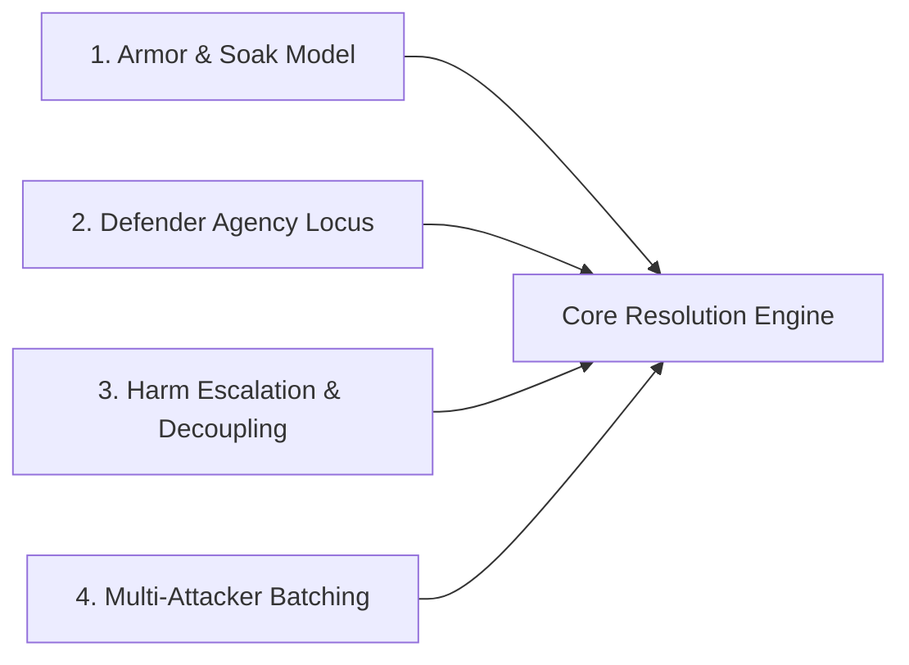

# Core Resolution Mechanics: Open Design Space

## Document Purpose

Authoritative generative canvas for brainstorming and structuring new candidate **Core Resolution Mechanics** in _caRdPG_.

While [constraints.md](constraints.md) fixes the non-negotiable architectural invariants (Action Stacks, tri-color cards, defender-centric flips to generate `Impact`), this document defines the **open mechanical axes** available for exploration.

Before drafting proposals, audit concepts against [pitfalls.md](pitfalls.md) and check [discarded-ideas.md](discarded-ideas.md) to ensure the concept does not resurrect a known dead end. For the narrative evolution of prior playtested engines, see [history.md](history.md).

---

## 1. The Open Mechanical Design Axes

When designing or evaluating a resolution candidate, the non-negotiables are fixed. The **open exploration space** consists of four independent design axes:

### Axis 1: How Armor Mitigates Impact

- **Divisor Stats (Canon):** Group flipped cards into buckets of size `Defense`. Simple math, but creates flat arithmetic divisions.
- **Layered Saturation / Pool Size ($N$):** Armor sets the width of tiers; Impact draws cards that saturate lower tiers before breaking into higher ones (as in Consequence Pool).
- **Direct Threshold Soak:** Armor absorbs the first $X$ Impact points cleanly (implicit blanks).
- **Card-Count Reductions:** Armor provides deterministic flips or cancels flips before they count toward Impact.

### Axis 2: Where Defender Agency Lives

- **Pre-Flip Agency (Settled Baseline):** Playing reactive `Defend` Action Stacks from hand or committing Vigilance before flipping cards from the deck to generate `Impact`.
- **Post-Impact Consequence Selection (Primary Exploration Space):** _"How I Take the Blow"_—curating from a pool of candidate cards or choosing how unmitigated `Impact` lands (e.g., trading positional footing or armor wear to protect vital anatomy).
- **Defense / Impact-Determination Tweaks (High-Bar Exception Only):** Modifying the flip procedure itself is generally out of scope because prior attempts (`Declared Defense Effort`, `Push Your Luck`) introduced card-counting incentives and per-flip analysis paralysis. Only explore pre-Impact tweaks if a particularly elegant option grants defender agency without adding fiddly complexity or AP points.

### Axis 3: Harm Escalation & Domain Decoupling

- **Global Track vs. Localized Tags:** Does harm advance a single global ladder (risking Unified Doom), or do conditions escalate contextually via matching leaf tags (`positioning`, `head`, `armor`)?
- **Separate Severity Decks vs. In-Place Escalation:** Are consequences split across separate physical severity decks, or does each card escalate dynamically via keywords and active conditions?
- **Crisis vs. Downtime Triage:** Are clinical tasks printed on combat cards, or decoupled into post-combat triage?

### Axis 4: Multi-Attacker & Swarm Scaling

- **Batched Round Impact:** All flips across incoming attacks sum into a single round Impact tally (prevents alpha-strike wipes).
- **Sequential Pool Drafting:** Resolving attacks in declaration order.
- **Mob Grouping:** Treating minion swarms as a single composite attacker.

---

## 2. Active Candidate Proposals

Candidate mechanics are formally documented in [candidates/](candidates/README.md):

- **[Consequence Pool & Tag Escalation Engine](candidates/consequence-pool-tag-escalation/README.md):** Full proposal suite featuring layered pool filling ($1\text{ Impact} = 1\text{ Card}$), _"I Cut, You Choose"_ consequence drafting market, and localized leaf-tag escalation.

For retired candidate proposals and their post-mortems, see [candidates/retired/](candidates/README.md#retired-candidates--post-mortems) and the master clearinghouse in [discarded-ideas.md](discarded-ideas.md).
