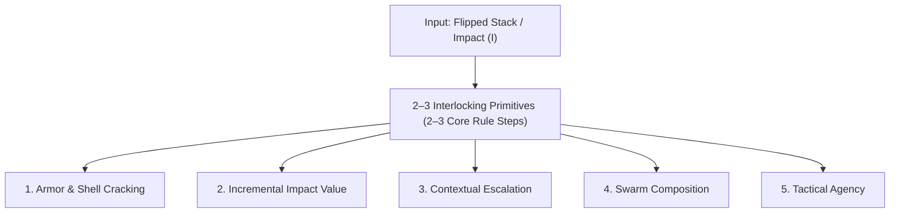

# Core Resolution Mechanics: Open Design Space

## Document Purpose

Generative framework for foraging, mixing, and evaluating new **Core Resolution Primitives** in _caRdPG_.

> [!IMPORTANT]
> **How to Use This Document (Human-in-the-Loop Brainstorming):**
> Do **not** attempt to invent a complete, fully patched end-to-end resolution engine in a single pass, and do **not** pre-load the exhaustive constraint/pitfall catalogs during initial ideation—doing so causes defensive "patchwork design" or minor reskins of existing proposals.
>
> Instead, follow a **Three-Stage Workflow**:
>
> 1. **Stage 1 — Divergent Primitive Foraging (Use Only This Document):** Propose 4–6 distinct, atomic **mechanical primitives** (and optionally 1–2 lightweight pairings) that each do one or two jobs with high tactile elegance and grounded ludonarrative feel. Keep descriptions punchy (2–4 sentences per primitive).
> 2. **Stage 2 — Human-in-the-Loop Mixing & Curation:** Pause and evaluate the raw primitives with the human designer. Select the most compelling primitives and explore how they combine so that individual pieces pull multiple bits of weight together.
> 3. **Stage 3 — Convergent Stress-Testing (Post-Selection Only):** Once a combined concept shows genuine promise, audit it against `discarded-ideas.md`, `pitfalls.md`, and `constraints.md`.

---

## 1. The Self-Contained Input / Output Contract

Any resolution primitive operates within this core game loop:

- **The 24-Card Substrate:** Each character has a 24-card deck representing stamina, focus, and training. Every card has numerical stats for all three Colors: `Red` (Force), `Yellow` (Finesse), and `Blue` (Discipline).
- **Fixed Input (`Strength`, `Color`, `Impact`):** When facing an attack or challenge of `(Strength, Color)`, the defender may optionally play a reactive `Defend` card from hand, then flips cards from the top of their deck into a **flipped stack** until the cumulative Color value meets or exceeds `Strength`. The number of cards in the flipped stack is the **Impact ($I$)**.
- **Why Deck Flips Alone Are Not Enough:** A single deck flip is only $\sim 1/24\text{th}$ of an endurance cycle, and `Fatigue` cards are not added until reshuffling on deck exhaustion. Fights cannot rely on deck depletion alone to conclude; penetrating hits must inflict on-table **Consequence Cards** (fleeting tactical impairments cleared by in-combat `Action:` recoveries, or lasting trauma requiring out-of-combat `Task:` care).
- **What Consequence Cards Already Do (Settled Baseline):** Every Consequence Card has a continual `passive:` effect that tangibly hinders the character. However, these passives target _diverse tactical vectors_ depending on the nature of the harm: some directly degrade future defense (e.g., `+1 Impact` when defending, or your highest flipped card provides `0` value), while others tax offense or action economy (e.g., must expend an extra card from hand to declare an Attack, or injecting `0/0/0` status cards into the deck). Because not every consequence's passive directly increases future defense flips, the resolution engine still needs a reliable way for accumulated conditions to drive vertical escalation toward defeat.
- **Fixed Output (Escalating Consequences, Never Instant Death):** Resolution determines which on-table Consequence(s) the target suffers and how they escalate toward an actionable incapacitation/crisis state (`Unconscious`, `Bleeding Out`, `Pinned`)—never sudden one-shot death against a fresh character.
- **Grounded & Universal:** Combat rounds represent 2-3 seconds of real-time action (mechanics must make intuitive physical/narrative sense in a real fight) and resolve all characters simultaneosly, while the same core math resolves social and environmental challenges without a global "Unified Doom" track where social embarrassment advances physical lethality.

---

## 2. What Makes a Great Primitive: Multi-Duty Leverage & Low Ceremony

The best resolution systems are built from **2–3 complementary primitives** where each mechanism pulls multiple pieces of weight at once, allowing the core rulebook procedure to stay at **2–3 crisp steps** (rather than a 4–5 step administrative flowchart).

When foraging for primitives and testing how they mix, look for combinations that naturally cover these **five functional jobs**:

1. **Armor Protection _and_ Native Ways Through the Shell:**
   Good armor should genuinely protect against glancing blows and survive massive single-hit spikes (`Impact 12` from fresh), while a big hit (`Impact 8–12`) cleanly drops a fragile minion. Crucially, look for primitives that offer a **native mechanical pathway to work through or compromise heavy armor's initial shell** with normal attacks—so fighting a knight doesn't default to "all minor hits bounce for zero effect unless you hoard cards for a massive alpha-strike or bring a specialized weapon."
2. **Incremental Impact Leverage ("Every Flip Matters"):**
   Forcing a defender to flip 4 cards instead of 2 ($I=4$ vs. $I=2$) should natively grant the attacker tangible leverage, sharper options, or forward progress rather than disappearing as wasted division remainder.
3. **Contextual Escalation (Without Unified Doom):**
   Prior consequences on the table should create realistic openings that accelerate a fight toward a decisive finish, without merging unrelated domains into a single global HP/Resilience bar.
4. **Simultaneous Multi-Attacker / Swarm Composition:**
   Multiple weak attackers acting simultaneously should meaningfully pressure an armored target, without their combined hits morphing into an instant Tier 4 execution against an unarmored target.
5. **Tactical Agency & Variance Governance:**
   Both attacker and defender should feel agency over _how_ a blow lands (e.g., trading footing or guard to protect vital anatomy), while dampening wild deck-draw RNG and avoiding per-flip math or solved "false dilemma" choices.

---

## 3. Foraging Territories for New Primitives

Rather than tweaking numbers on existing formulas, explore fundamentally different **mechanical primitives** across these four questions:

### Territory A: How Does Armor / Poise Interact with Incoming Impact?

- _Beyond pure binary bounce ($I < N \implies \text{nothing}$) or flat division ($\lfloor I / D \rfloor$):_
- Can armor act as an **active filter, interceptor, or directional guard** (e.g., blocking or downgrading specific consequence types/anatomical zones until compromised, while leaving positional or leverage openings exposed)?
- Can sub-threshold hits against heavy armor create **native positional friction, guard strain, or opening tokens/states** that subsequent attacks exploit to crack the shell, without turning armor into a generic HP pool?
- How does a single stat or property on Armor/Nature smoothly separate a fragile minion ($N=1$) from a knight in plate ($N=5$)?

### Territory B: How Does Impact ($I$) Translate into Consequence Selection?

- _Beyond drawing $I$ cards into a multi-step curation hand:_
- **Selection & Division Primitives:** Beyond cake-cutting (_"I Cut, You Choose"_), what other low-ceremony selection primitives exist? (e.g., Attacker presents a constrained threat and Defender pays/pivots to deflect it; Veto/Ban-Pick; simultaneous reveal; or threshold-gated overrides).
- **Flipped-Stack Indexing:** The defender just flipped $I$ cards from their deck onto the table, and those cards have printed `Red`, `Yellow`, and `Blue` numbers. Can the **properties of the flipped stack itself** (its card count, highest/lowest values, or color distribution) directly key into or constrain the consequence outcome, reducing secondary deck-drawing ceremony?

### Territory C: How Do Active Conditions Drive Escalation in Minimal Steps?

- _Our leading candidate uses a post-draw ceremony (place matching Tier $K$ card on active condition $\to$ draw Tier $K+1$ card $\to$ scoop and curate). And while Consequence cards already carry continual `passive:` effects, many of those passives penalize offense, hand size, or deck quality rather than defense. How could vertical escalation toward higher severity happen in **0 or 1 core-rules steps**?_
- **Pre-Resolution Shifts:** What if matching active conditions modify the resolution inputs _before_ consequences are drawn (e.g., matching vulnerabilities directly lower effective armor/soak threshold or shift the starting draw tier upward)?
- **Anatomical / Domain Slot Collisions:** What if consequences occupy distinct locus/posture slots on the character, and hitting an already-occupied locus natively forces an upgrade or spillover cascade without requiring random deck tag-matching?
- **Universal Defensive Hook on Conditions:** What if, in addition to its unique tactical `passive:` (taxing attacks, hand size, etc.), _every_ active condition also carries a standardized defensive vulnerability or `Impact`/soak modifier when its domain/tag is targeted—pushing escalation entirely into the initial Impact or Tier calculation rather than a post-draw card-swapping phase?

### Territory D: How Do Multiple Attackers Combine Pressure?

- How can 3–4 attackers targeting one defender in a simultaneous round combine their pressure naturally (e.g., flanking/saturating defensive slots, exhausting guard capacity across attacks, or pooling candidate options) in a single clean rule?

---

## 4. Quick Heuristics for Stage 1 & Stage 2 Evaluation

When reviewing brainstormed primitives with the human designer, ask three questions:

1. **The Multi-Duty Check:** Which of the 5 Functional Jobs does this primitive solve natively, and what partner primitive would it need to cover the rest?
2. **The Ceremony / Step-Count Check:** Does this primitive let us express the core resolution loop in **2–3 intuitive steps** (pushing special cases onto equipment and condition card text), or does it require a multi-phase procedural ceremony on every hit?
3. **The Isomorphism Filter ("Same Thing, Extra Steps"):** Strip away the vocabulary—is this genuinely a new mechanical dynamic, or is it just an existing divisor/drafting rule translated into intermediate tokens?

---

## 5. Active & Historical Benchmarks (For Stage 3 Comparison)

Once a primitive combination is selected for deeper development, compare it against our established benchmark:

- **Leading Candidate — [Consequence Pool & Tag Escalation Engine](candidates/consequence-pool-tag-escalation/README.md):** Uses `1 Impact = 1 Card` layered into tiers of width $N$ (Pool Size), paired with _"I Cut, You Choose"_ drafting and tag-based bonus draws.
  - _Strengths to Match:_ `1 Impact = 1 Card` acts as an analog state computer that simultaneously handles soak ($I < N$), multiplicative top-end scaling, intra-tier curation, and swarm pool merging.
  - _Awkwardnesses to Beat:_ Requires a 5-step procedural ceremony in the core rules (specifically Step 3 pool merging and Step 4 _"Place to Draw, Scoop to Curate"_), causes isolated sub-$N$ attacks against heavy armor to bounce with zero native progress, and draws large hands of cards on heavy hits.
- **Stage 3 Audit References:** When stress-testing a mature candidate, consult [discarded-ideas.md](discarded-ideas.md), [pitfalls.md](pitfalls.md), [constraints.md](constraints.md), and [history.md](history.md).
