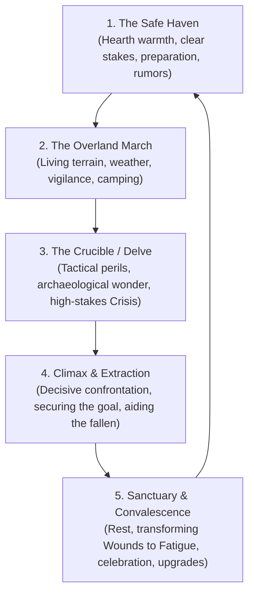

# Default Setting: Grounded Heroism

This document defines the canonical default campaign setting and world baseline for _caRdPG_. While the core rules engine is modular and supports multiple genres, **Grounded Heroism** is the flagship vision the game was built to showcase. It bridges our empirical research into biomechanics, trauma, and material physics with the narrative lift of classic heroic fantasy.

This guide serves as an authoritative, opinionated primer for scenario authors, adventure designers, and AI partners. When authoring adventures, encounters, or campaign hooks, tag this document to instantly lock in world texture, tone, and design constraints without needing to calibrate engine dials. Crucially, Section 6 provides an explicit **Scenario Evaluation Rubric** to audit proposed adventures—ensuring they embody genuine grounded heroism rather than collapsing into grimdark misery or consequence-free fantasy gloss.

---

## 1. The Core Thesis: Earned Heroism

**Grounded Heroism is about earned victory against an honest physical world.**

Protagonists are capable, courageous adventurers who undertake formidable quests to protect what is good, uncover ancient mysteries, and confront dreadful evils. Their heroics resonate not because they have plot armor or cartoon invulnerability, but because they operate within a consistent, unyielding physical substrate:

- **Physics is Tonally Neutral:** Realistic momentum, thermodynamics, biological limits, metabolic expenditure, and material properties govern the world. But physics is not an aesthetic genre, nor is it a mandate for misery. Gravity guides an eagle’s soaring arc just as strictly as a falling stone; thermodynamics warms a welcoming tavern hearth just as surely as it freezes a snowy mountain pass. Realism exists as an honest anchor that makes heroic skill, teamwork, and sacrifice feel authentic.
- **Competence Over Clumsiness:** Characters are trained, disciplined adventurers. They know how to secure their footing on scree, pitch an all-weather camp, oil their blades, and keep their wits in a skirmish. Physical challenges are tactical puzzles to be approached with preparation and skill, never slapstick traps designed to humiliate the heroes.
- **The Upward Trajectory:** Characters advance monotonically. They upgrade their cards into higher double-digit tiers, learn specialized stances, master ancient relics, and rise to meet escalating threats. Physical trauma produces dramatic hurdles and temporary setbacks, but does not condemn heroes to permanent, non-monotonic physical rot.

---

## 2. The Prime Invariant: Dynamic Range Across All Axes

The fatal pitfall when designing with empirical realism is flattening the setting into a monotone sludge of brown mud, exhaustion, and despair. A _caRdPG_ scenario must maintain **full-spectrum dynamic range across all narrative axes**:

```
[ GRIMDARK COLLAPSE ] <========== [ GROUNDED HEROISM ] ==========> [ UBIQUITOUS GRANDEUR ]
  Endless brown mud, sepsis,        Dynamic range across all         Consequence-free magic,
  flash rust, despair, bumbling     axes; real physics, earned       effortless sparkles, cartoon
  incompetence, cynical rot         triumph, warmth, and wonder      invulnerability, flat stakes
```

### The Two Guardrails

1. **Guardrail 1: The Grimdark Collapse.** The false belief that physical realism requires everything to be damp, rotting, infected, cynical, and miserable. Grimdark scenarios punish basic player agency, turn routine travel into a grueling metabolic penalty, and strip away all beauty, making victory feel pointless.
2. **Guardrail 2: The Ubiquitous Grandeur Trap.** The opposite extreme, where magic is so casual, frictionless, and ubiquitous that physical consequences dissolve. When every forest glitters with fairy dust and every tavern has floating lanterns, wonder becomes cheap wallpaper and heroic effort loses its weight.

### The Five Dynamic Axes

- **1. Atmospheric Dynamic Range (Light and Shadow):** Peril and dread carry weight only because there is warmth, sanctuary, fellowship, and beauty worth fighting for. The terror of a wind-blasted bog or subterranean crypt is thrown into sharp relief by the crackling hearth of a wayside inn, the smell of fresh bread, shared songs, and the camaraderie of a dry campfire.
- **2. Magical Dynamic Range (Wonder and Grounding):** Supernatural marvels hit harder _because_ the mundane world obeys stubborn physical laws. When an ancient barrow radiates celestial light or a sacred ward repels shadow beasts, players feel genuine awe. Wonder is earned, sacred, or uncanny—never ubiquitous wallpaper.
- **3. Pacing Dynamic Range (Harsh Survival as Plot, Not Tax):** When a scenario is explicitly about braving a howling blizzard, surviving a desert crossing, or escaping a collapsed mine, physical survival (caloric depletion, hypothermia, suffocating gas) _is_ the drama. But survival mechanics must never become an oppressive, universal tax levied on ordinary frontier travel or town scenes.
- **4. Dramatic Dynamic Range (Moral and Adversarial Breadth):** The world is not a wash of cynical, self-serving grey. There is room for **dastardly, unapologetic villains** and terrifying apex beasts when clear, high-stakes opposition drives heroic momentum—alongside **complex, multi-faceted factions** and tragic dilemmas when players engage in political or social intrigue.
- **5. Heroic Dynamic Range (Competence and Genuine Cost):** Heroes win through preparation, tactical mastery, and courage within the laws of the universe. When they suffer, the costs are tangible—accumulated [[Fatigue]], wounded limbs, and strained gear—but these costs rally the party into dramatic recovery arcs rather than permanent degradation.

---

## 3. Pre-Locked Campaign Dials

When authoring scenarios in this setting, the engine dials from [game-settings.md](file:///home/tdimiduk/cardpg/cardpg/design/philosophy/game-settings.md) are pre-locked to the following calibrations:

| Dial                                | Setting                         | Concrete Scenario Impact                                                                                                                                                                                                                                                                               |
| :---------------------------------- | :------------------------------ | :----------------------------------------------------------------------------------------------------------------------------------------------------------------------------------------------------------------------------------------------------------------------------------------------------- |
| **Dial 1: Power Level**             | **Heroic Tier (Double Digits)** | Characters start in the single digits and scale into double-digit card numbers (10–50+). They tackle formidable monsters, elite warbands, and dangerous terrain hazards. Bounded mortal limits anchor their physiology, but their potential scales toward legendary renown.                            |
| **Dial 2: Wonder & Magic**          | **Grounded Wonder**             | Magic exists as a tangible, wondrous reality with strict kinetic, metabolic, or spiritual conservation laws. Miracles mend grievous wounds into manageable fatigue and ancient wards hold the darkness at bay, but magic never trivializes basic physical logistics or erases danger.                  |
| **Dial 3: Consequences & Recovery** | **Narrative Recovery Arcs**     | Standard Consequence Deck with layered Condition Cards. Traumatic injuries (broken bones, deep cuts) are serious narrative obstacles requiring rest, chirurgery, or miracles, but they **heal completely** over time. They transform into [[Fatigue]] rather than leaving permanent crippling debuffs. |
| **Advancement Model**               | **Monotonic Progression**       | Character growth is an upward path of increasing skill, specialized master stances, and card upgrades. Setbacks are dramatic chapter obstacles, not permanent downward spirals.                                                                                                                        |

---

## 4. World Texture & Material Culture

### 4.1. The Technological Baseline

- **Material Epoch:** Pre-industrial Late Iron Age / High Medieval frontier.
- **Everyday Material Culture:** Well-forged iron and carbon steel weapons; chainmail hauberks over padded gambesons; boiled leather, shields, and occasional fitted plate pieces; oiled wool cloaks, treated leather boots, waxed canvas tarps, flint and steel, and sturdy pack saddles.
- **Physical Verisimilitude in Practice:**
  - Torches burn down in ~30–40 minutes, throw thick soot in dead-end caverns, and blind pupils to anything outside the firelight perimeter. Lanterns require whale oil or animal fat.
  - Liquid water conducts heat away from the body 24 times faster than air; wading cold rivers or trekking soaked moors triggers peripheral numbness and motor fumbling if gear is not dried.
  - Iron blades require drying and oiling at camp to prevent flash rust; chainmail requires care after salt or mud exposure.
  - Heavy hauling across broken terrain burns 500–800 kcal/hr, exhausting intramuscular glycogen reserves within hours without carbohydrate replenishment ("bonking").
- **Crucial Design Rule:** These physical realities are **tactical choices and preparation puzzles for competent heroes**, NOT "gotcha" traps designed to nickel-and-dime the party into misery. Capable adventurers pack dry rations, spare socks, tallow, and kindling.

### 4.2. Geography, Havens, and Frontiers

- **Havens of Warmth:** Civilized life is marked by bastions of hospitality and craft: walled market towns, roadside taverns with roaring hearths, stone waystations, frontier homesteads, timbered guildhalls, and cloistered abbeys. These are places of genuine relief, fresh food, gossip, medical aid, and celebration.
- **The Wilderness Frontier:** Between havens lie ancient, living wildernesses: mist-shrouded old-growth forests, wind-scoured highlands, river valleys, and jagged mountain passes. Nature is wild, majestic, and perilous, but not inherently evil or cursed.
- **Ancient Ruins & Archaeological Wonder:** Scattered through the wild are the monumental remnants of fallen elder civilizations: megalithic barrows with celestial alignments, cyclopean stone causeways, weathered aqueducts, and deep mountain vaults. Exploring these sites evokes solemn archaeological awe, not just horror.

### 4.3. The Nature of the Supernatural

- **The Sacred and the Eldritch:** Divine miracles, elemental rites, and ancestral wards exist. When a miraculous blessing or arcane binding is invoked, it feels potent, solemn, and demanding.
- **Conservation and Cost:** Magic respects the world's weight. Channeling energy costs breath, stamina, and willpower. Magic can light a dark hall, deflect a deadly strike, or close a mortal wound, but it cannot feed an empire out of thin air or casually bypass an entire mountain range.
- **Absence of High-Magic Trivialization:** There are no ubiquitous magic item shops, no cheap teleportation circles, and no flying carpets. Enchanted relics are storied heirlooms with names, histories, and specific powers.

---

## 5. The Canonical Adventure Lifecycle

A default _caRdPG_ scenario breathes through a natural five-phase rhythm, balancing high-stakes tension with restorative warmth:



1. **The Safe Haven:** The party gathers in a place of life and warmth. Stakes are established—vulnerable villagers in danger, an honorable oath to fulfill, a lost relic to recover, or a looming threat. The party provisions gear, gathers local intelligence, and prepares their decks.
2. **The Overland March:** The journey through the living world. The party contends with weather, navigation, and physical terrain. Challenges test tracking, vigilance, and endurance. Evenings are punctuated by setting a defensible camp, sharing rations, and standing watch under starry skies.
3. **The Crucible / The Site:** Entering the danger zone (an ancient barrow, a mountain redoubt, an enemy stronghold). Physical hazards are solved through teamwork and tools. Combats resolve in 5–10 minutes of decisive, simultaneous Crisis Time where positioning and defense matter. Ancient history and wonder reward careful exploration.
4. **The Climax & Extraction:** The decisive confrontation with the primary adversary or apex hazard. With resources stretched, heroes push past safe limits to achieve victory. Extraction requires coordinating help for wounded comrades and hauling secured relics back through hostile territory.
5. **Sanctuary & Convalescence:** Returning to sanctuary. The convalescence cycle begins: wounds are cleansed and dressed, transforming into [[Fatigue]]; days of warmth, sleep, and companionship restore the deck; and earned achievements are reflected in card upgrades and new tactical stances.

---

## 6. The Scenario Evaluation Rubric

Use this checklist to audit any proposed scenario, encounter, or adventure sketch. If an adventure fails multiple tests below, it has slipped into **Grimdark Misery** or **Ubiquitous Grandeur** and must be revised or scrapped.

### 1. The "Warm Hearth" Test

- **Pass:** The scenario features havens, characters, or sanctuaries that possess genuine warmth, hospitality, and beauty worth fighting for. The contrast between dark peril and bright comfort is palpable.
- **Fail (Grimdark):** Every town is a squalid cesspool; every NPC is a cynical, backstabbing parasite; every meal is ash; and the world offers no light or joy to defend.

### 2. The "Competent Heroes" Test

- **Pass:** Obstacles test the players' tactical ingenuity, courage, and athletic capability. Protagonists act like seasoned adventurers who know how to walk on scree, start campfires, and use ropes.
- **Fail (Grimdark):** The scenario treats basic outdoor movement as slapstick punishment (e.g., slipping into instant hypothermia over a routine puddle, weapons instantly shattering or rusting into uselessness, heroes fumbling like untrained infants).

### 3. The "Dynamic Range of Opposition" Test

- **Pass:** The scenario features clear, high-stakes adversaries—ruthless villains, dangerous apex predators, or corrupt despots—giving the party clear moral purpose and earned satisfaction in victory, alongside nuanced neutral parties where appropriate.
- **Fail (Grimdark):** Every conflict is an ambiguous, cynical tragedy where every choice is equally vile, no victory is clean, and the heroes are mocked for trying to do good.

### 4. The "Recovery vs. Attrition" Test

- **Pass:** Severe harm generates a compelling narrative recovery arc. Injured heroes are protected by companions, treated with medicine or miracles, and recover fully through downtime, converting wounds into temporary fatigue.
- **Fail (Grimdark):** Harm permanently degrades characters with chronic gangrene, amputations, and irreversible trauma spirals that destroy character viability after a few sessions.

### 5. The "Archaeological Wonder" Test

- **Pass:** Ancient ruins and wild landscapes possess awe, grandeur, and historical solemnity. Players feel genuine curiosity and discovery.
- **Fail (Grimdark):** Every ruin is just a sewer or slaughterhouse of blood, feces, rot, and mindless despair.
- **Fail (Ubiquitous Grandeur):** Ruins sparkle with consequence-free cartoon magic, removing all sense of ancient gravity or danger.

### 6. The "Survival as Drama, Not Universal Tax" Test

- **Pass:** Harsh survival mechanics (extreme cold, suffocation, thirst) appear specifically when the _plot is about surviving that hazard_ (a blizzard crossing, a cave collapse).
- **Fail (Grimdark):** Caloric tracking, trench foot, and micro-encumbrance are universal taxes levied relentlessly on every single room and routine movement.

---

## 7. Canonical Touchstones

When calibrating scenes, descriptions, and character interactions, draw directly on these touchstones:

1. **_The Deed of Paksenarrion_ (Elizabeth Moon):** Rigorous military realism, pack discipline, blister care, and tactical stances paired with genuine paladinhood, divine oaths, and moral clarity. Real physics without moral rot.
2. **_The Lord of the Rings_ (J.R.R. Tolkien):** The benchmark of dynamic range: dreadful Nazgûl and ancient subterranean tombs balanced by Shire pipeweed, Rivendell majesty, hearty lembas, and unbreakable fellowship.
3. **_The Wheel of Time_ (Robert Jordan):** Martial combat rooted in named forms and physical balance ("Heron Spreads Its Wings"); magic that demands severe biological stamina; and cozy village warmth contrasting with primal terrors.
4. **_The Heralds of Valdemar_ (Mercedes Lackey):** The restorative power of convalescence: hot herbal teas, warm hearths, patient healing, companionship, and emotional recovery after grievous battles.
5. **_The Stormlight Archive_ (Brandon Sanderson):** Hard physical labor and strict kinetic conservation (Bridge Four, Allomantic action/reaction) becoming the forge for heroic oaths ("Life before death, strength before weakness").
6. **_Seven Samurai_ & Classical Samurai Cinema (Akira Kurosawa):** Tactically grounded, mud-and-rain combat where skilled warriors use preparation and terrain to defend vulnerable folk with dignity and honor.
7. **_Princess Mononoke_ & Studio Ghibli:** Awe-inspiring natural grandeur, primeval forest spirits, and grounded physical weight combined with deep empathy, courage, and visual wonder.
8. **Classic CRPGs (_Baldur's Gate_, _Skyrim_, _Dragon Age: Origins_):** The tangible loop of stepping from a warm roadside inn out into a howling mountain pass, clearing an ancient ruin with torches and steel, and returning to camp to celebrate and heal.
