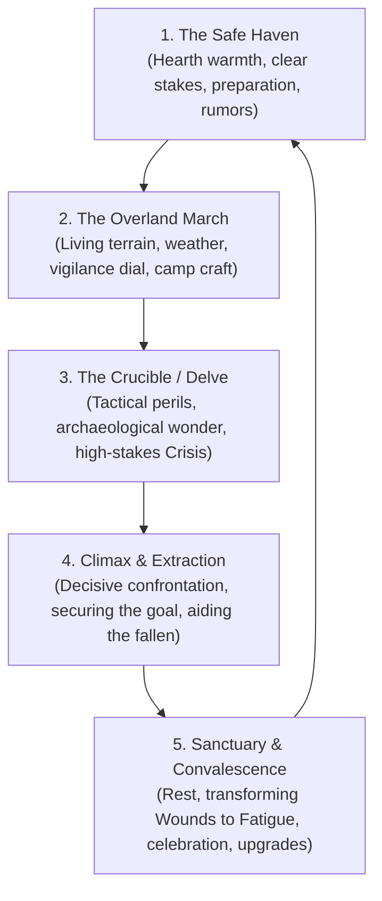

# Narrative Baseline: Grounded Heroism

This document is the authoritative scenario-authoring guide and narrative baseline for _caRdPG_'s flagship mode: **Grounded Heroism**. When designing scenarios, encounters, adventure hooks, or campaign arcs—whether as a human GM or an AI collaborative partner—this guide provides the generative building blocks, structural lifecycle, and evaluation rubric needed to author compelling, tonally coherent content.

For the philosophical rationale and mechanical tuning across the three campaign dimensions (Power Scale, Grounded Wonder, and Narrative Recovery Arcs), see [campaign-dimensions.md](file:///home/tdimiduk/cardpg/cardpg/design/philosophy/campaign-dimensions.md).

---

## 1. Core Narrative Invariants

Every scenario authored in Grounded Heroism must respect three non-negotiable invariants:

1. **Earned Victory Against an Honest Physical World:** Protagonists succeed through courage, tactical preparation, and teamwork within a consistent, unyielding physical substrate. Realism is not an aesthetic of despair or an excuse for slapstick humiliation; it is the honest anchor that makes heroic triumph feel authentic and earned.
2. **Competence Over Clumsiness:** Characters are seasoned, disciplined adventurers. They know how to secure footing on scree, pitch weather-tight camps, pack dry rations, and keep their wits in battle. Physical challenges are tactical puzzles to solve, never "gotcha" traps.
3. **Dynamic Range Across All Axes:** Gloom without light is tedious; wonder without physical grounding is cheap. A scenario must maintain vibrant contrast:
   - _Light & Shadow:_ Peril in the wild is thrown into relief by warm hearths, good food, and fellowship.
   - _Wonder & Grounding:_ Relics and ancient mysteries evoke awe precisely because ordinary physics is stubborn.
   - _Moral Breadth:_ Nuanced, desperate factions operate alongside clear, ruthless villains and terrifying apex threats.
   - _Monotonic Progression:_ Characters advance upward in skill and card scaling. Trauma creates dramatic chapter obstacles and recovery arcs, never permanent downward spirals of bodily rot.

---

## 2. Material Realities as Tactical Dilemmas

Rather than bogging down adventures with bookkeeping or physiological factoids (e.g., tracking micro-calories or gear rust as an ongoing tax), physical reality should present heroes with **clear, meaningful tactical tradeoffs**:

- **Light vs. Concealment:** Torches and open lanterns pierce subterranean blackness and keep predators at bay, but they throw thick soot in dead ends, blind pupils to anything beyond the firelight perimeter, and telegraph the party's presence to intelligent sentinels.
- **Route vs. Time & Exposure:** Taking the high mountain pass or crossing a swollen, icy river directly saves crucial hours against a ticking clock, but risks soaking gear, chilling limbs, and demanding high endurance checks. Bypassing via the ancient stone bridge is warm and safe, but advances enemy clocks or weather fronts.
- **Load vs. Mobility & Salvage:** Adventurers must choose what to pack into the field (dry fuel, climbing tackle, spare boots, heavy shields). Overpacking limits speed and restricts how much heavy elder salvage, rescued villagers, or wounded comrades can be hauled back out.
- **Pressing Ahead vs. Making Camp:** Continuing the delve with dwindling stamina risks severe consequence spirals in Crisis Time. Halting to establish a dry, defensible hearth allows convalescence and restores the deck, but expends fuel and allows adversaries to reposition.

> [!IMPORTANT]
> **Design Rule:** Treat physical constraints as **deliberate decisions for competent heroes**, not passive penalties levied on routine movement.

---

## 3. World Geography & Regional Archetypes

The default world is a pre-industrial frontier—an untamed wilderness dotted with bastions of hospitality and shadowed by monumental ruins of elder civilizations. When brainstorming scenarios, draw from or combine these canonical regional archetypes:

### 3.1. The Wind-Scoured High Moors

- **The Landscape:** Vast rolling highlands of heather, shifting granite scree, sudden rain squalls, and deep peat bogs. Wind howls relentlessly; visibility collapses in sudden moor-mists.
- **Havens:** Fortified stone waystations, lonely sheep-herder hamlets tucked into sheltered combes, roadside coaching inns with roaring peat hearths and heavy timber shutters.
- **Wilderness Hazards:** Flash hypothermia from soaked clothing, unstable scree slopes, treacherous peat sinks, roving wolf packs, and territorial barrow-eagles.
- **The Crucible / Archaeological Wonder:** Megalithic barrow-mounds and cyclopean granite lintels aligned with celestial solstices, sealing iron-age chieftain tombs and forgotten smithing vaults.

### 3.2. The Drowned Fens & Low Marches

- **The Landscape:** Stagnant river deltas, dense willow groves, black-water mires, and half-submerged cobblestone causeways built by elder empires.
- **Havens:** Stilted peat-cutter villages, walled abbey infirmaries surrounded by dry dykes, smoky marsh-side taverns serving strong ale and smoked eels.
- **Wilderness Hazards:** Leeches, waterborne sickness, rotten timber bridges, sudden sinkholes, thick marsh-fog muffling sound, and ambush predators waiting in dark pools.
- **The Crucible / Archaeological Wonder:** Sunken fortress redoubts, waterlogged crypts choked with ancient moss, half-drowned aqueducts, and forgotten sluice gates holding back dark reservoirs.

### 3.3. The Primeval Forest Border

- **The Landscape:** Dense old-growth timber, monumental moss-draped oaks, limestone karst ravines, and forgotten boundary stones carved with ancient warnings.
- **Havens:** Stockaded timber logging outposts, charcoal-burner camps, frontier shrines tended by solitary hermits, river crossing settlements.
- **Wilderness Hazards:** Disorienting canopy cover hiding the sun, sudden deadfall, territorial apex beasts (boars, owlbears, cave drakes), and fungal spore pockets.
- **The Crucible / Archaeological Wonder:** Overgrown stone dolmens, subterranean root-vaults, abandoned elven or elder-race boundary watchtowers built into living redwoods.

### 3.4. The Alpine Spires & High Passes

- **The Landscape:** Jagged tooth-like peaks, glacial cirques, roaring meltwater gorges, and precarious cliffside ledges choked with late-season snowpack.
- **Havens:** Mountain monasteries carved into sheer granite, fortified toll-gates garrisoned by disciplined borderers, high alpine shelters stocked with dry firewood.
- **Wilderness Hazards:** High winds, thinning air, avalanche chutes, crevasse bridges of rotten snow, and sudden blizzards.
- **The Crucible / Archaeological Wonder:** Mountain redoubts carved into cliff faces, forgotten subterranean dwarf-delves, deep iron mines, and ancient fire-beacons.

---

## 4. The Conflict Engine & Plot Seeds

Adventures in Grounded Heroism are driven by grounded stakes: protecting vulnerable communities, uncovering lost history, or halting ruthless adversaries. Use these four primary conflict engines to seed scenarios:

### 4.1. The Apex Incursion / Displaced Beast

- **The Premise:** An apex natural predator or ancient monstrous beast has been displaced from the deep wild (by forest fire, harsh winter, or ruin breach) and encroaches on frontier settlements.
- **The Stakes:** Livestock slaughtered, trade routes severed, settlers huddled in terror.
- **The Twist:** The beast is not mindless evil; it is clever, territorial, and physically formidable. Defeating it requires tracking, setting bait, controlling terrain, or driving it back to its ancestral den.

### 4.2. The Elder Breach / Unsealed Vault

- **The Premise:** Natural erosion, miners, or reckless treasure-hunters unseal an ancient megalithic barrow or deep vault, waking ancient guardians or releasing a dormant environmental peril (noxious damp, cursed dust, or creeping blights).
- **The Stakes:** Local water sources tainted, miners trapped, or ancient mechanical/eldritch wards threatening to collapse an entire hillside.
- **The Twist:** A legendary iron relic or curative ancestral secret inside the vault holds the key to saving the nearby haven, demanding a daring delve.

### 4.3. Frontier Friction / Desperate Factions

- **The Premise:** Scarcity or political upheaval forces two factions into dangerous confrontation on the frontier (e.g., a ruthless bailiff levying cruel taxes vs. a dispossessed knight leading desperate outlaw homesteaders; competing mining companies fighting over a single dry tunnel).
- **The Stakes:** Common folk caught in the crossfire, threatened with starvation or violence.
- **The Twist:** Neither side can be solved by mindless slaughter alone; heroes must exercise moral discernment, tactical deterrence, and negotiate or decisively dismantle the corrupt core while protecting the vulnerable.

### 4.4. The Critical Expedition & Relic Recovery

- **The Premise:** A haven is threatened by an impending disaster (an early winter, a spreading plague, or a siege by warlords). The only remedy is lost within an elder site across hostile terrain.
- **The Stakes:** A race against a clear, physical countdown clock (the first deep snow, the turn of the harvest season).
- **The Twist:** Extracting the remedy or relic involves heavy physical logistics (clearing cave-ins, securing rafts across white water, hauling delicate apothecary stores intact).

---

## 5. Factions & NPC Dynamics

To ensure NPCs feel authentic and scenarios avoid cynical grey-sludge or flat caricature:

- **Settlers & Common Folk:** Hardworking, cautious, and deeply attached to their hearths. They are vulnerable and value honor and bravery. When heroes protect them, they respond with genuine hospitality, shared meals, local rumors, and lasting loyalty.
- **Local Authorities & Patrons:** Often pragmatic and stretched dangerously thin. A bailiff, village elder, or frontier sheriff may be stern or suspicious, but their primary duty is keeping their people alive through the next winter.
- **Adversaries & Villains:** Clear, high-stakes opposition. Villains are motivated by greed, ambition, vengeance, or ruthless zeal. They use fortifications, terrain, and disciplined retinues to protect themselves. They fight to win, but retreat or parley when their physical position collapses.

---

## 6. The Canonical Adventure Lifecycle

A default _caRdPG_ adventure breathes through a five-phase rhythm, alternating between restorative preparation, high-tension crisis, and earned recovery:

1. **The Safe Haven:** The party gathers in a bastion of warmth and hospitality. Stakes are established—a clear threat to innocent lives, an expedition contract, or an unsealed ruin. Players gather intelligence, provision physical gear (torches, ropes, rations), and tune their deck builds.
2. **The Overland March:** The journey across the living frontier. Navigating terrain, managing weather fronts, and setting the Ready Hand Vigilance dial (0–4). Obstacles are resolved through General Actions. Evenings are marked by defensible camping, standing watch, and campfire camaraderie.
3. **The Crucible / The Delve:** Entering the danger site (an ancient barrow, mountain redoubt, or flooded crypt). Physical hazards are solved with tools and teamwork. Encounters transition into fast, high-stakes Crisis Time (5–10 minutes of simultaneous card resolution). Ancient architectural wonder rewards careful exploration.
4. **The Climax & Extraction:** The decisive confrontation with the apex threat or lead adversary. Resources are stretched thin; heroes push their limits to prevail. Extraction requires tactical coordination: guarding wounded companions, carrying heavy salvage, and escaping before exits collapse.
5. **Sanctuary & Convalescence:** Returning to warmth. The convalescence cycle begins: chirurgeons dress injuries, transforming severe condition cards into manageable [[Fatigue]]; days of wholesome rest, food, and companionship flush fatigue from the deck; and earned victories translate into card upgrades and new tactical stances.

---

## 7. The Scenario Evaluation Rubric

Use this checklist to audit any proposed scenario, encounter, or adventure hook. If an adventure fails multiple tests, revise it to bring it into alignment with Grounded Heroism:

### 1. The "Warm Hearth" Test

- **Pass:** The scenario features havens, characters, or sanctuaries that possess genuine warmth, hospitality, and beauty worth fighting for. The contrast between dark peril and bright comfort is palpable.
- **Fail (Grimdark):** Every town is a squalid cesspool; every NPC is a cynical parasite; every meal is ash; and the world offers no light or joy to defend.

### 2. The "Competent Heroes" Test

- **Pass:** Obstacles test the players' tactical ingenuity, courage, and athletic capability. Protagonists act like seasoned adventurers who know how to use ropes, pitch tents, and walk on scree.
- **Fail (Grimdark):** Routine travel turns into slapstick punishment (e.g., slipping into hypothermia from a regular puddle, weapons immediately shattering, heroes bumbling like infants).

### 3. The "Dynamic Range of Opposition" Test

- **Pass:** The scenario features clear, high-stakes adversaries—ruthless villains, apex predators, or corrupt despots—giving the party clear moral purpose and earned satisfaction in victory, alongside nuanced neutral parties where appropriate.
- **Fail (Grimdark):** Every conflict is an ambiguous, cynical tragedy where every choice is equally vile, no victory is clean, and heroes are mocked for doing good.

### 4. The "Recovery vs. Attrition" Test

- **Pass:** Severe harm generates a compelling narrative recovery arc. Injured heroes are protected by companions, treated with medicine or miracles, and recover fully through downtime, converting wounds into temporary fatigue.
- **Fail (Grimdark):** Harm permanently degrades characters with chronic gangrene, amputations, and irreversible trauma spirals that destroy character viability after a few sessions.

### 5. The "Archaeological Wonder" Test

- **Pass:** Ancient ruins and wild landscapes possess awe, grandeur, and historical solemnity. Players feel genuine curiosity and discovery.
- **Fail (Grimdark):** Every ruin is just a sewer or slaughterhouse of blood, feces, rot, and mindless despair.
- **Fail (Ubiquitous Grandeur):** Ruins sparkle with consequence-free cartoon magic, removing all sense of ancient gravity or danger.

### 6. The "Survival as Drama, Not Universal Tax" Test

- **Pass:** Harsh survival mechanics (extreme cold, suffocation, thirst) appear specifically when the _plot is about surviving that hazard_ (a blizzard crossing, a cave collapse).
- **Fail (Grimdark):** Caloric tracking, trench foot, and micro-encumbrance are universal taxes levied relentlessly on every single room and routine movement.

---

## 8. Canonical Touchstones

When calibrating scenes, descriptions, and character interactions, draw directly on these touchstones:

1. **_The Deed of Paksenarrion_ (Elizabeth Moon):** Rigorous military realism, pack discipline, blister care, and tactical stances paired with genuine paladinhood, divine oaths, and moral clarity. Real physics without moral rot.
2. **_The Lord of the Rings_ (J.R.R. Tolkien):** The benchmark of dynamic range: dreadful Nazgûl and ancient subterranean tombs balanced by Shire pipeweed, Rivendell majesty, hearty lembas, and unbreakable fellowship.
3. **_The Wheel of Time_ (Robert Jordan):** Martial combat rooted in named forms and physical balance ("Heron Spreads Its Wings"); magic that demands severe biological stamina; and cozy village warmth contrasting with primal terrors.
4. **_The Heralds of Valdemar_ (Mercedes Lackey):** The restorative power of convalescence: hot herbal teas, warm hearths, patient healing, companionship, and emotional recovery after grievous battles.
5. **_The Stormlight Archive_ (Brandon Sanderson):** Hard physical labor and strict kinetic conservation (Bridge Four, Allomantic action/reaction) becoming the forge for heroic oaths ("Life before death, strength before weakness").
6. **_Seven Samurai_ & Classical Samurai Cinema (Akira Kurosawa):** Tactically grounded, mud-and-rain combat where skilled warriors use preparation and terrain to defend vulnerable folk with dignity and honor.
7. **_Princess Mononoke_ & Studio Ghibli:** Awe-inspiring natural grandeur, primeval forest spirits, and grounded physical weight combined with deep empathy, courage, and visual wonder.
8. **Classic CRPGs (_Baldur's Gate_, _Skyrim_, _Dragon Age: Origins_):** The tangible loop of stepping from a warm roadside inn out into a howling mountain pass, clearing an ancient ruin with torches and steel, and returning to camp to celebrate and heal.
