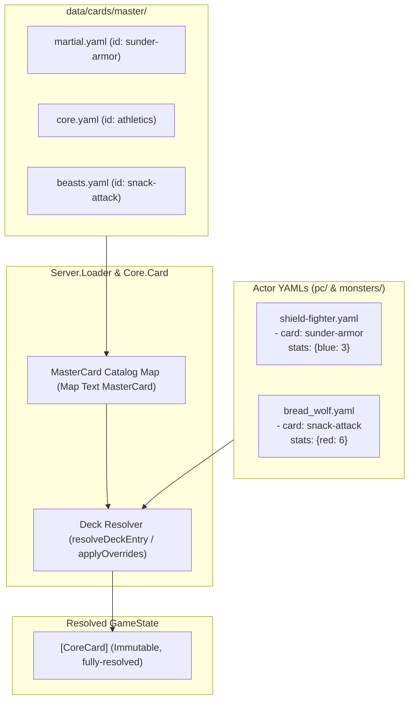

# Implementation Plan - Master Card Database & Reference System

Centralize card definitions into a Master Card Database (`data/cards/master/`). Decks reference cards by semantic ID, support stat overrides and progression deltas, and track rules currency metadata (`rules_status: current | outdated | experimental`).

---

## Architecture



---

## Completed Phases

- **Phase 1: Core Schema & Types (`Core.Card`)** — [COMPLETED]
  - Added `RulesStatus`, `CardMilestone`, `MasterCard`, `CardReference`, `DeckEntry`, `ActorDefinition`, `resolveDeckEntry`, `resolveActorDeck`, and `applyOverrides` in [`Core.Card`](file:///home/tdimiduk/cardpg/cardpg/core/src/Core/Card.hs).
  - Verified with comprehensive unit & roundtrip tests in [`core/tests/CardParsingTest.hs`](file:///home/tdimiduk/cardpg/cardpg/core/tests/CardParsingTest.hs) (79/79 passing).

- **Phase 2: Catalog Loading & Deck Resolution (`Server.Loader` & `Server.Scenario`)** — [COMPLETED]
  - Implemented `loadMasterCatalog` and recursive catalog discovery in [`Server.Loader`](file:///home/tdimiduk/cardpg/cardpg/server/src/Server/Loader.hs).
  - Integrated `masterCatalog` into `CardLibrary` in [`Server.Types`](file:///home/tdimiduk/cardpg/cardpg/server/src/Server/Types.hs).
  - Wired runtime deck resolution in [`Server.Scenario`](file:///home/tdimiduk/cardpg/cardpg/server/src/Server/Scenario.hs) and [`Server.Session`](file:///home/tdimiduk/cardpg/cardpg/server/src/Server/Session.hs), raising descriptive errors for unresolved card references.
  - Verified with unit tests in [`server/test/LoaderTest.hs`](file:///home/tdimiduk/cardpg/cardpg/server/test/LoaderTest.hs) (31/31 server tests passing, 0 linter warnings).

---

## Key Lessons Learned (Crucial for Phases 3 & 4)

1. **Byte-for-Byte Roundtrip Testing in `CardParsingTest.hs`:**
   - [`core/tests/CardParsingTest.hs`](file:///home/tdimiduk/cardpg/cardpg/core/tests/CardParsingTest.hs) enforces `Data.Yaml.encode actor == originalFileBytes` for all files in `data/cards/pc/` and `data/cards/monsters/`.
   - When rewriting actor YAMLs in Phase 3/4, the emitted YAML must match `Data.Yaml.encode` formatting (2-space indentation, standard key ordering) so roundtrip assertions pass.

2. **UTF-8 ByteString Encoding for Unicode Symbols:**
   - Rules texts contain Unicode glyphs like `'→'` (`U+2192`).
   - Never use `Data.ByteString.Char8.pack` or `Char8.unlines` (which truncates codepoints > 255 and corrupts YAML).
   - Always encode with `Data.Text.Encoding.encodeUtf8` when exporting YAML files in `tools-hs`.

3. **Global ID Uniqueness Across Master YAMLs:**
   - `loadMasterCatalog` recursively collects cards from all `.yaml` files under `data/cards/master/` into a single flat `Map Text MasterCard`.
   - Card IDs (e.g. `sunder-armor`, `athletics`) must be globally unique across all category files (`martial.yaml`, `core.yaml`, `beasts.yaml`). Duplicate IDs overwrite earlier entries. The Phase 3 deduplication audit must enforce unique slug generation.

4. **Multi-Card File Formatting:**
   - The loader supports both single-card YAML files and multi-card YAML lists (`[- id: ..., - id: ...]`).
   - Group canonical cards into category lists (`data/cards/master/martial.yaml`, `data/cards/master/monsters/beasts.yaml`) to avoid thousands of tiny single-card files.

5. **Canonical Field Naming in Output:**
   - Canonical `MasterCard` YAML must use snake_case for `rules_status` and `legacy_notes`.
   - Milestone mappings should nest under `milestones: { <key>: { stats: ..., rules: ... } }`.

6. **Incremental Migration Support:**
   - `ActorDefinition.deck` freely mixes `EntryInline CoreCard` and `EntryRef CardReference`.
   - Conversion does not need to be all-or-nothing: individual cards within an actor deck can be migrated incrementally.

7. **Weeder / Dead Code Enforcement:**
   - `./scripts/lint` runs `weeder` across compiled HIE files. Any new types or helper functions added to `tools-hs` or `server` must be directly utilized by executables or test suites to pass CI.

---

## Remaining Phases

### Phase 3: Haskell Tooling & Migration (`tools-hs/`)

#### [MODIFY] `tools-hs/tools-hs.cabal` & [NEW] `tools-hs/app/manage-cards/Main.hs`

Implement a CLI tool (`cabal run tools-hs:exe:manage-cards -- <subcommand>`):

1. **Audit & Deduplicate (`manage-cards audit`):**
   - Scan all PC (`data/cards/pc/`) and monster (`data/cards/monsters/`) files.
   - Extract inline cards via `actorDeckCards`.
   - Group identical cards by name, rules text, and stats, assigning canonical slug IDs.
   - Report card reuse counts and candidate master cards.

2. **Heuristic Legacy Classifier:**
   - Automatically assign `rules_status: outdated` with appropriate `legacy_notes` when detecting:
     - Shorthand color syntax (`|[xyzb]|`)
     - Legacy armor syntax (`ignore .*armor`, `no armor`, `armor damage`)
     - Legacy defense wording (`defend from anywhere`)
     - Obsolete consequence tiers (`Minor:`, `Major:`, `Critical:`)
     - Legacy wound phrasing (`basic wound`)

3. **Export Master Catalog (`manage-cards export`):**
   - Emit categorized, normalized YAML files under `data/cards/master/`:
     - `core.yaml` (basic attacks, defenses, generic actions)
     - `martial.yaml` (weapons, combat maneuvers)
     - `arcane.yaml` (spells, magical effects)
     - `monsters/beasts.yaml` (animals, natural beasts)
     - `monsters/humanoids.yaml` (sentient enemies, brigands)

4. **Deck Rewriter (`manage-cards rewrite --actor <file>`):**
   - Replace matching inline cards in target actor YAMLs with `CardReference` (`card: <id>`).
   - Preserve non-standard stats via `stats` overrides or `upgrades`.
   - Format rewritten files using `Data.Yaml.encode` to ensure byte-for-byte roundtrip compliance.

---

### Phase 4: Master Database Population & Pilot Refactor

1. **Populate Master Database:**
   - Run `manage-cards export` to generate master catalog files in `data/cards/master/`.
   - Review and manually refine rules text, tags, and `rules_status` annotations.

2. **Pilot Conversion:**
   - Convert target actors to reference syntax:
     - `data/cards/pc/shield-fighter.yaml`
     - `data/cards/pc/squire.yaml`
     - `data/cards/monsters/bread_wolf.yaml` (stat curve demonstration)
     - `data/cards/monsters/troglodyte.yaml` and `data/cards/monsters/infernal_troglodyte.yaml`
   - Verify byte-for-byte roundtrip tests in `CardParsingTest.hs`.

---

## Verification Plan

### Automated Tests

1. **Tooling & Parser Tests (`tools-hs-test`):**
   - Test deduplication logic, legacy rules classifier, and YAML serialization in `tools-hs`.
2. **Data Integrity Test:**
   - Add a test verifying that every `card: <id>` reference in all actor files in `data/cards/pc/` and `data/cards/monsters/` resolves to an existing master card without dangling references.
3. **Regression & Full Suite:**
   - Verify no regressions across the workspace:
     ```bash
     cabal test all
     ./scripts/lint
     ```

### Manual Verification

1. `cabal run client:exe:cardpg-static -- deck data/cards/pc/shield-fighter.yaml` to ensure visual rendering is identical before and after reference migration.
2. Inspect generated master YAML files for accurate `rules_status` flags and proper categorization.
