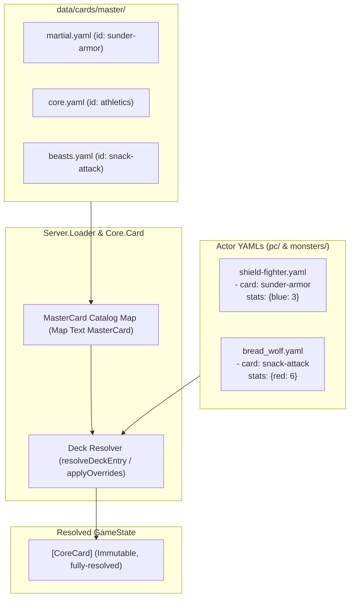

# Implementation Plan - Master Card Database & Reference System

Centralize card definitions into a Master Card Database (`data/cards/master/`). Decks reference cards by semantic ID, support stat overrides and progression deltas, and track rules currency metadata (`rules_status: current | outdated | experimental`).

---

## Architecture



---

## Phase Status & Lessons Learned

### Phase 1: Core Schema & Types (`Core.Card`) — **[COMPLETED]**

- Implemented in [`Core.Card`](file:///home/tdimiduk/cardpg/cardpg/core/src/Core/Card.hs): `RulesStatus`, `CardMilestone`, `MasterCard`, `CardReference`, `DeckEntry`, `ActorDefinition`, `actorDeckCards`, `resolveDeckEntry`, `resolveActorDeck`, and `applyOverrides`.
- Updated all existing usages in `server` and `client` to maintain backward-compatibility.
- Added comprehensive unit tests in [`core/tests/CardParsingTest.hs`](file:///home/tdimiduk/cardpg/cardpg/core/tests/CardParsingTest.hs) (79/79 tests passing).

### Non-Obvious Lessons Learned (Crucial for Phase 2 & Beyond)

1. **Resolution Logic Already Lives in `Core.Card`:**
   - The original plan proposed writing resolution in `Server.Loader`. However, because `core` tests cannot depend on `server` (Cabal dependency direction is `core -> server`), all resolution logic (`resolveDeckEntry`, `resolveActorDeck`, `applyOverrides`) was implemented directly in [`Core.Card`](file:///home/tdimiduk/cardpg/cardpg/core/src/Core/Card.hs).
   - **For Phase 2:** `Server.Loader` does _not_ need to reimplement resolution algorithms. It only needs to load the catalog `Map Text MasterCard` from disk and call `resolveDeckEntry` / `resolveActorDeck`.

2. **UTF-8 ByteString Encoding with Unicode Symbols:**
   - Card rules and attacks contain Unicode characters such as `'→'` (`U+2192`).
   - Using `Data.ByteString.Char8.pack` or `Data.ByteString.Char8.unlines` truncates codepoints `> 255`, causing `YamlParseException: invalid leading UTF-8 octet`.
   - Always encode with `Data.Text.Encoding.encodeUtf8 . T.unlines` when handling YAML byte buffers in tests and tools.

3. **Field Normalization in `MasterCard`:**
   - In YAML/JSON, canonical master cards use snake_case: `rules_status` and `legacy_notes`.
   - `FromJSON MasterCard` automatically normalizes camelCase keys (`rulesStatus`, `legacyNotes`) to snake_case, accepting both seamlessly.

4. **Sum Type Discriminator in `DeckEntry`:**
   - `DeckEntry` discriminates `EntryRef` vs `EntryInline` by the presence of the `"card"` object key.
   - An inline `CoreCard` never has `"card"`; a `CardReference` always requires `"card"`. Missing required fields in either produce targeted parse errors rather than obscure fallback failures.

5. **Extracting Cards Prior to Catalog Resolution:**
   - `ActorDefinition.deck` is `[DeckEntry]`. To access inline cards without catalog resolution (e.g. legacy deck iteration, static preview without catalog), use `actorDeckCards :: ActorDefinition -> [CoreCard]`.
   - To resolve against a loaded catalog, use `resolveActorDeck :: Map Text MasterCard -> ActorDefinition -> Either String [CoreCard]`.

6. **Byte-for-Byte Roundtrip Testing in `CardParsingTest.hs`:**
   - [`core/tests/CardParsingTest.hs`](file:///home/tdimiduk/cardpg/cardpg/core/tests/CardParsingTest.hs) asserts that `Data.Yaml.encode actor == originalFileBytes` for all files in `data/cards/pc/` and `data/cards/monsters/`.
   - When converting actor files to reference syntax in Phase 4, the YAML files on disk must match the exact formatting emitted by `Data.Yaml.encode` (e.g., indentation and key order), or the test will flag a mismatch.

---

## Remaining Phases

### Phase 2: Catalog Loading & Deck Resolution (`Server.Loader`)

#### [MODIFY] `server/src/Server/Loader.hs` & `server/src/Server/Types.hs` & `server/src/Server/Scenario.hs`

1. **Master Catalog Loader:**
   - In `Server.Loader`, recursively parse YAML files under `data/cards/master/**/*.yaml` into `Map Text MasterCard`.
   - Master files can contain either a single card object or a list of card objects (similar to `parseAsListOrSingle`).
2. **Library & State Integration:**
   - Add `masterCatalog :: Map Text MasterCard` to `CardLibrary` in `Server.Types.hs`.
   - Update `classifyAndParse` to populate the catalog.
3. **Scenario Actor Resolution:**
   - In `Server.Scenario.hs`, update `loadAndInstantiateActor` to resolve actor decks using the loaded master catalog (`resolveActorDeck`). If any card fails resolution, report a descriptive error.

---

### Phase 3: Haskell Tooling & Migration (`tools-hs/`)

#### [MODIFY] `tools-hs/tools-hs.cabal` & [NEW] `tools-hs/app/manage-cards/Main.hs`

Implement a CLI tool (`cabal run tools-hs:exe:manage-cards`):

1. **Audit & Deduplicate:** Scan all PC and monster files, grouping identical cards by name and stats, identifying candidate canonical `MasterCard` entries.
2. **Heuristic Legacy Classifier:**
   - Flag `rules_status: outdated` with `legacy_notes` when detecting:
     - Shorthand color syntax (`|[xyzb]|`)
     - Legacy armor syntax (`ignore .*armor`, `no armor`, `armor damage`)
     - Legacy defense wording (`defend from anywhere`)
     - Obsolete consequence tiers (`Minor:`, `Major:`, `Critical:`)
     - Legacy wound phrasing (`basic wound`)
3. **Export Master Catalog:** Emit normalized master YAML files under `data/cards/master/`.
4. **Deck Rewriter:** Convert target actor YAMLs to concise `CardReference` format.

---

### Phase 4: Master Database Population & Pilot Refactor

1. **Populate Master Files:**
   - `data/cards/master/core.yaml`
   - `data/cards/master/martial.yaml`
   - `data/cards/master/arcane.yaml`
   - `data/cards/master/monsters/beasts.yaml`
   - `data/cards/master/monsters/humanoids.yaml`
2. **Pilot Conversion:**
   - Convert `data/cards/pc/shield-fighter.yaml` and `data/cards/pc/squire.yaml` to reference syntax.
   - Convert `data/cards/monsters/bread_wolf.yaml` (stat curve demonstration).
   - Convert `data/cards/monsters/troglodyte.yaml` and `data/cards/monsters/infernal_troglodyte.yaml`.

---

## Verification Plan

### Automated Tests

1. **Catalog Loading & Resolution Tests (`server/test/ScenarioTest.hs` or new `Server.LoaderTest`):**
   - Verify `loadLibrary` discovers and loads master cards into `masterCatalog`.
   - Verify actor loading instantiates characters with referenced cards correctly.
   - Commands:
     ```bash
     cabal test core
     cabal test server
     cabal test all
     ```
2. **Data Integrity Test:**
   - Validate that every `card: <id>` reference in actor YAMLs resolves to an existing master card without dangling references.

### Manual Verification

1. `cabal run client:exe:cardpg-static -- deck data/cards/pc/shield-fighter.yaml` to ensure visual rendering is identical before and after reference migration.
2. Inspect generated master YAML files for accurate `rules_status` flags.
