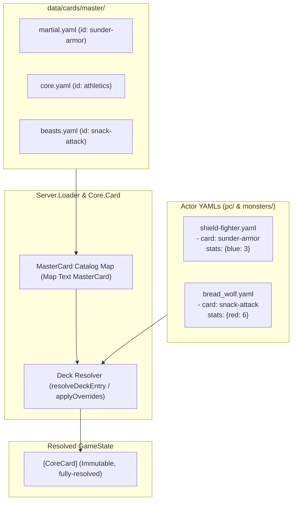

# Implementation Plan - Master Card Database & Reference System

Centralize card definitions into a Master Card Database (`data/cards/master/`). Decks reference cards by semantic ID, support stat overrides and progression deltas, and track rules currency metadata (`rules_status: current | outdated | experimental`).

---

## Architecture



---

## Completed Foundations (Phases 1–3)

- **Phase 1: Core Schema & Types (`Core.Card`)** — Added `RulesStatus`, `CardMilestone`, `MasterCard`, `CardReference`, `DeckEntry`, `ActorDefinition`, `resolveDeckEntry`, `resolveActorDeck`, and `applyOverrides`.
- **Phase 2: Catalog Loading & Deck Resolution (`Server.Loader` & `Server.Scenario`)** — Recursive multi-card catalog loading, runtime scenario deck resolution with descriptive errors for missing IDs.
- **Phase 3: Haskell Tooling & Migration (`tools-hs/`)** — Implemented `manage-cards` CLI tool (`audit`, `export`, `rewrite`), heuristic legacy classifier, deduplication/unique slug generator, override calculator, and data integrity test suite.

---

## Key Constraints & Context for Phase 4

1. **Byte-for-Byte Roundtrip Testing (`core/tests/CardParsingTest.hs`):**
   - [`core/tests/CardParsingTest.hs`](file:///home/tdimiduk/cardpg/cardpg/core/tests/CardParsingTest.hs) asserts `Data.Yaml.encode actor == originalFileBytes` for all files in `data/cards/pc/` and `data/cards/monsters/`.
   - `manage-cards rewrite` uses `Data.Yaml.encode` to ensure converted actor files pass roundtrip checks without formatting discrepancies.

2. **Client Static Deck Rendering (`client/app/StaticMain.hs`):**
   - [`StaticMain.hs`](file:///home/tdimiduk/cardpg/cardpg/client/app/StaticMain.hs#L622) currently calls `actorDeckCards actor`, which only yields inline cards (`EntryInline`).
   - Prior to visual verification of pilot actors, `deckWidget` in `StaticMain.hs` must resolve the deck against `data/cards/master/` using `resolveActorDeck catalog actor` so cards converted to references continue to be rendered.

3. **Global ID Uniqueness Across Master YAMLs:**
   - All master card IDs (`sunder-armor`, `athletics`, etc.) are globally unique across all category files (`core.yaml`, `martial.yaml`, `arcane.yaml`, `monsters/beasts.yaml`, `monsters/humanoids.yaml`).
   - `manage-cards export` assigns and verifies unique slugs with collision disambiguation (`-2`, `-3`).

4. **Multi-Card File Formatting & UTF-8 Encoding:**
   - Master catalog entries are grouped as YAML lists in their category files.
   - Text containing Unicode characters (e.g. `'→'`) must be encoded via UTF-8 `ByteString`.

5. **Stat Curve Overrides & Incremental Migration:**
   - Actor decks support any mixture of `EntryInline CoreCard` and `EntryRef CardReference`.
   - Repeated cards with stat curves (such as `Snack attack` in `bread_wolf.yaml`) reference a single base master card while overriding only the differing stat dimensions (e.g. `stats: { red: 6 }`).

---

## Phase 4: Master Database Population & Pilot Refactor

### Step 1: Populate Master Database

1. Run `manage-cards export`:
   ```bash
   cabal run tools-hs:exe:manage-cards -- export --out-dir data/cards/master
   ```
2. Verify generated YAML files under `data/cards/master/`:
   - `core.yaml` (generic action cards: Conditioning, Athletics, Dodge, etc.)
   - `martial.yaml` (weapons, martial combat maneuvers, stances, strikes)
   - `arcane.yaml` (wizard spells and magical effects)
   - `monsters/beasts.yaml` (natural beasts and animal monster cards)
   - `monsters/humanoids.yaml` (sentient enemies, brigands, and monster adversaries)
3. Inspect generated YAML files to confirm snake_case field names (`rules_status`, `legacy_notes`) and clean tagging.

### Step 2: Enable Master Deck Resolution in Static Site Generator (`client`)

1. In [`client/app/StaticMain.hs`](file:///home/tdimiduk/cardpg/cardpg/client/app/StaticMain.hs), load the master catalog from `data/cards/master/` if present.
2. In `deckWidget` (or `generateDeck`), resolve actor deck entries via `resolveActorDeck catalog actor` (falling back to `actorDeckCards actor` if catalog is unavailable).
3. Ensure `cabal test client:test:client-test` and `./scripts/lint` pass.

### Step 3: Pilot Conversion of Target Actors

Convert selected pilot actors to reference syntax using `manage-cards rewrite`:

1. **Martial PC Pilot — Shield Fighter**:

   ```bash
   cabal run tools-hs:exe:manage-cards -- rewrite --catalog data/cards/master --actor data/cards/pc/shield-fighter.yaml
   ```

   _Objective_: Verifies martial maneuvers, stances, and legacy syntax annotation tracking.

2. **Standard PC Pilot — Squire**:

   ```bash
   cabal run tools-hs:exe:manage-cards -- rewrite --catalog data/cards/master --actor data/cards/pc/squire.yaml
   ```

   _Objective_: Verifies basic martial PC deck conversion.

3. **Stat Curve Monster Pilot — Bread Wolf**:

   ```bash
   cabal run tools-hs:exe:manage-cards -- rewrite --catalog data/cards/master --actor data/cards/monsters/bread_wolf.yaml
   ```

   _Objective_: Demonstrates stat curve overrides on repeated cards (`Snack attack`, `Bread bite`, `On A roll`, `Crust claw`).

4. **Monster Family Variant Pilot — Troglodytes**:
   ```bash
   cabal run tools-hs:exe:manage-cards -- rewrite --catalog data/cards/master --actor data/cards/monsters/troglodyte.yaml
   cabal run tools-hs:exe:manage-cards -- rewrite --catalog data/cards/master --actor data/cards/monsters/infernal_troglodyte.yaml
   ```
   _Objective_: Demonstrates card reuse and stat scaling between a base monster and an elite variant.

### Step 4: Verification & Integrity Audits

1. **Automated Data Integrity Test**:
   - Run `cabal test tools-hs:test:tools-hs-test` to verify that all card references in all actor files resolve against `data/cards/master/` with zero dangling IDs.
2. **Byte-for-Byte Roundtrip Test**:
   - Run `cabal test core:test:core-test` to confirm all rewritten actor files roundtrip cleanly with zero formatting discrepancies.
3. **Runtime Scenario Resolution**:
   - Run `cabal test server:test:server-test` to verify runtime scenario resolution with catalog references.
4. **Visual Regression Verification**:
   - Run `cabal run client:exe:cardpg-static -- deck data/cards/pc/shield-fighter.yaml` and inspect output HTML to ensure card visual styling and text layout are unchanged.
5. **Full Workspace Test & Lint**:
   - Run full verification:
     ```bash
     cabal test all
     ./scripts/lint
     ```
